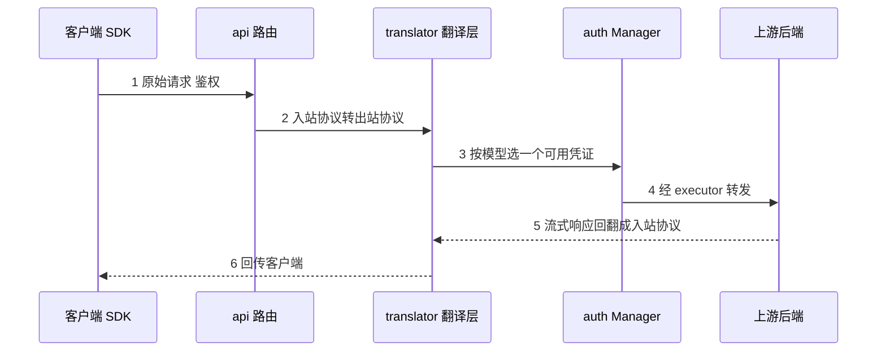
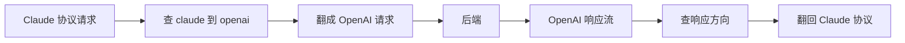
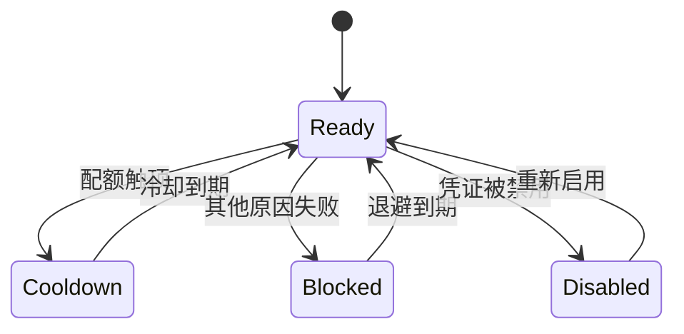
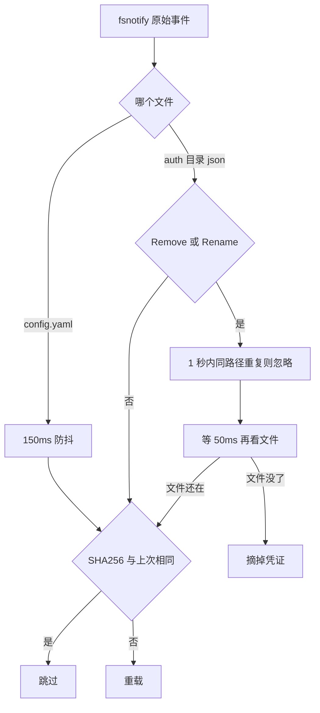

## 1. CLIProxyAPI

[CLIProxyAPI](https://github.com/router-for-me/CLIProxyAPI) 是一个本地代理服务。你用 Claude Code、Codex、Gemini CLI 登录拿到的 OAuth 凭证，经它包装后变成一个 OpenAI / Anthropic / Gemini 兼容的 HTTP endpoint，可以直接给 Cursor、Cline、评测脚本或自己写的 agent 用。

它要解决的场景很具体：厂商把一部分模型和额度放在自家 CLI 后面。Claude Code 的订阅能用最新的 opus，Gemini 的免费额度只对 `gemini-cli` 开放，Codex 的订阅同理。你手里有这些 OAuth 凭证，想做的事却是：

- 让 Cursor 用上订阅里的 opus，而 Cursor 只认 OpenAI 兼容的 base URL；
- 写个评测脚本批量调模型，脚本里是 `openai.OpenAI(base_url=...)`；
- 几个人轮着用一份团队订阅。

中间隔着两层差异。一是凭证：三家都走 OAuth，但登录流程和凭证字段各不相同。CLIProxyAPI 自己走一遍各家的登录，把拿到的 token 存进自己的凭证目录，比如 Codex 的凭证比 Claude 多一个 `account_id`（`internal/auth/codex/token.go:26`）。二是协议：客户端讲 OpenAI 协议，后端讲 Anthropic 或 Gemini 协议。CLIProxyAPI 在中间做三件事：翻译协议、挑一个可用账号、给过期的 token 续期。

这三件事离开这个项目同样常见，也是本章要讲的三块：

1. **多协议翻译矩阵**。支付网关对接多家渠道、IM 机器人对接多个平台，都会碰到翻译对子越来越多、上游字段不停变的问题。CLIProxyAPI 用注册表登记每个翻译方向，在原始 JSON 上按路径读写，不建中间结构体。
2. **有配额的凭证池**。多 GitHub token 轮转、多云子账号路由都是同一类问题。CLIProxyAPI 让所有后端实现同一个接口，由一个中心 Manager 负责选、调、冷却、续期。
3. **文件驱动的热重载**。改配置不重启，靠防抖、内容哈希和原子替换检测过滤文件系统噪声。

对照源码：

```bash
cd _references
git clone --depth 1 --branch v7.1.32 https://github.com/router-for-me/CLIProxyAPI.git
```

路径都从仓库根算起。项目用 Go 写，不含测试约 11 万行，本章讲的三块加起来约 2.5 万行。本文基于 tag `v7.1.32`（commit `3a54fb7`）。

## 2. 5 分钟跑起来

二进制从 [release 页](https://github.com/router-for-me/CLIProxyAPI/releases) 下载，解压后的可执行文件叫 `cli-proxy-api`（`.goreleaser.yml:16`）。先准备配置：

```bash
mkdir -p ~/cli-proxy
cp config.example.yaml ~/cli-proxy/config.yaml   # release 包和仓库里都有这份模板
```

登录是一组 `--xxx-login` 开关，会拉起浏览器走 OAuth，回调把凭证写进配置里的 `auth-dir`。不带 `--config` 时程序读当前目录下的 `config.yaml`（`cmd/server/main.go:452`），所以每条命令都带上它：

```bash
./cli-proxy-api --config ~/cli-proxy/config.yaml --claude-login   # Claude
./cli-proxy-api --config ~/cli-proxy/config.yaml --codex-login    # Codex
./cli-proxy-api --config ~/cli-proxy/config.yaml --login          # Gemini / Google
```

全部登录开关在 `cmd/server/main.go:82-90`，另有 `--antigravity-login`、`--kimi-login`、`--xai-login`，每个对应 `internal/auth/` 下一个目录。

`config.yaml` 关键的几行：

```yaml
port: 8317
auth-dir: "~/.cli-proxy-api"     # 登录后的凭证存这里，模板默认值
api-keys:                         # 客户端调用本代理用的 key，自己定
  - "sk-local-whatever"
routing:
  strategy: "round-robin"         # 默认值；改成 fill-first 即切换策略，见 4.2
```

起服务：

```bash
./cli-proxy-api --config ~/cli-proxy/config.yaml
```

用 Docker 时，镜像的工作目录是 `/CLIProxyAPI`，凭证目录在容器里是 `/root/.cli-proxy-api`，照仓库里 `docker-compose.yml` 的挂载方式：

```bash
docker run -p 8317:8317 \
  -v ~/cli-proxy/config.yaml:/CLIProxyAPI/config.yaml \
  -v ~/.cli-proxy-api:/root/.cli-proxy-api \
  eceasy/cli-proxy-api:latest
```

然后用任意 OpenAI SDK 调它，后端走的是你的 Claude 订阅：

```python
from openai import OpenAI
client = OpenAI(base_url="http://localhost:8317/v1", api_key="sk-local-whatever")
resp = client.chat.completions.create(
    model="claude-opus-4-7",          # 模型名决定路由到哪个后端
    messages=[{"role": "user", "content": "ping"}],
)
print(resp.choices[0].message.content)
```

入站协议由路径决定（`internal/api/server.go:386-431`）：

- `/v1/chat/completions`：OpenAI
- `/v1/messages`：Anthropic
- `/v1/responses`：Codex Responses
- `/v1beta/models/*`：Gemini
- `/v1internal:method`：Gemini CLI

同一份后端凭证，这几种客户端都能调。

## 3. 全景架构

一次请求从客户端到上游再回来，穿过五层（图 1-1）：



图 1-1：一次请求穿过的五层

各层的代码位置和规模：

| 区块 | 位置 | 规模 | 职责 |
|---|---|---|---|
| 协议翻译 | `internal/translator/` | 约 1.8 万行，27 个翻译对子 | 5 种入站 × 6 种出站，按需注册 |
| 凭证池 | `sdk/cliproxy/auth/` | `conductor.go` 单文件 4455 行 | 选、执行、冷却、续期、持久化 |
| 热重载 | `internal/watcher/` | 约 1100 行 | 监听配置和凭证目录 |
| HTTP 入口 | `internal/api/` | 基于 Gin | 路由、鉴权、handler |
| OAuth 登录 | `internal/auth/` | 每个后端一个目录 | 各家的登录流程 |

贯穿全项目的四个抽象：

| 抽象 | 位置 | 职责 |
|---|---|---|
| `translator.Registry` | `sdk/translator/registry.go:13` | 全局翻译注册表 |
| `auth.Manager` | `sdk/cliproxy/auth/conductor.go` | 凭证池控制平面（类型叫 Manager，文件叫 conductor） |
| `ProviderExecutor` | `sdk/cliproxy/auth/conductor.go:32` | 每个后端要实现的 6 方法接口 |
| `Watcher` | `internal/watcher/watcher.go:32` | 监听文件变化，触发重载 |

## 4. 核心模块

### 4.1 协议翻译：N×M 个对子，各自注册

CLIProxyAPI 没有定义统一的中间格式，而是为每个方向写一个翻译函数，用注册表登记。新增一种协议就新建几个目录，旧代码不动。

#### 同一件事，四种写法

OpenAI 的 `tool_calls`、Anthropic 的 `tool_use`、Gemini 的 `function_call`、Codex Responses 的 `output_item`，说的都是“模型要调工具”，字段名、嵌套结构、流式切分却都不一样。单独翻一对不难，难在三件事叠在一起：

- **对子多**：入站 5 种、出站 6 种，理论上 30 对，实际注册了 27 对。少的 3 对里，两对是同协议直通（Claude 到 Claude、Gemini CLI 到 Gemini CLI），另一对是 Gemini CLI 客户端调 Antigravity 后端。新增一种客户端协议，就要给 6 个后端各补一对。
- **字段一直在加**：OpenAI 加 `reasoning_effort`，Anthropic 加 `thinking.budget_tokens`，Codex 加新的 `output_item` 类型。
- **流式切分粒度不同**：Anthropic 是 `content_block_start`、若干 `content_block_delta`、`content_block_stop` 组成的块结构，OpenAI 是一条扁平的 `delta` 流。这不只是改字段名。

#### 统一中间格式为什么没被选

常见做法有三种：

| 做法 | 好处 | 代价 |
|---|---|---|
| 统一中间格式（hub-and-spoke） | 翻译器从 N×M 个降到 2N 个 | 中间格式要追所有协议的新字段，最后变成各家并集 |
| 一个大 switch | 一眼看全 | 单文件无限膨胀，新增协议要改公共代码 |
| 每个方向一个函数，注册表登记 | 新增方向不动旧代码，每个对子各管各的边界情况 | 对子总数多；`init()` 的副作用让依赖关系变隐式 |

LiteLLM 走的是第一条，以 OpenAI 的 `ModelResponse` 为中间格式。每个 provider 的 `transformation.py`（如 `litellm/llms/anthropic/chat/transformation.py`）都要把自己映射到它。OpenAI 格式表达不了的东西，比如 Anthropic 的块级流式和 `cache_control` 的语义，只能塞进扩展字段。

CLIProxyAPI 选了第三条。它面对的协议都是别人定义的，隔几周就变一次；中间格式省下来的翻译器数量，会被“中间格式永远在追新字段”吃回去。N×M 的代码量没有消失，但每次改动都落在一个新目录里。项目的发版节奏也说明了这一点：到 2026 年 9 月下旬已有 858 个 release，最近三周就发了 30 个。

#### 注册表加 init()：新增方向不碰旧代码

注册入口是一个函数（`sdk/translator/registry.go:128`）：

```go
func Register(from, to Format, request RequestTransform, response ResponseTransform) { /* 写进全局 map */ }
```

每个翻译方向一个目录，目录里的 `init()` 把自己登记进去（`internal/translator/openai/claude/init.go`）：

```go
func init() {
    translator.Register(
        Claude,        // from：入站协议
        OpenAI,        // to：出站协议，也就是后端讲的协议
        ConvertClaudeRequestToOpenAI,
        interfaces.TranslateResponse{
            Stream:     ConvertOpenAIResponseToClaude,
            NonStream:  ConvertOpenAIResponseToClaudeNonStream,
            TokenCount: ClaudeTokenCount,
        },
    )
}
```

一次请求往返要查两次注册表：进来时翻请求，回去时翻响应（图 1-2）。



图 1-2：一次往返两次查表

`init()` 只有在包被 import 时才会执行，Go 工具链也分析不出“谁注册了谁”。项目的处理是在 `internal/translator/init.go` 里用 27 个空白 import 把所有翻译目录集中列出：

```go
import (
    _ "github.com/router-for-me/CLIProxyAPI/v7/internal/translator/openai/claude"
    _ "github.com/router-for-me/CLIProxyAPI/v7/internal/translator/codex/openai/responses"
    // ... 共 27 个
)
```

想知道支持哪些方向，看这一个文件就够。漏写一行 import，对应方向就不会注册，而编译照样通过；集中列在一处，这种遗漏比较容易在 review 时看出来。

#### 不建结构体，在原始 JSON 上改

以 Claude 请求转 OpenAI 请求为例（`internal/translator/openai/claude/openai_claude_request.go:21`）：

```go
func ConvertClaudeRequestToOpenAI(modelName string, inputRawJSON []byte, stream bool) []byte {
    out := []byte(`{"model":"","messages":[]}`)
    root := gjson.ParseBytes(inputRawJSON)
    out, _ = sjson.SetBytes(out, "model", modelName)
    if maxTokens := root.Get("max_tokens"); maxTokens.Exists() {
        out, _ = sjson.SetBytes(out, "max_tokens", maxTokens.Int())
    }
    // ... 一连串 Get / SetBytes
}
```

这里没有 `ClaudeRequest` 或 `OpenAIRequest` 结构体。[gjson](https://github.com/tidwall/gjson) 按路径从源 JSON 里读，只解析用到的路径；[sjson](https://github.com/tidwall/sjson) 按路径往目标 JSON 里写。整个翻译是一串读、改、写，没有完整的反序列化和序列化。

不建结构体有三个好处：

- **少解析一遍**：messages 可能很长，结构体方案要进出各解析一次，路径读写只碰用到的部分。
- **不认识的字段不会丢**：结构体要先给新字段建模，否则反序列化时就丢了；路径读写只改关心的字段。
- **多模态内容不用强行建模**：Claude 的 `content` 块有 text、image、tool_use、tool_result 多种，路径方式可以原样转发嵌套结构。

代价是没有类型检查。翻译里真正费事的是有损映射，比如把 Claude 的思考预算翻成 OpenAI 的思考等级（`openai_claude_request.go:65` 起）：

```go
case "enabled":
    if budgetTokens := thinkingConfig.Get("budget_tokens"); budgetTokens.Exists() {
        budget := int(budgetTokens.Int())
        if effort, ok := thinking.ConvertBudgetToLevel(budget); ok && effort != "" {
            out, _ = sjson.SetBytes(out, "reasoning_effort", effort)  // 数字预算转 low/medium/high
        }
    }
```

Claude 给的是 token 数，OpenAI 要的是等级字符串，两家对思考预算的建模粒度不同，只能有损映射。这也是中间格式方案最难处理的地方：中间格式该存数字还是等级？存哪个都会丢信息。

#### 用 Python 搭一个翻译矩阵

一个注册表，加一组先拷贝原请求、再只改需要字段的翻译函数：

```python
from typing import Callable

# 注册表：(from, to) -> 翻译函数
_REGISTRY: dict[tuple[str, str], Callable[[dict], dict]] = {}

def register(src: str, dst: str):
    def deco(fn):
        _REGISTRY[(src, dst)] = fn
        return fn
    return deco

def translate(src: str, dst: str, raw: dict) -> dict:
    if src == dst:
        return raw
    return _REGISTRY[(src, dst)](raw)

@register("claude", "openai")
def claude_to_openai(req: dict) -> dict:
    out = dict(req)                        # 先整体拷贝，不认识的字段原样透传
    system = out.pop("system", None)       # Claude 的 system 在顶层，OpenAI 要放进 messages
    if system:
        out["messages"] = [{"role": "system", "content": system}] + list(out["messages"])
    thinking = out.pop("thinking", None) or {}
    budget = thinking.get("budget_tokens")
    if budget is not None:                 # 有损映射：数字预算转等级
        out["reasoning_effort"] = "high" if budget > 8000 else "medium" if budget > 2000 else "low"
    return out
```

这段在 Python 3.11 下跑过，`metadata`、`temperature` 这类未处理的字段会原样带过去。透传也有代价：严格校验的上游可能拒收另一家的专有字段，这时要在翻译函数里显式删掉。流式响应还需要单独的一组翻译函数，把 Anthropic 的块事件和 OpenAI 的 delta 互相转换，这部分本章不展开。

### 4.2 凭证池：一个接口，按模型记状态

CLIProxyAPI 让每种后端实现同一个 6 方法接口，Manager 只管选谁、调谁、谁该冷却、谁该续期。状态按模型记，调度策略可以按后端的限流方式切换。

#### 状态为什么会组合爆炸

单个 OAuth 凭证已经够麻烦：会过期要续期，有配额会用完。再乘上多种后端、每种多个账号、每个账号对不同模型的状态又不同，情况就多了：一个 Claude 账号 sonnet 用满了，haiku 还能用；另一个账号配额暂时用完，但 token 还有效，不需要续期，只要等。这些状态如果写成请求路径上的 if/else，很快就没人敢改了。

常见的做法有三种：

| 做法 | 代价 |
|---|---|
| channel 模型（one-api、new-api）：每个凭证一条 channel，加权轮询，失败禁用 | 调度不记状态，感知不到“5 小时滚动窗口”这类限额 |
| 每个后端各写一套轮询和续期 | 各后端行为很快就不一致 |
| 统一执行接口 + 中心 Manager（CLIProxyAPI） | Manager 成了单点，状态机全压在 `conductor.go` 一个 4455 行的文件里 |

#### ProviderExecutor：后端的脏活关在实现里

每个后端要实现的接口（`sdk/cliproxy/auth/conductor.go:32`）：

```go
type ProviderExecutor interface {
    Identifier() string
    Execute(ctx, auth *Auth, req, opts) (Response, error)
    ExecuteStream(ctx, auth *Auth, req, opts) (*StreamResult, error)
    Refresh(ctx, auth *Auth) (*Auth, error)        // token 过期由后端自己续
    CountTokens(ctx, auth *Auth, req, opts) (Response, error)
    HttpRequest(ctx, auth *Auth, req) (*http.Response, error)
}
```

Manager 不需要知道 Claude 的 OAuth 怎么续期、Codex 的 token 长什么样，只关心能不能从这个 executor 拿到响应、失败时能不能调 `Refresh` 救回来。

`Refresh` 由谁来调，也收在 Manager 里：一个后台循环（`sdk/cliproxy/auth/auto_refresh_loop.go`）按 `NextRefreshAfter` 把凭证放进最小堆，到期的推进 channel，默认 16 个 worker（`conductor.go:75` 的 `refreshMaxConcurrency`）取出来调 `Refresh`。并发数固定，账号再多也不会同时发起一大批续期请求。

#### Auth 结构里的三处分离

Manager 和 executor 之间传递的是 `Auth`（`sdk/cliproxy/auth/types.go:47`）：

```go
type Auth struct {
    Provider         string                 // "claude" / "codex" / ...
    Status           Status                 // 生命周期状态
    Disabled         bool                   // 操作员主动禁用
    Unavailable      bool                   // 配额用完等临时不可用
    Attributes       map[string]string      // 给 executor 用的只读配置，如文件路径、email
    Metadata         map[string]any         // 可变的 token、过期时间，落盘写的就是它
    NextRefreshAfter time.Time              // 续期退避时间
    NextRetryAfter   time.Time              // 执行失败退避时间
    ModelStates      map[string]*ModelState // 按模型记的状态
}
```

有三组字段刻意分开：

- **`Attributes` 和 `Metadata`**：凭证文件落盘的内容就是 `Metadata`（`sdk/auth/filestore.go:85-87`），token 续期后写回它。`Attributes` 是加载文件时推出来的索引，只有 `path` 和 `email` 两项（`filestore.go:250-259`），给 executor 读，不写回。
- **`Disabled` 和 `Unavailable`**：一个是操作员的意图，一个是临时状态，恢复方式完全不同，不能合成一个 bool。
- **`ModelStates`**：账号不是整体可用或不可用，sonnet 在冷却时 haiku 可能还能用。

这里有三套状态，各管一层：

- `Auth.Status`：整个凭证的生命周期，如 active、refreshing、disabled（`status.go:8-18`）。
- `ModelStates`：这个凭证在每个模型上的运行记录，如下次可重试时间。
- 调度状态：调度器根据前两者，给每个“凭证加模型”算出一个结论，能不能选（`scheduler.go:27-30`）。

最后这一层的流转如图 1-3：



图 1-3：一个凭证对某个模型的调度状态

Cooldown 和 Blocked 的区别在失败原因。模型状态带着 `NextRetryAfter` 时，配额触顶判为 Cooldown，其他原因的失败退避判为 Blocked（`selector.go:395-406`，`scheduler.go:692-704`）。两者都挂在单个模型上。冷却时返回的错误也带着模型名（`selector.go:47`）：

```go
type modelCooldownError struct {
    model    string
    resetIn  time.Duration
    provider string
}
// "All credentials for model gpt-5.5 are cooling down via provider codex"
```

#### round-robin 和 fill-first：看后端限流有没有状态

调度分两层。`Selector` 是挑选策略的接口，只有一个 `Pick` 方法（`conductor.go:120`）；`authScheduler` 按“后端加模型”分片维护上面那套调度状态（`scheduler.go:34`）。内置的两种策略由 scheduler 直接实现，自定义的 Selector 则由 Manager 把可用凭证列表交给它的 `Pick`（`conductor.go:703`、`:3069`）。

默认策略是 round-robin，在配置里写 `routing.strategy: fill-first` 就能切换（`config.example.yaml:118-119`）。fill-first 为什么存在，写在注释里（`selector.go:33-36`）：

```go
// FillFirstSelector selects the first available credential (deterministic ordering).
// This "burns" one account before moving to the next, which can help stagger
// rolling-window subscription caps (e.g. chat message limits).
type FillFirstSelector struct{}
```

判断用哪个，看后端的限流是按请求算还是按时间窗算：

- **按请求计费的 API key**：后端基本无状态，round-robin 把流量摊匀最合适，这也是 one-api 类网关的默认做法。
- **订阅的滚动窗口限额**（如 5 小时内最多若干条消息）：round-robin 会把 5 个账号同时推到 80%，然后在某一刻一起触顶。fill-first 先把一个账号用到触顶、进入冷却，再切下一个，各账号的冷却窗口就错开了，任何时刻都更可能有账号可用。

配置里还有一个默认关闭的 `session-affinity` 开关（`config.example.yaml:125`，实现在 `selector.go:437`）：同一会话尽量落到同一个凭证，凭证不可用时自动换。多账号调度里的会话粘性是另一个大话题，本书第 3 章 sub2api 专门讲。

两种策略放在一起，差别只在 `pick` 的最后一行。下面摘自配套代码 `examples/01-cliproxyapi/cred_pool.py`，完整版还有 401 续期和自测：

```python
def pick(self, model: str) -> Cred:
    now = time.time()
    ready = [c for c in self.creds if c.usable(model, now)]  # 跳过禁用和这个模型冷却中的
    if not ready:
        raise RuntimeError(f"all creds cooling down for {model}")
    if self.strategy == "fill-first":
        return ready[0]                              # 前面的用到触顶才轮到后面
    return ready[next(self._rr) % len(ready)]        # 默认：轮流摊匀

def execute(self, model: str, call) -> str:
    tried = set()
    while True:
        c = self.pick(model)
        if c.name in tried:
            raise RuntimeError(f"no more creds for {model}")
        tried.add(c.name)
        try:
            return call(c)
        except QuotaError as e:
            c.cooldown_until[model] = time.time() + e.reset_in  # 只冷却这个模型
        except AuthExpired:
            c.refresh()
            return call(c)                           # 续期后重试一次
```

这段在 Python 3.11 下跑过：fill-first 下第一个凭证在 sonnet 上触顶后切到第二个，haiku 仍用第一个；round-robin 下两个凭证轮流；401 续期后重试成功。

### 4.3 热重载：文件事件里大半是噪声

CLIProxyAPI 监听配置文件和凭证目录，文件一变就重载，不用重启进程。难点在于文件系统事件很吵，一次保存可能产生好几个事件，真正需要重载的只有一小部分。

#### 三种重载方式

| 做法 | 好处 | 代价 |
|---|---|---|
| 改完重启进程 | 实现成本为零 | 在途请求全断，内存里的冷却状态丢失 |
| 收到 SIGHUP 重读（nginx 的做法） | 不用重启 | 要手动发信号，凭证文件被其他工具改写时不会自动生效 |
| fsnotify 监听目录自动重载 | 全自动，外部工具改了 token 文件也能跟上 | 要过滤大量无效事件 |

CLIProxyAPI 用第三种。fsnotify 的事件有多吵：

- 一次保存可能触发多个 Write；
- vim 的 `:w`、VSCode 保存、`sed -i` 都是先写新文件再 rename 覆盖，fsnotify 先看到 Remove、再看到 Create；
- 很多工具即使内容没变也会 touch 一下。

直接响应这些事件，会频繁地误重载，甚至把一次替换当成删除，摘掉一个还在用的凭证。

#### 四个时间常量各挡一种噪声

配置文件和凭证目录的事件走不同的支路，各自要过几道关才会真正触发重载（图 1-4）：



图 1-4：配置文件和凭证文件走两条支路（`internal/watcher/events.go:67-123`）

参数是 `internal/watcher/watcher.go:83-86` 的四个常量：

```go
replaceCheckDelay        = 50 * time.Millisecond   // 凭证文件被删后等 50ms，看是不是原子替换
configReloadDebounce     = 150 * time.Millisecond  // 合并一次保存的多个 Write（只管 config）
authRemoveDebounceWindow = 1 * time.Second         // 1 秒内同一路径的重复 Remove 只处理一次
serverUpdateDebounce     = 1 * time.Second         // 批量变更（如 rsync）合并成一次服务更新
```

区分真删除和原子替换的，是 `replaceCheckDelay` 加一次 `os.Stat`：等 50ms 后文件还在，就当内容更新处理（`events.go:97-108`）。这 50ms 是在事件处理函数里直接 `time.Sleep` 等出来的（`internal/watcher/events.go:99`）。这 50ms 里事件循环不处理别的事件，短时间内大量凭证文件被替换时会排队。自己实现时，可以改成定时器回调，不阻塞循环。

#### 内容哈希：事件来了不等于内容变了

防抖只能解决事件太密，解决不了事件来了、内容却没变。第二道关是 SHA256 内容哈希（`internal/watcher/config_reload.go:43`，省略了日志）：

```go
func (w *Watcher) reloadConfigIfChanged() {
    data, err := os.ReadFile(w.configPath)
    if err != nil { return }                    // 原子替换瞬间可能读不到，等下次
    if len(data) == 0 { return }                // 替换中途可能读到空文件
    newHash := hex.EncodeToString(sha256.Sum256(data)[:])

    w.clientsMutex.RLock()
    same := w.lastConfigHash != "" && w.lastConfigHash == newHash
    w.clientsMutex.RUnlock()
    if same { return }                           // 内容没变，不重载

    if w.reloadConfig() {
        // 重载期间文件可能又变了，取最新内容再算一次
        if updated, e := os.ReadFile(w.configPath); e == nil && len(updated) > 0 {
            newHash = hex.EncodeToString(sha256.Sum256(updated)[:])
        }
        w.clientsMutex.Lock()
        w.lastConfigHash = newHash
        w.clientsMutex.Unlock()
    }
}
```

结尾重新算一次哈希，是因为重载过程中文件可能又被改了。如果记下的是旧内容的哈希，下一次变化到来时比对结果会出错。

`reloadConfig()` 本身（`config_reload.go:80-105`）还做了两件事，决定了重载能不能安全地发生在服务运行中：

- 先完整解析新配置，解析失败直接返回 false，旧配置继续生效。写错一行 YAML 不会把服务搞挂。
- 新配置对象构造好之后，才在锁内一次性替换 `w.config` 指针。读配置的一方要么看到旧的，要么看到新的，不会看到改了一半的。

配套代码 `examples/01-cliproxyapi/hot_reload.py` 用 `watchdog` 把这几道关都实现了一遍：防抖、内容哈希、文件消失后等 50ms 再判断是否原子替换、解析失败不记哈希也不换配置。核心是防抖回调里的判断顺序：

```python
def _settle(self):
    if not os.path.exists(self.path):
        time.sleep(self.replace_delay)      # 原子替换：等新文件就位
        if not os.path.exists(self.path):
            self.on_remove()                # 真删除
            return
    data = open(self.path, "rb").read()
    if not data:
        return                              # 替换中途读到空文件
    h = hashlib.sha256(data).hexdigest()
    if h == self.last_hash:
        return                              # 内容没变
    if self.on_reload(data):                # 解析成功才记住哈希
        self.last_hash = h
```

自测在 Python 3.11 下跑过：连写三次只重载一次，写入相同内容不触发，写坏的 JSON 被拒绝且旧配置保留，`os.replace` 原子替换按更新处理，真删除触发移除回调。

## 5. 可嵌入的 SDK

CLIProxyAPI 除了能作为独立进程跑，核心能力还以 SDK 形态提供。`sdk/cliproxy/builder.go` 的 Builder 把凭证加载、文件监听、鉴权都做成了可替换的依赖，`service.go:36` 的 `Service` 持有它们。

想做“员工用自己的 Claude OAuth 访问内部网关”的团队，可以直接 import 这个包，不必额外部署一个进程再走 HTTP。几个扩展点：

- 客户端鉴权：`WithRequestAccessManager`（`builder.go:131`）
- 凭证创建后的回调，如登记到自己的系统：`WithPostAuthHook`（`builder.go:159`）
- 用量记录：实现 `usage.Plugin` 的 `HandleUsage`，用 `usage.RegisterPlugin` 注册（`usage/manager.go:154`、`:292`）
- 启停回调：`WithHooks`，只有 `OnBeforeStart` 和 `OnAfterStart` 两个（`builder.go:57-65`）

项目没有内置 Prometheus 或 OpenTelemetry 埋点，自带的只有每个凭证一个 20 桶、每桶 10 分钟的请求统计环（`types.go:99-105`）。做成对外服务时，要自己通过 usage 插件补标准指标，并在请求入口加 trace ID 透传。

JSON 处理全程只用 tidwall 的 gjson 和 sjson 两个库，同一套路径语法。重度改写 JSON 的项目统一一套库，读代码时不用来回切换心智。

## 6. 适用边界

| 场景 | 建议 | 原因 |
|---|---|---|
| 个人多账号复用自己的订阅 | 适合 | 正是设计目标 |
| Go 服务想内嵌凭证池 | 适合 | 用 `sdk/cliproxy/auth/` |
| 对外多租户、把订阅当 API 卖 | 不要 | 违反厂商账号共享条款，fill-first 的使用节律也更容易被风控识别 |
| 需要标准指标和链路追踪的企业网关 | 谨慎 | 没有内置埋点，要通过 usage 插件自己补 |

这类项目依赖上游 CLI 的协议保持稳定。上游每改一次 token 格式或续期流程，它就要跟一次，前面提到的发版频率就是这个代价；上游一旦加上客户端签名或证书绑定，整条链路可能直接失效。当作生产基础设施之前，要接受这种脆弱性。

照搬代码时，`conductor.go` 这个 4455 行的单文件不必学。作者把控制平面放在一个文件里，理由是状态机逻辑本来就耦合在一起。自己写时可以按动作拆成 select、execute、refresh、update 几个文件，方法仍挂在同一个 `Manager` 上，Go 里没有额外成本。

## 7. 从哪开始写

三块可以各自独立做。建议先把一条路径端到端跑通：OpenAI SDK 调 Claude 后端，只做 OpenAI 和 Claude 两个方向的翻译，加一个凭证。然后再按需求扩展：

- 需要多账号，就加凭证池，先用 round-robin 加 401 自动续期，账号多了再切 fill-first 做对比（`examples/01-cliproxyapi/cred_pool.py` 两种都有）；
- 需要改账号不重启，就加防抖加哈希的热重载；
- 需要更多客户端，就往注册表里加翻译对子。

## 8. 延伸阅读

- [musistudio/claude-code-router](https://github.com/musistudio/claude-code-router)：方向正好相反，它让 Claude Code 客户端去调任意 OpenAI 兼容后端，是客户端一侧的路由层。
- [BerriAI/litellm](https://github.com/BerriAI/litellm)：Python 写的 LLM 网关，用 OpenAI 格式做中间格式。对照它的 `litellm/llms/*/transformation.py`，能看清两种翻译架构的差别。
- [songquanpeng/one-api](https://github.com/songquanpeng/one-api) 与 [Calcium-Ion/new-api](https://github.com/Calcium-Ion/new-api)：面向计费和渠道管理的网关，channel 模型是按量付费场景下的另一种调度思路。
