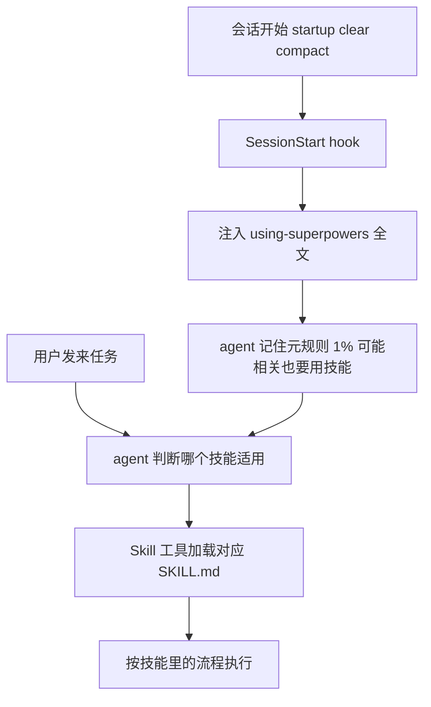
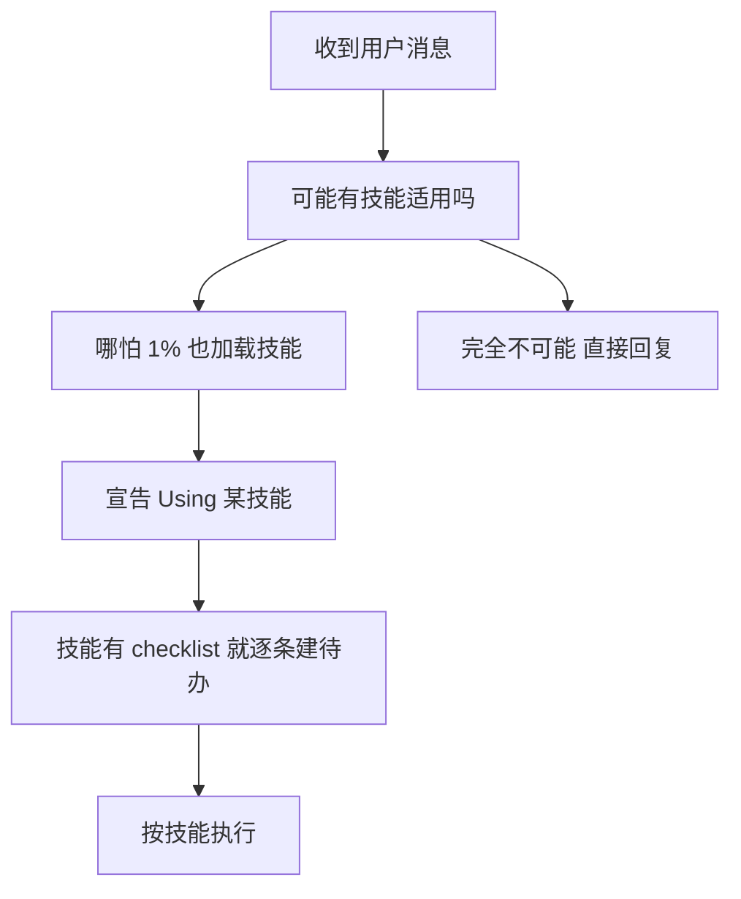
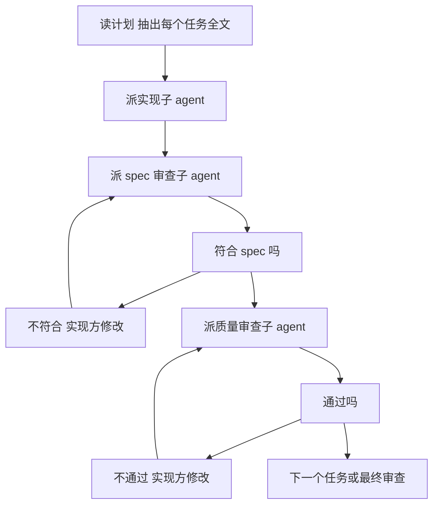

## 1. Superpowers

[Superpowers](https://github.com/obra/superpowers) 是一套装进 coding agent 的软件开发方法论。它没有库，也没有 MCP server，只有一组 Markdown 写的技能（skill）和一段开机引导。装上之后，Claude Code、Codex、Gemini CLI 不再上来就闷头写代码，而是先把需求问清楚、先写测试、宣布完成前先自己跑一遍验证。

用过 coding agent 的人大多见过这几个场景：

- 你说“加个登录功能”，它直接开始写代码，不问你要什么，也不写测试。
- 你让它用 TDD，它先把实现写完，再补几个必过的测试。
- 它说“已完成、测试通过”，你一跑全红。

模型不是不懂 TDD，它会给偷懒找理由：“这个太简单不用写测试”“我先探索一下代码库”。把规则写进一个长长的 system prompt 也不管用，prompt 越长，中间那几条越容易被忽略。作者 Jesse（obra）的做法是把每条纪律写成一个独立的技能，只在该用的时候加载，并且像写测试一样反复验证它能不能堵住 agent 的借口。

这一章从 Superpowers 里拿走四个做法，它们都能用在别的 agent 系统上：

1. **按需加载的技能库**。上下文里平时只放每个技能的一句触发条件，真用到时才载入正文。
2. **先录借口再写规则**。先不加约束跑一遍，逐字记下 agent 违规时说的话，再写规则专门堵这些话。
3. **每个任务一个新子 agent**。上下文不跨任务累积，做完先后过两道独立审查。
4. **开机注入引导**。会话一开始用 hook 把“怎么用技能”的说明注入上下文，同一份内容适配多个平台。

对照源码：

```bash
git clone --depth 1 --branch v5.1.0 https://github.com/obra/superpowers.git
cd superpowers
```

路径都从仓库根算起。项目核心是 `skills/` 下 14 个 `SKILL.md` 和 `hooks/` 下一个 SessionStart 脚本，工程量几乎全在 prompt 里。本文基于 tag `v5.1.0`（commit `f2cbfbe`）。

## 2. 5 分钟跑起来

Superpowers 是 Claude Code 插件，一行装好（其他平台见 README 对应小节）：

```
/plugin install superpowers@claude-plugins-official
```

装完要**重启一个会话**，因为它的能力靠 SessionStart hook 在会话开始时注入（4.4 节）。然后开个空目录，说一句要做东西：

```
> 帮我做一个命令行待办工具
```

没装之前，agent 会直接开始写 `todo.py`。装之后，它先触发 brainstorming 技能，反过来问你：

```
Using superpowers:brainstorming to clarify requirements.

在写任何代码之前，我想先把需求聊清楚。几个问题：
1. 待办存哪里？纯内存、本地文件，还是要持久化到数据库？
2. 需要哪些操作？增删改查之外，要不要优先级、截止日期、标签？
3. 多人用还是单人？要不要同步？
...
```

聊清楚后，它会产出一份 spec 分段给你确认，再写实现计划，然后逐个任务派子 agent 去做。每个任务做完先过 spec 审查，再过代码质量审查，才进入下一个。

你不需要记命令。技能靠 description 自动触发，想看有哪些技能，问一句“列出你的 superpowers 技能”。

## 3. 全景架构

图 2-1 是 Superpowers 的运行链路：会话开始时注入引导，之后每来一个任务，agent 先判断该用哪个技能，再按技能里的流程做。



图 2-1：从会话开始到技能执行

14 个技能分三类：

| 类别 | 技能 | 管什么 |
|---|---|---|
| 入口 | using-superpowers、writing-skills | 怎么用技能、怎么写技能 |
| 流程（必须照做） | brainstorming、writing-plans、subagent-driven-development、executing-plans、test-driven-development、systematic-debugging、verification-before-completion | 一个需求从澄清到交付 |
| 协作与收尾（可按情境调整） | dispatching-parallel-agents、requesting-code-review、receiving-code-review、using-git-worktrees、finishing-a-development-branch | 多 agent 协作、审查、分支收尾 |

每个技能是一个 `SKILL.md`，开头一段 YAML frontmatter：

```yaml
---
name: test-driven-development
description: Use when implementing any feature or bugfix, before writing implementation code
---
```

`description` 是整套机制的枢纽。它写给 agent 看，内容是触发条件：什么情况下该加载我。agent 不用预读 14 个文件的正文，看 description 就能决定用不用。

| 抽象 | 位置 | 职责 |
|---|---|---|
| SKILL.md 与 description | `skills/*/SKILL.md` | 一条可独立加载、按需触发的纪律 |
| SessionStart hook | `hooks/session-start` | 开机注入引导技能，按平台选输出格式 |
| 反合理化 prompt | 散布在各 SKILL.md | 用铁律和借口表堵住 agent 绕开规则的理由 |

## 4. 核心模块

### 4.1 技能库：上下文里只放触发条件

system prompt 里只放每个技能的 name 和 description，正文等 agent 判断要用时再加载。这样上下文里始终只有当前相关的那几条规则。

#### 巨型 prompt、向量检索、description 目录

规则都写进 system prompt 最直接，但规则一多，模型对长上下文中段的注意力会衰减（lost in the middle），该触发的规则反而被漏掉；写代码和调 bug 需要的规则也不一样，全堆在一起还互相干扰。按需加载有两条路：

| 做法 | 谁判断加载什么 | 代价 |
|---|---|---|
| 巨型 system prompt | 不判断，全部常驻 | 越长越被忽略，浪费 token |
| 向量检索召回规则 | 相似度分数 | 要建检索设施，召回不稳，触发错了很难调 |
| description 目录 | 模型读一句人话自己判断 | 依赖模型的判断力，可能漏判误判 |

向量检索和 description 都是按需加载，区别在触发条件可不可读。相似度是一个黑盒分数，`description: Use when...` 是一句人能改的话，触发错了改这句话就行。

#### 三层机制

第一层是 description 声明触发条件：

```yaml
description: Use when implementing any feature or bugfix, before writing implementation code
description: Use when about to claim work is complete, fixed, or passing, before committing or creating PRs
description: Use when creating new skills, editing existing skills, or verifying skills work before deployment
```

第二层是平台的 `Skill` 工具加载正文。`using-superpowers` 要求（`skills/using-superpowers/SKILL.md:30`）：

> **In Claude Code:** Use the `Skill` tool. When you invoke a skill, its content is loaded and presented to you—follow it directly. Never use the Read tool on skill files.

源码只给了这条规则，没写理由。

第三层是元规则。光有 description，模型可能懒得去加载，`using-superpowers` 开头用一段很重的话压住（`:11-13`）：

```
If you think there is even a 1% chance a skill might apply to what you are doing,
you ABSOLUTELY MUST invoke the skill.
IF A SKILL APPLIES TO YOUR TASK, YOU DO NOT HAVE A CHOICE. YOU MUST USE IT.
```

图 2-2 是 `using-superpowers` 里的判定流程（原文是 graphviz，这里转成 Mermaid）。



图 2-2：技能触发的判定流程

流程里有两处容易被忽略：

- **查技能排在一切动作之前**，连“先问个澄清问题”“先看一眼代码库”都要往后排，理由是技能会告诉你该怎么问、怎么看。
- **加载后先宣告**，比如 “Using brainstorming to ...”。加载哪个技能变成用户看得见的一句话，走错了能当场发现。

还有一个边界：`using-superpowers` 开头有个 `<SUBAGENT-STOP>` 块（`:6-8`），写明被派去执行具体任务的子 agent 跳过这个技能。没有它，4.3 节那些子 agent 也会被元规则要求从 brainstorm 开始走全流程。

把触发判断交给模型，天然不如写死的路由可靠。Superpowers 用两招弥补：1% 元规则把漏判的代价抬高，先宣告再执行让误判暴露出来。

#### description 只写触发条件

仓库里收了一份 Anthropic 官方的 skill 编写指南，要求 description 同时写“做什么”和“什么时候用”（`skills/writing-skills/anthropic-best-practices.md:187`）。`writing-skills` 的要求更窄：description 只写触发条件，以 “Use when...” 开头，不许概括技能的流程（`skills/writing-skills/SKILL.md:148-152`）。

理由是一次实测（`:154-156`）：某个 description 写成 “code review between tasks”，Claude 照着 description 只做了一次 review，跳过了正文流程图里的两次（先 spec 再质量）。改成只写触发条件后，它才去读流程图，做了两段 review。description 一旦概括流程，模型就会拿它当捷径，不再读正文。

#### 脱离平台的最小实现

下面这段 Python 不依赖 Claude Code，演示按 description 选技能的内核：目录进 system prompt，正文按需注入。

```python
import glob
import frontmatter   # pip install python-frontmatter

def load_skills(skill_dir: str) -> list[dict]:
    skills = []
    for path in glob.glob(f"{skill_dir}/*/SKILL.md"):
        post = frontmatter.load(path)
        skills.append({
            "name": post["name"],
            "description": post["description"],   # 触发条件
            "body": post.content,                 # 正文，用到才注入
        })
    return skills

def build_system_prompt(skills: list[dict]) -> str:
    # 只放 name 和 description，不放正文
    catalog = "\n".join(f"- {s['name']}: {s['description']}" for s in skills)
    return (
        "你有以下技能。哪怕只有 1% 可能相关，也要先取用对应技能再行动。\n"
        "取用方式：回复 USE_SKILL: <name>，我会把正文给你。\n\n"
        f"{catalog}"
    )

def skill_body(skills: list[dict], reply: str) -> str | None:
    # agent 回复 USE_SKILL: xxx 时，取出正文注入下一轮
    if reply.startswith("USE_SKILL:"):
        name = reply.split(":", 1)[1].strip()
        return next((s["body"] for s in skills if s["name"] == name), None)
    return None
```

这段（Python 3.10+）对 Superpowers 仓库的 14 个真实技能跑过：放进 system prompt 的目录约 2.5 KB，14 份正文合计约 110 KB。接到任意 LLM API 上，就是一个最小的按需技能系统。

### 4.2 先录借口，再写规则

写“务必用 TDD”，模型照样先写实现，还会给自己一个理由：“这个改动太小，先写实现更快。”它不是没看懂规则，而是会为破例找理由。Superpowers 写约束性 prompt 的方法是：先看 agent 怎么违规，把它的原话记下来，再写规则专门堵这些话。

#### 铁律加借口表

常见的三种写法效果差别很大：

| 写法 | 例子 | 效果 |
|---|---|---|
| 陈述规则 | “请遵守 TDD，先写测试” | 遇到理由就破例 |
| 加重语气 | “务必、一定、非常重要” | 短期有效，长对话里衰减 |
| 铁律加借口表 | 一条不容商量的规则，外加一张“这些念头说明你在找借口”的表 | 提前点名模型最可能用的理由 |

每个必须照做的技能都有一条铁律（Iron Law），一句话、全大写。TDD 技能是：

```
NO PRODUCTION CODE WITHOUT A FAILING TEST FIRST
```

verification-before-completion 技能是：

```
NO COMPLETION CLAIMS WITHOUT FRESH VERIFICATION EVIDENCE
```

铁律之外是借口表。`using-superpowers` 把模型常用的理由和对应的回应并排列出：

| 模型的念头 | 回应 |
|---|---|
| “这只是个简单问题” | 问题也是任务，先查技能 |
| “我得先了解上下文” | 查技能在澄清提问之前 |
| “我先探索一下代码库” | 技能会告诉你怎么探索 |
| “这个技能小题大做了” | 简单的事会变复杂，用它 |
| “我记得这个技能” | 技能会更新，读当前版本 |

这张表没有重复规则本身，列的是模型会用来开脱的原话，并把这些话直接标成危险信号。TDD 技能里还有一句专门堵“打擦边球”：

```
Violating the letter of the rules is violating the spirit of the rules.
```

#### 借口表是测出来的

`writing-skills` 把写技能直接定义成 TDD：

> **Writing skills IS Test-Driven Development applied to process documentation.**
>
> **Core principle:** If you didn't watch an agent fail without the skill, you don't know if the skill teaches the right thing.

对应关系如下：

| TDD | 写技能 |
|---|---|
| 测试用例 | 给子 agent 施压的场景 |
| 测试失败（RED） | 不带技能时 agent 违规 |
| 最小实现 | 针对这些具体违规写技能 |
| 测试通过（GREEN） | agent 守规矩了 |
| 重构 | 找到新借口，补上，再验证 |

图 2-3 是这个循环。写技能本身也有一条同构的铁律：`NO SKILL WITHOUT A FAILING TEST FIRST`（`skills/writing-skills/SKILL.md:377`）。按这个流程，借口表的每一行都应该对应一次“看着 agent 用这句话破例”的观察。


图 2-3：用 RED-GREEN 循环写技能

没看过它怎么失败，写出来的规则只是猜测。4.1 节 description 不能概括流程的结论，就是这样测出来的。

#### 在自己的 prompt 上做一轮

不需要框架，照下面做一轮：

1. **挑一条 agent 老不遵守的规则**，比如“返回 JSON 前必须校验 schema”。
2. **RED**：不加约束让 agent 做 10 个相关任务，逐字记下它违规时给的理由，例如“这个响应很简单，应该没问题”。
3. **GREEN**：写一条铁律（`NO RESPONSE WITHOUT SCHEMA VALIDATION`），加一张借口表，把上一步的理由逐条列进去。
4. **REFACTOR**：再跑 10 个任务，把新出现的理由补进表里，重跑。两三轮后理由基本就枯竭了。

这样写出来的 prompt 更长、更啰嗦，还要随模型升级重测：旧借口可能消失，新借口会冒出来，借口表得像测试套件一样维护。一次性、容错高的任务写一句陈述就够了；规则被违反代价高、agent 又要长时间自主运行时，这份维护成本才值得。

### 4.3 每个任务一个新子 agent

`subagent-driven-development` 把计划里的每个任务派给一个全新的子 agent，做完先过 spec 审查、再过代码质量审查，都通过才进入下一个任务。图 2-4 是这条流水线。



图 2-4：每个任务的实现与两段审查

技能里的核心原则：

> **Fresh subagent per task + two-stage review (spec then quality) = high quality, fast iteration**

原文接着解释为什么用子 agent：委派给隔离上下文的 agent，它们不继承当前会话的上下文和历史，需要的一切由主 agent 精确构造；主 agent 自己的上下文也因此留给协调工作。

#### 为什么不让一个 agent 做到底

一个 agent 连做十个任务，前面的探索、试错、半成品都堆在它的上下文里，越往后越容易被早期的错误假设带偏。它还在审自己的代码，刚写完就问它好不好，它几乎总说挺好。拆开后有三点不同：

- **每个任务一个全新子 agent**：上下文从零开始，不带前面任务的包袱。
- **两段审查分开**：做对了没有（符合 spec）和做好了没有（代码质量）是两件事，混在一起会互相妥协。
- **审查者不是作者**：换一个没写过这段代码的 agent 来挑毛病。

代价是协调开销：主 agent 要为每个子 agent 准备完整输入，多派几轮审查。任务之间越独立、单个任务质量要求越高，越适合这种方式；任务紧耦合、要频繁共享中间状态时，一个 agent 做到底反而顺手。

#### 派活给全文，完成看证据

两个细节决定这条流水线能不能跑通。

第一，派活时把任务**全文**交给子 agent，而不是让它“去读计划文件的第 3 个任务”。子 agent 的上下文是空的，它不知道第 3 个任务在哪、前因后果是什么。技能第一步就写明：

> Read plan, extract all tasks **with full text**, note context, create TodoWrite

第二，子 agent 报告“完成了”，主 agent 不能直接信。它会漏跑验证，也会高估自己。这里接上 `verification-before-completion` 的铁律：主 agent 要拿到重新跑测试的真实输出，才认可完成。

#### 协调器骨架

骨架的重点在于怎么给子 agent 构造输入。下面是示意代码，`dispatch`、`build_context`、`verify_fresh` 要接到你自己的 agent 平台上：

```python
def run_plan(plan):
    tasks = extract_tasks_with_full_text(plan)   # 抽出每个任务的全文，不是序号
    for t in tasks:
        ctx = build_context(t)                    # 任务全文 + 相关文件 + 约束
        while True:
            result = dispatch("implementer", ctx + t.full_text)   # 每次都是新 agent
            spec = dispatch("spec-reviewer", ctx + t.spec + result.diff)
            if not spec.ok:
                ctx += f"\nspec 未过：{spec.issues}"
                continue
            quality = dispatch("quality-reviewer", result.diff)
            if not quality.ok:
                ctx += f"\n质量未过：{quality.issues}"
                continue
            if not verify_fresh(t):               # 自己重跑验证，不信报告
                ctx += "\n验证未通过，重做"
                continue
            break
```

`dispatch` 每次都不带历史，输入全靠 `ctx + t.full_text` 显式拼出来，这就是上下文隔离落到代码上的样子。

### 4.4 SessionStart hook：开机注入引导

按需加载有个先有鸡还是先有蛋的问题：agent 一开始不知道有这套技能，也不知道 1% 元规则。Superpowers 用一个 SessionStart hook，在每次会话开始时把 `using-superpowers` 的全文注入上下文。

让用户把引导贴进 CLAUDE.md 也行，但要用户自己维护，换一个平台就得再贴一遍。hook 的好处是用户无感，代价是要处理各平台输出格式的差异。

#### 同一个脚本，只输出一个字段

`hooks/session-start` 是个 bash 脚本：读出 `using-superpowers` 的全文，包进 `<EXTREMELY_IMPORTANT>` 标签，再输出成平台认的 JSON。难点在于三类平台认的字段名不同，而且不能三个都输出。脚本注释写明了原因（`hooks/session-start:41-42`）：

```bash
# Claude Code reads BOTH additional_context and hookSpecificOutput without
# deduplication, so we must emit only the field the current platform consumes.
```

Claude Code 两个字段都读、而且不去重，都输出就会把几千字的引导注入两遍。所以脚本按环境变量判断平台，只输出一种（`hooks/session-start:46-55`）：

```bash
if [ -n "${CURSOR_PLUGIN_ROOT:-}" ]; then
  # Cursor 认 additional_context
  printf '{\n  "additional_context": "%s"\n}\n' "$session_context"
elif [ -n "${CLAUDE_PLUGIN_ROOT:-}" ] && [ -z "${COPILOT_CLI:-}" ]; then
  # Claude Code 认 hookSpecificOutput.additionalContext
  printf '{\n  "hookSpecificOutput": {\n    "hookEventName": "SessionStart",\n    "additionalContext": "%s"\n  }\n}\n' "$session_context"
else
  # Copilot CLI 等认顶层 additionalContext
  printf '{\n  "additionalContext": "%s"\n}\n' "$session_context"
fi
```

Cursor 也可能同时设置 `CLAUDE_PLUGIN_ROOT`，所以它的判断排在最前面。脚本用 `printf` 而不用 heredoc，注释里链着原因：bash 5.3 以上 heredoc 会卡住（`:44-45`，issue #571）。

hook 注册在 `hooks/hooks.json`，`matcher` 是 `startup|clear|compact`：开机、清屏、压缩上下文之后各注入一次。不是每条消息都注入，那样太费 token；但必须覆盖 `compact`，因为压缩可能把早先注入的引导挤掉。

#### 引导层全文注入，能力层按需加载

Superpowers 整体是按需加载，唯独 `using-superpowers` 全文注入。原因是它讲的就是“怎么加载技能”。如果它也要按需加载，agent 得先知道怎么加载技能，才能加载这份说明，就绕不出来了。所以引导层必须一开始就在，其余技能才能按需加载。自己设计注入系统时也要做这个区分。

#### 最小注入脚本

平台支持 SessionStart 类 hook 的话，最小脚本就几行：

```bash
#!/usr/bin/env bash
BOOTSTRAP=$(cat "${PLUGIN_ROOT}/skills/using-yourtool/SKILL.md")
# 用 json.dumps 转义换行、引号、反斜杠，再去掉两端引号
escaped=$(printf '%s' "$BOOTSTRAP" | python3 -c 'import json,sys; print(json.dumps(sys.stdin.read())[1:-1])')
printf '{ "hookSpecificOutput": { "hookEventName": "SessionStart", "additionalContext": "%s" } }\n' "$escaped"
```

这段跑过：引导文件里带引号、反斜杠和换行时，输出仍是合法 JSON。平台没有 hook 的话，就把引导贴在 system prompt 最前面，或者在自己的入口脚本里每次调用前注入。要保证的只有一点：每次会话开始时，引导一定在上下文里。

## 5. 规则的刚性与优先级

| 做法 | 项目怎么做 | 用在哪 |
|---|---|---|
| 决策画成流程图 | 技能里嵌 graphviz 决策图，把什么情况走哪条路画死 | 想让 agent 的决策可复现 |
| 标明刚性等级 | 技能声明自己是必须照做还是可按情境调整 | 防止 agent 把铁律也“灵活处理” |
| 用户指令优先 | CLAUDE.md 说不用 TDD，就不用 | 所有注入式规范 |

第三条值得展开。注入式规范天然有越权风险：它凭什么覆盖用户当下的要求？`using-superpowers` 把优先级写死为“用户显式指令 > 技能 > 默认系统提示”，并举例说明 CLAUDE.md 说不用 TDD、技能说必须 TDD 时，听用户的（`skills/using-superpowers/SKILL.md:22-26`）。agent 不能拿技能当理由违抗用户。

## 6. 什么时候用它

| 场景 | 建议 | 原因 |
|---|---|---|
| 用 coding agent 做正经工程，怕它糊弄 | 适合 | 正是它的设计目标 |
| 给自己的 agent 产品装一套方法论 | 学机制，内容自己定 | 按需技能和先录借口是通用手法 |
| 一次性脚本、探索性原型 | 不必 | brainstorm、spec、TDD 全流程在小任务上是负担 |
| 指令遵循能力弱的模型 | 谨慎 | 触发判断和长流程都依赖模型听话 |

这套方法论很重，默认你愿意为质量牺牲速度。Superpowers 自己也留了口子：`brainstorming` 讨论了“这太简单不需要设计”这种反模式（`skills/brainstorming/SKILL.md:16`），TDD 技能列了一次性原型等例外。

照搬时要分清两层。**机制**可以直接拿走：按需技能、先录借口再写规则、子 agent 隔离加两段审查、引导层全文注入、用户指令优先。**内容**是 Jesse 的工程偏好，比如一定要 TDD、一定要先 brainstorm，换成你团队的规范（必须先写 RFC、必须过安全扫描），机制完全一样。全大写铁律的语气在当前一代模型上有效，模型升级后要重测。

自己落地时，先别抄 14 个技能。先用 4.2 节的方法把你最在意的一条规则真正焊死，跑顺了再扩。技能库骨架一天能搭好，一条规则的 RED-GREEN 往往要跑十几个场景才收敛，时间应该花在这里。技能多了触发判断的负担也会涨，每加一个都要回归测一下别的技能有没有被带歪。

## 7. 延伸阅读

- [Anthropic 官方 skill 文档](https://docs.anthropic.com/en/docs/claude-code/skills)：和 Superpowers 对照看。官方要求 description 写“做什么 + 何时用”，Superpowers 只写触发条件，还加了一整套对付借口的写法。
- [obra 的博客](https://blog.fsck.com/) 和仓库里的 `docs/superpowers/plans/`、`specs/` 目录：作者把每次大改的设计文档都留在仓库里，可以看到这些 prompt 是怎么一版版改出来的。
- “Lost in the Middle”（Liu et al., 2023）：长上下文中段信息被忽略的实验，是按需加载的动机。
