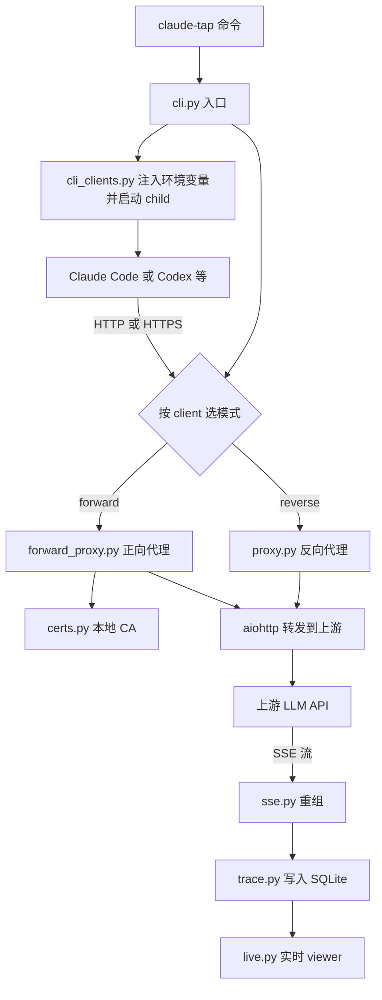
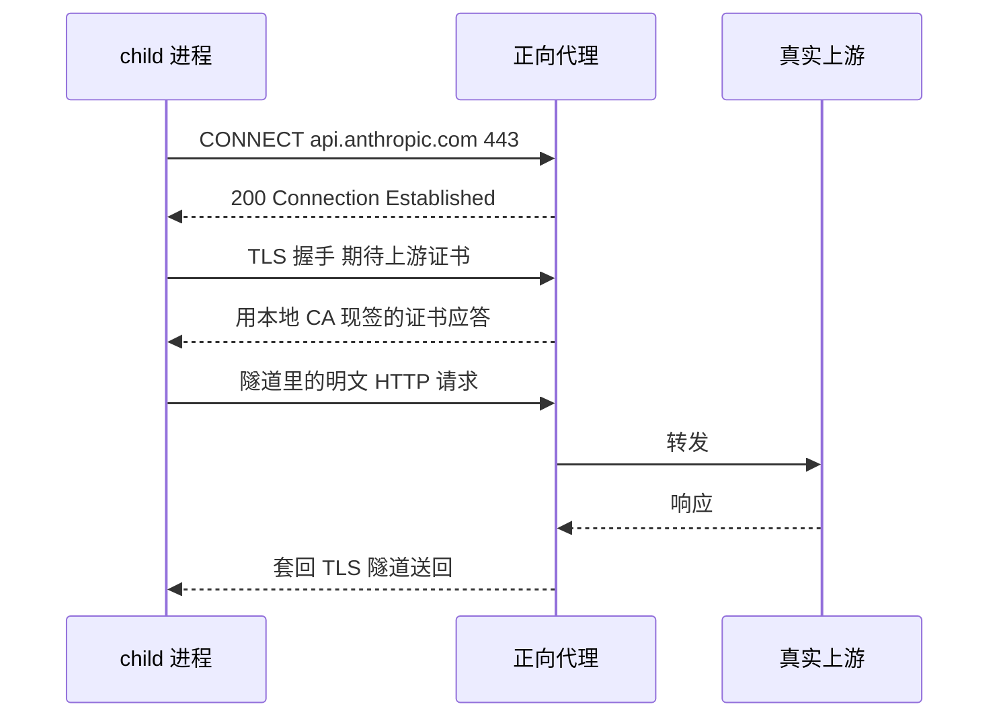
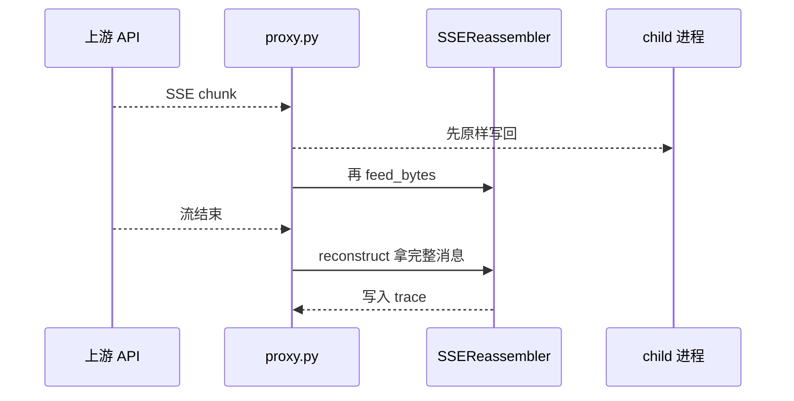
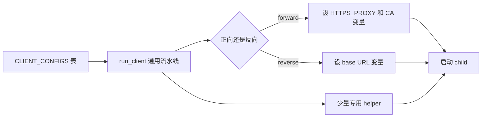

## 1. claude-tap

[claude-tap](https://github.com/liaohch3/claude-tap) 是 AI coding agent 的本地流量记录器。你照常用 Claude Code、Codex、Gemini CLI 干活，它在背后录下这些 CLI 和上游 LLM 之间的真实 HTTP 流量：完整的 system prompt、对话历史、工具 schema、工具调用、流式响应、token 用量。记录存进本机的 SQLite，用自带的 dashboard 按会话浏览，也能导出成单文件 HTML，相邻两次请求之间还能看结构化 diff。

调试 agent 时，最麻烦的往往不是答案不对，而是看不到它到底发出去了什么：

- `-v` 打不出 system prompt；
- `strace` 看到的是加密后的 TLS 字节；
- 自己起个 HTTP server 冒充 `api.anthropic.com`，又会被 TLS 握手挡住。

标准答案是本地代理加 MITM（中间人解密）。难在每个 CLI 的脾气都不一样：

- Claude Code 认 `ANTHROPIC_BASE_URL`；
- Codex 认 `OPENAI_BASE_URL`，还得在 `~/.codex/config.toml` 里同时覆盖；
- Antigravity 在 macOS 上不读 `SSL_CERT_FILE`，CA 必须装进 login keychain；
- Hermes 的 `gateway start` 会交给 systemd 托管，代理环境变量全部丢失。

claude-tap 把这些差异收在一条命令后面：敲 `claude-tap`，对使用者来说和直接跑 `claude` 没有区别。

读完这一章，你能带走三个做法：

1. **拦截 child 进程的 HTTPS 时，在反向代理和正向代理之间做选择**。抓包工具、API 调试器、移动端 MITM 工具都要先答这道题。
2. **边转发边累积 SSE**。不破坏流式体验，同时把碎片还原成可存盘的完整消息。任何录流量的代理都会碰到。
3. **用策略表收拢多个 client 的差异**。12 个 client 的差异打包进一个 frozen dataclass，多账户认证、多云部署脚本、多 IDE 入口都是同一套结构。

对照源码：

```bash
git clone --depth 1 --branch v0.1.104 https://github.com/liaohch3/claude-tap.git
```

路径都从 `claude_tap/` 这个 Python 包目录算起。项目约 1.1 万行 Python，另有 viewer 前端 JS 约 4.8K 行。本文基于 tag `v0.1.104`（commit `1e6f4ed`）。本章三个最小实现的完整代码在 [`examples/04-claude-tap/`](../examples/04-claude-tap/)。

## 2. 上手

要求 Python 3.11+，用 `uv` 或 pip 装：

```bash
uv tool install claude-tap      # 或 pip install claude-tap
claude-tap --version            # claude-tap 0.1.104
```

先装好要抓的 CLI 并完成登录。不带参数时，`claude-tap` 包装 Claude Code：在本地随机端口起一个反向代理，把 `ANTHROPIC_BASE_URL` 指向自己，再启动 `claude` 子进程。

下面是我在 0.1.104 上实跑的输出。为了不花 token，上游换成了一个本地假服务（`--tap-target`），`claude` 换成了一个只发一次流式请求的脚本，数据库路径已截短：

```
$ claude-tap --tap-target http://127.0.0.1:18765 --tap-no-open --tap-no-update-check
🌐 Dashboard: http://127.0.0.1:19527
🔍 claude-tap v0.1.104 listening on http://127.0.0.1:32933
📁 Trace session: e412feca-5237-4bb6-bf13-f43ed6a44eb4
🗄️  Trace database: …/tap.db

🚀 Starting Claude Code: claude --settings {"env":{"ANTHROPIC_BASE_URL":"http://127.0.0.1:32933"}}
   ANTHROPIC_BASE_URL=http://127.0.0.1:32933

fake claude got: Hello, tap

📋 Claude Code exited with code 0

📊 Trace summary:
   API calls: 1
   Tokens: 12 in / 3 out
   Session: e412feca-5237-4bb6-bf13-f43ed6a44eb4
   Database: …/tap.db
   Dashboard: http://127.0.0.1:19527
```

child 运行期间终端上没有代理日志：claude 是全屏 TUI，代理往终端打印会把界面搅乱，所以每轮的 `[Turn 1] → POST /v1/messages …` 这类日志都写进了数据库的 `proxy_logs` 表（`cli.py:239`）。数据库默认在 `~/.local/share/claude-tap/` 下（5 节讲路径怎么定）。

看结果有两种方式：

```bash
claude-tap dashboard                          # 按日期、client、模型浏览历史会话
claude-tap export <session-id> -o out.html    # 导出单文件 HTML，可以直接发给同事
claude-tap export <session-id> --format markdown
```

同一个会话导出成 Markdown，是这样的：

```
## Turn 1

**Model**: `claude-test` | **Duration**: 155ms

### User

hi

### Assistant

Hello, tap
```

其他用法：

```bash
claude-tap --tap-client codex                 # 换 client，还支持 gemini、kimi、cursor 等
claude-tap --tap-client gemini -- -p "hello"  # -- 之后的参数原样透传给 client
claude-tap --tap-no-launch --tap-port 8080 --tap-host 127.0.0.1   # 只起代理
ANTHROPIC_BASE_URL=http://127.0.0.1:8080 claude                   # 在另一个终端自己接
```

用 `--tap-no-launch` 时要注意：这个模式默认监听 **0.0.0.0**，不是 127.0.0.1（`cli.py:689-692`，作者假设这时代理多半跑在远程机器上）。我实测 `ss -ltn` 看到的就是 `0.0.0.0:8080`，同一局域网的机器都能连上来，挡在前面的只有 4.1 节讲的路径白名单。只在本机用，就像上面那样显式加 `--tap-host 127.0.0.1`。

所有 `--tap-*` 参数由 claude-tap 自己消费，其余全部透传。

## 3. 全景架构

一个被抓的请求依次穿过图 4-1 里的这些组件。



图 4-1：一次请求从 child 进程到 trace 的路径

代码量集中在代理、存储和适配三块：`forward_proxy.py` 1196 行，`trace_store.py` 1124 行，`cli_clients.py` 1050 行，`proxy.py` 780 行。它还有一个 608 行的 `ws_proxy.py`，专门代理 Codex 这类走 WebSocket 的 client，和第 3 章 sub2api 的 HTTP 转 WS 桥可以对照着读。本章重点讲的 `sse.py` 只有 302 行，`certs.py` 277 行。

表 4-1 是贯穿全项目的五个抽象。

| 抽象 | 位置 | 职责 |
|---|---|---|
| `CertificateAuthority` | `certs.py:183-277` | 本地 CA，按域名签发并缓存证书 |
| `SSEReassembler` | `sse.py:11-302` | 把 SSE 碎片累积成完整响应 |
| `ClientConfig` | `cli_clients.py:68-100` | 一个 client 的全部适配策略 |
| `TraceWriter` | `trace.py:15-90` | 写 trace 并累加 token 统计 |
| `TraceStore` | `trace_store.py:69+` | SQLite 持久化，带 schema 版本 |

前三个依次对应下面 4.1、4.2、4.3 三节。

## 4. 核心模块

### 4.1 拦截 child 进程的 HTTPS：反向代理还是正向代理

要拦的是一个不是你写的 child 进程发出的 HTTPS 请求。Claude Code 闭源，Codex 是 Rust 二进制，你能控制的只有它的启动环境：环境变量、配置文件、命令行参数。选哪种代理，只看一个问题：**能不能让 child 改 base URL**。能，就用反向代理；不能，就用正向代理加自签 CA。

#### 两种代理各自要做什么

**反向代理**：在本地起一个 HTTP 服务，让 child 把请求地址从真实上游改成它。child 发明文 HTTP 过来，代理转发给上游。mitmproxy 的 reverse 模式、Charles 的 Map Remote 都是这个思路。核心只有几行：

```python
async def handler(request):
    async with ClientSession() as session:
        resp = await session.request(
            request.method,
            "https://api.anthropic.com" + request.path_qs,
            headers={k: v for k, v in request.headers.items() if k.lower() != "host"},
            data=await request.read(),
        )
        return web.Response(status=resp.status, body=await resp.read())
```

它的局限是只能拦得住能改 base URL 的 client。Claude Code、Codex、Kimi 都能改；Cursor 把地址编译进了二进制，Antigravity 跨好几个 Google 域名，Qoder 在配置文件里写死了 endpoint，这些拦不到。

**正向代理**：让 child 把所有 HTTPS 流量都交给代理，代理冒充上游完成 TLS 握手，解开后再转发。它要解决三件事：

1. **让流量过来**：设 `HTTPS_PROXY`。Python 的 httpx 和 requests、Node.js 的 undici、Go 的 net/http、Rust 的 reqwest 默认都认它。
2. **让 child 信任你的 CA**：每种运行时认的变量不同，Node.js 是 `NODE_EXTRA_CA_CERTS`，httpx 是 `SSL_CERT_FILE`，requests 是 `REQUESTS_CA_BUNDLE`。Codex 的 Rust 二进制认 `CODEX_CA_CERTIFICATE`，这是 Codex 自己定义的变量，别的 Rust 程序不认。
3. **解开 TLS**：收到 CONNECT 后，用一张以目标域名签发的证书应答握手。

图 4-2 是一次 CONNECT 隧道的过程。



图 4-2：正向代理解开一条 CONNECT 隧道

child 肯接受代理现签的证书，前提是它信任了代理的 CA，所以第 2 件事做不好，整条路就走不通。

两条路的开源标杆都是 mitmproxy，5 万行 Python，做到了产品级。claude-tap 的范围窄得多：只为 LLM CLI 服务，两种模式并存，按 client 选。

#### claude-tap 按 client 选模式

每个 client 用哪种模式，由 `ClientConfig.default_proxy_mode` 决定。规则可以归纳成两句：

- 单一 provider 且能改 base URL，用反向；
- 多 provider 或改不了 base URL，用正向。

12 个 client 的配置（`cli_clients.py:138-276`）符合这个规则：Claude Code、Codex、Kimi、OpenClaw、CodeBuddy 用默认的反向；Gemini、OpenCode、Pi、Hermes、Cursor、Qoder、Antigravity 显式写了 `default_proxy_mode="forward"`。

反向代理（`proxy.py:465` 起）在上面那几行的基础上多做了三件事：

- **路径白名单**：`ALLOWED_PATH_PREFIXES`（`proxy.py:89-119`）只放行 `/v1/messages`、`/v1/chat/completions` 等 LLM 路径，其余返回 404。默认只绑 127.0.0.1 时，同机其他进程照样能扫它；`--tap-no-launch` 默认绑 0.0.0.0 时，它是局域网里唯一的一道护栏。
- **`strip_path_prefix`**：Codex 的 OAuth 请求走 `chatgpt.com/backend-api/codex/...`，环境变量给的 base URL 却带着 `/v1`，要剥掉。
- **流式分支**：流式响应不能 `await resp.read()` 一次读完，4.2 节展开。

正向代理（`forward_proxy.py`）还有一个平台坑：`loop.start_tls()` 在 macOS 的 Python 3.11 上不稳。作者绕了一下（`forward_proxy.py:336-403`）：在 `127.0.0.1` 的随机端口上起一个临时 TLS server，再用 TCP 转发把客户端 socket 和它接上。代价是多两次 socket 拷贝。只跑 Linux 或 Python 3.12+ 的话，直接用 `start_tls()` 就行，不必照搬。

#### 自签 CA 和 SAN

正向代理能工作，靠的是一张 child 信任的 CA。`certs.py` 不到 280 行，核心是两个函数。

**`ensure_ca()`：首次启动时签一张自签 CA，存到 `~/.claude-tap/ca.pem`。** 几个关键设置：

- **有效期 5 年**，免得用户隔几个月就要重新信任一次。
- **`BasicConstraints(ca=True, path_length=0)`**：`ca=True` 表示这张证书能签发别的证书，`path_length=0` 表示它下面不能再挂中间 CA，只能直接签叶子证书。这条防不住私钥失窃，拿到私钥的人直接签叶子证书就够了。
- **`KeyUsage(key_cert_sign=True, crl_sign=True, ...)`**：声明这把钥匙用来签证书。`ExtendedKeyUsage(SERVER_AUTH)` 只加在每张 host 证书上（`certs.py:231`），CA 上没有。
- **私钥权限 `0o600`**，但以 `NoEncryption()` 明文 PEM 落盘（`certs.py:96-104`）。同一用户下的任何进程都能读到它，这是这张 CA 真正的风险所在。

只写 `path_length=0` 不写 `KeyUsage(key_cert_sign=True)` 的话，老版本 Python 不报错，Python 3.13 的严格校验会直接拒绝，报 `Path length given without key usage keyCertSign`。claude-tap 两个都写了。

**`get_host_cert_pem(hostname)`：每个新域名第一次握手时签一张证书。** 这里有个常见坑：现代 TLS 客户端只看 SAN（证书里列出的可用域名或 IP），不看 CN。只写 CN 不加 SAN，Chrome、Node.js、httpx 都会拒绝。SAN 还要分类型（`certs.py:210-216`）：

```python
san_names = []
try:
    ip = ipaddress.ip_address(hostname)
    san_names.append(x509.IPAddress(ip))         # IP 用 IPAddress
except ValueError:
    san_names.append(x509.DNSName(hostname))     # 域名用 DNSName
```

签好的证书按域名缓存在进程内（`_host_cache`），因为每张 host 证书都要新生成一把 RSA-2048 密钥。我在一台 4 核 x86 Linux 上连生成 20 把，中位数 53ms，最慢 112ms，每次握手都签就太慢了。

这套签发有两个边界，自己实现时要补上：每张证书只签一个名字，没有通配符，也不合并多个 SAN；CONNECT 的目标按最后一个冒号切出主机名（`forward_proxy.py:317`），IPv6 字面量带着方括号（`[::1]`），`ip_address()` 解析失败，会被当成域名签出一张 DNSName 为 `[::1]` 的证书。

#### CA 只交给 child，不进系统证书库

把 CA 装进系统证书库（macOS 的 System keychain、Linux 的 `/usr/local/share/ca-certificates/`）能一次解决所有信任问题。但私钥是明文落盘的，一旦被读走，这台机器上所有信任系统证书库的程序都能被伪造证书骗过。

所以 claude-tap 只通过环境变量把 CA 交给被包装的 child，浏览器和系统里的其他程序一律不受影响。mitmproxy 的常规用法正好相反：让用户打开 `mitm.it` 下载 CA，手动装进系统或浏览器。两种选择对应不同的用户：mitmproxy 的用户是安全研究员，愿意承担这个风险；claude-tap 的用户是调 prompt 的普通工程师，默认不该动系统。

例外是 Antigravity（`agy`）。它在 macOS 上不读这些环境变量，只认 keychain。claude-tap 给它的配置加了 `auto_trust_ca_macos=True`，启动时执行 `security add-trusted-cert` 装进 **login keychain**，而不是 System keychain：前者不需要 sudo，只影响当前用户，可以单独撤销。

#### 最小双模式代理

[`examples/04-claude-tap/mini_tap.py`](../examples/04-claude-tap/mini_tap.py) 把两种模式压到了约 130 行，在 Python 3.11 下跑过：

- 反向模式对一个返回 gzip 的本地上游转发正常；
- 正向模式用 curl 走 CONNECT，同一条隧道里连发两个 HTTPS 请求都能解开转发；
- 签出的证书在 `VERIFY_X509_STRICT` 下也能通过校验。

正向模式的核心是下面这段（节选，省略了日志）：收到 CONNECT 后回 200，把连接升级成 TLS，然后在隧道里循环读请求。

```python
async def handle(reader, writer, ca, session):
    head = await read_head(reader)
    if not head or not head[0].startswith("CONNECT "):
        writer.close()                         # 明文 HTTP 代理从略
        return
    host, port = head[0].split(" ")[1].rsplit(":", 1)
    writer.write(b"HTTP/1.1 200 Connection Established\r\n\r\n")
    await writer.drain()
    await writer.start_tls(host_ctx(host, *ca))   # 从这里起 reader 读到的是明文
    while head := await read_head(reader):         # 一条隧道里可以有多个请求
        method, path, _ = head[0].split(" ", 2)
        hdrs = dict(h.split(": ", 1) for h in head[1:])
        size = int({k.lower(): v for k, v in hdrs.items()}.get("content-length", 0))
        body = await reader.readexactly(size)
        hdrs = {k: v for k, v in hdrs.items() if k.lower() != "accept-encoding"}
        hdrs["Accept-Encoding"] = "identity"
        async with session.request(method, f"https://{host}:{port}{path}",
                                   headers=hdrs, data=body) as resp:
            data = await resp.read()
        out = f"HTTP/1.1 {resp.status} {resp.reason}\r\n"
        out += "".join(f"{k}: {v}\r\n" for k, v in clean(resp.headers).items())
        writer.write(out.encode() + f"Content-Length: {len(data)}\r\n\r\n".encode() + data)
        await writer.drain()
    writer.close()
```

运行：

```bash
python mini_tap.py forward
HTTPS_PROXY=http://127.0.0.1:8080 NODE_EXTRA_CA_CERTS=$PWD/mini-tap-ca.pem claude
```

写这段时有三个地方容易出错：

- **正向模式要在 socket 流这一层接管**。CONNECT 之后连接要升级成 TLS，HTTP 框架做不了这件事，得用裸 `asyncio.start_server` 加 `StreamWriter.start_tls()`（3.11+）。反向模式则随便用哪个 HTTP 框架都行。
- **上游响应头不能原样回传**。aiohttp 客户端会自动解压，body 已经是明文，再带着上游的 `Content-Encoding: gzip` 回给 child，child 会把明文当 gzip 解，直接报错。`Content-Length`、`Transfer-Encoding` 也得由本地重新决定，代码里的 `clean()` 就是删这几个头。
- **CA 要持久化**。示例每次启动都新生成一张 CA；真实工具要把它存下来，否则用户每次都得重新信任。

### 4.2 SSE：边转发边累积

Agent CLI 的主对话请求基本都是流式的。代理这种响应时，要同时满足两个互相拉扯的要求：

1. **零延迟转发**。child 期待 chunk 一到就显示。代理要是 `await resp.read()` 收完再转，`claude` 会卡几秒，然后一口气吐出全部文本。
2. **存下完整消息**。每个 chunk 是一段 SSE 帧，比如 `event: content_block_delta` 加一行 `data: {...}`，单独看没有意义。`delta = "hello"` 要放进上下文，知道它属于第几个内容块、前面累积到了哪里，才读得懂。存盘时要的是 SDK 调 `messages.create()` 拿到的那种完整 `Message`。

claude-tap 的做法是每个 chunk 先原样转发，再喂给一个累积器，如图 4-3。



图 4-3：转发和累积在同一个循环里先后发生

#### 用 SDK 还是手写

| 做法 | 代价 |
|---|---|
| 收完再解析 | 流式体验全坏，child 卡几秒再一次性输出 |
| 借上游 SDK 的流式 helper | 绑死 SDK 版本；多协议就要拉进多个 SDK；内部 API 不保证稳定 |
| 手写增量累积器 | 要自己理解每种协议的流式语义 |

同类项目里没有谁完整走第二条路。LiteLLM 是折中：

- OpenAI 系借官方 `openai` SDK 拿解析好的 chunk（`litellm/llms/openai/openai.py`）；
- Anthropic 的 SSE 自己解析（`litellm/llms/anthropic/chat/handler.py` 的 `ModelResponseIterator`）；
- 最后用自己写的 `stream_chunk_builder`（`litellm/main.py`）累积。

claude-tap 选了手写。`sse.py` 302 行，覆盖 Anthropic Messages、OpenAI Chat Completions、OpenAI Responses 三套协议，只依赖标准库。`SSEReassembler` 是个纯数据类：不发请求，不写文件，喂进字节、拿出快照，所以单测很好写。内部分三层，`feed_bytes` 切行，`_feed_line` 拼帧，`_accumulate` 按事件更新快照；支持一个新协议，只需在 `_accumulate` 里加分支。它的注释里写明了取代的是谁：`This replaces the anthropic SDK's accumulate_event() with a simple manual implementation`。

#### 按行切帧

入口 `feed_bytes()`（`sse.py:23-28`）：

```python
def feed_bytes(self, chunk: bytes):
    self._buf += chunk
    while b"\n" in self._buf:
        line, self._buf = self._buf.split(b"\n", 1)
        self._feed_line(line.decode("utf-8", errors="replace"))
```

这是解析流式协议的标准写法：留一个字节缓冲，每次只切出完整的一行，不完整的半行留着等下一个 chunk。`split(b"\n", 1)` 只切第一个换行；换成 `splitlines()` 一次全切，末尾的半行就会被当成完整行处理掉。

`_feed_line()`（`sse.py:29-60`）是 SSE 的状态机：`event:` 行记下事件类型，`data:` 行收集数据，空行表示一帧结束，拼好数据交给下一层。实际抓包会遇到三种帧：

| 协议 | 帧的样子 |
|---|---|
| Anthropic Messages | `event:` 行加 `data:` 行 |
| OpenAI Chat Completions | 只有 `data:` 行，以 `data: [DONE]` 结束 |
| OpenAI Responses | 只有 `data:` 行，类型写在 data 的 `type` 字段里 |

状态机用三条规则兼容它们：没有 `event:` 行时类型默认为 `"message"`；`[DONE]` 是结束标记，不当数据；Responses 协议到了累积层再看 `data["type"]` 分流。

#### 按事件类型累积

`_accumulate()`（`sse.py:67-133`）按事件类型更新快照。Anthropic 协议的一次回复是这样的顺序：

- `message_start` 带来空的消息骨架（`id`、`role`、`model`、`content: []`）；
- 每个内容块（文本、thinking、tool_use）各有一组 `content_block_start`、若干 `content_block_delta`、`content_block_stop`；
- `message_delta` 最后带来 `stop_reason` 和 token 用量。

去掉防御判断后，累积逻辑是这样：

```python
def _accumulate(self, event_type, data):
    if event_type == "message_start":
        self._snapshot = copy.deepcopy(data["message"])      # 开局骨架
    elif event_type == "content_block_start":
        block = copy.deepcopy(data["content_block"])
        self._snapshot["content"][data["index"]] = block     # 新内容块入位
    elif event_type == "content_block_delta":
        block = self._snapshot["content"][data["index"]]
        delta = data["delta"]
        if delta["type"] == "text_delta":
            block["text"] = block.get("text", "") + delta["text"]
        elif delta["type"] == "input_json_delta":            # 工具参数：先拼字符串
            block["_partial_json"] = block.get("_partial_json", "") + delta["partial_json"]
    elif event_type == "content_block_stop":
        block = self._snapshot["content"][data["index"]]
        if "_partial_json" in block:                          # 块结束才解析
            block["input"] = json.loads(block.pop("_partial_json"))
    elif event_type == "message_delta":
        self._snapshot.update(data["delta"])
        if usage := data.get("usage"):
            self._snapshot["usage"] = usage
```

工具参数被切成 `{"comma`、`nd": "`、`ls"}` 这样的片段，中间任何一段单独看都不是合法 JSON，所以先拼成字符串，等 `content_block_stop` 再解析。OpenAI function calling 的 `arguments` 也是这样累积的。

OpenAI 分支还多做一件事：把结果同时整理成 Anthropic 的形状，在快照的 `content` 里挂一份 `[{type: "text"}, {type: "tool_use"}]`。这样 viewer、dashboard、diff 只需要认一种格式。协议差异在写入存储之前就抹平了，代价是写入路径多一次转换，消费方越多越划算。

#### 先转发，再累积

真正的边走边录发生在 `_handle_streaming`（`proxy.py:609-686`）：

```python
resp = web.StreamResponse(status=upstream_resp.status,
                          headers={k: v for k, v in upstream_resp.headers.items()
                                   if k.lower() not in HOP_BY_HOP})
await resp.prepare(request)                    # 先把响应头发给 child
reassembler = SSEReassembler(store_events=store_stream_events)
try:
    async for chunk in upstream_resp.content.iter_any():
        await resp.write(chunk)                # 先转发
        reassembler.feed_bytes(chunk)          # 再累积
except (ConnectionError, asyncio.CancelledError):
    pass
# ... write_eof()，然后 reassembler.reconstruct() 写入 trace
```

`iter_any()` 是有数据就给，不攒大小；换成 `iter_chunked(8192)` 会等满 8K 才给一次，凭空加延迟。

先 `write` 再 `feed`，保证 child 收到每个 chunk 的时间不受解析耗时影响。但这个顺序挡不住异常：`feed_bytes` 一旦抛错，循环照样中断，外层的 `except` 也不接这类异常。

真正让解析错误不影响转发的，是 `_accumulate` 内部那层 `try/except Exception`（`sse.py:75` 起）。最常见的诱因是上游新增了一种事件类型或字段，这类数据在那一层就被吞掉了。代理类工具的取向是宁可 trace 缺一块，也不能让 child 的流断掉；代价是重组的 bug 不报错，只能事后从残缺的 trace 反推。

外层那个 `except` 要分开看：

- **`ConnectionError`**：child 断开时 `resp.write()` 会抛 `ConnectionResetError`，当作正常结束、保存已经录到的部分，合理。
- **`CancelledError`**：吞掉它是 asyncio 的反模式。发起取消的一方（超时、服务关闭）以为任务停了，它却还在往下跑、写 trace。稳妥的写法是先保存已累积的部分，再重新 `raise`。

还有一个副作用：child 一断开循环就退出，上游剩下的 SSE 不再读取，trace 里的响应是截断的，usage 也可能缺失。sub2api（第 3 章）在同样的位置做了相反的选择，child 断开后继续读完上游，为的是拿到完整 usage 用于计费（`backend/internal/service/gateway_service.go:5471`，v0.1.133）。要保证 trace 完整，可以学它。

另外，代理默认只存最后的快照，不存原始事件列表。`SSEReassembler` 类本身的 `store_events` 默认是 `True`（`sse.py:15`）。但两种代理创建它时，传进去的是命令行开关 `--tap-store-stream-events` 的值，而这个开关默认关闭（`proxy.py:592`）。一次 Claude Code 对话动辄几千个 delta 事件，要排查重组结果时再打开。

两份数据各有用途：`events` 是原始帧，用来排查重组出错在哪一帧；快照是存盘和展示用的完整消息。`reconstruct()` 只是把当前快照交出去，不改任何状态，流什么时候算结束由调用方决定，调用方在 `write_eof()` 之后才取。

[`examples/04-claude-tap/mini_sse.py`](../examples/04-claude-tap/mini_sse.py) 是约 85 行的最小版，只认 Anthropic 的文本块和 `message_delta`，自带一段样本流：

```bash
python mini_sse.py      # 按 7 字节一片喂入样本，打印累积出的完整消息
```

自己扩展时，先把一个协议做通再加第二个；再用 `curl --raw` 抓几段真实流存成 fixture，写 `feed_bytes(fixture)` 加断言的单测。claude-tap 的 `tests/test_sse.py` 可以当范本。

### 4.3 12 个 client 的差异放进一张表

claude-tap 支持 12 个 client，差异远不止命令名：

- 用哪个环境变量指定 base URL，末尾要不要加 `/v1`，默认上游是哪里；
- 反向代理时要不要剥掉路径前缀，默认用反向还是正向；
- 启动前要清理哪些环境变量，要不要把变量也写进 CLI 的 `--settings`；
- macOS 上要不要把 CA 装进 keychain，有没有要改写的子命令。

维度多，但每个维度的取值都可以枚举。这种问题有三种常见写法：

| 写法 | 问题 |
|---|---|
| 一条 `if client == ...` 长链 | 12 个分支几百行，加一个 client 要把整条链读一遍 |
| 每个 client 一个子类 | 样板代码多；想知道哪些 client 不用清环境变量，得打开 12 个类 |
| 每个 client 一行配置，排成一张表 | 塞不进字段的特殊情况要另想办法 |

claude-tap 用的是第三种。图 4-4 是它的结构：差异全在表里，`run_client` 只有一条通用流水线。



图 4-4：策略表驱动的 client 启动流程

#### ClientConfig 和 CLIENT_CONFIGS

`ClientConfig`（`cli_clients.py:68-100` 是字段，`:102-136` 是几个辅助方法）有 16 个字段，核心的是这几个（节选）：

```python
@dataclass(frozen=True)
class ClientConfig:
    cmd: str                                 # 命令名
    base_url_env: str                        # 反向代理时改哪个环境变量
    base_url_suffix: str                     # base URL 末尾是否加 /v1
    default_target: str                      # 默认上游
    default_proxy_mode: str = "reverse"      # reverse 或 forward
    nesting_env_keys: tuple[str, ...] = ()   # 启动前要清理的变量
    # 其余字段处理 keychain、配置文件覆盖、子命令改写等
```

表里两个差异最大的条目（`cli_clients.py:139-149`、`:241-252`，有删节）：

```python
CLIENT_CONFIGS: dict[str, ClientConfig] = {
    "claude": ClientConfig(
        cmd="claude", label="Claude Code",
        base_url_env="ANTHROPIC_BASE_URL",
        extra_base_url_envs=("ANTHROPIC_BEDROCK_BASE_URL",),
        base_url_suffix="",
        default_target="https://api.anthropic.com",
        nesting_env_keys=("CLAUDECODE", "CLAUDE_CODE_SSE_PORT"),  # 避免被识别成嵌套调用
        inject_settings_env=True,             # 变量也写进 --settings
    ),
    "agy": ClientConfig(                      # Antigravity
        cmd="agy", label="Antigravity CLI",
        base_url_env="CLOUD_CODE_URL", base_url_suffix="",
        default_target="https://daily-cloudcode-pa.googleapis.com",
        default_proxy_mode="forward",
        auto_trust_ca_macos=True,
        forward_base_url_envs=("CLOUD_CODE_URL",),
    ),
    # ... 其余 10 个；每个条目都省略了 install_url，agy 还省略了一个路径白名单字段
}
```

默认值写在 dataclass 定义里，所以只有和默认不同的字段需要出现在条目里：用反向代理的 client 不用写 `default_proxy_mode`，只有 7 个正向的写了。读表时，差异就是条目里出现的那几个字段；code review 新加的 client 时，拿它和最像的一行对比就行。

#### run_client 只剩一条流水线

`run_client()`（`cli_clients.py:279` 起）的核心逻辑：

```python
async def run_client(port, args, client, proxy_mode, ca_cert_path):
    cfg = CLIENT_CONFIGS[client]
    env = os.environ.copy()
    if proxy_mode == "forward":
        env["HTTPS_PROXY"] = f"http://127.0.0.1:{port}"
        for env_key in cfg.forward_base_url_envs:
            env[env_key] = cfg.reverse_base_url(port)
        if ca_cert_path:                                # 四种 CA 变量一起设
            for key in ("NODE_EXTRA_CA_CERTS", "SSL_CERT_FILE",
                        "CODEX_CA_CERTIFICATE", "REQUESTS_CA_BUNDLE"):
                env[key] = str(ca_cert_path)
    else:
        env.update(cfg.reverse_base_url_env_map(port))
    for key in cfg.nesting_env_keys:
        env.pop(key, None)
    return await spawn_and_wait([cfg.cmd] + list(args), env)
```

四种 CA 变量一起设，是覆盖多种运行时成本最低的办法。但它们的语义不一样：

- `NODE_EXTRA_CA_CERTS` 是**追加**：Node 在内置根证书之外再多信任这一张。
- `SSL_CERT_FILE`、`REQUESTS_CA_BUNDLE` 是**替换**：httpx 和 requests 只信任这个文件里的证书，系统根证书全部失效。

claude-tap 给这两个变量的文件里只有自己的 CA（`cli_clients.py:323-330`）。Python 写的 child 只要有一条请求绕开了代理（比如命中 `NO_PROXY`），直连真实站点时就会证书校验失败。要避免这一点，得先把系统根证书和自签 CA 拼成一个 bundle，再交给这两个变量。

#### 塞不进表的三种情况

策略表的前提是差异可以枚举。有三个 client 的行为塞不进字段，作者给它们写了单独的 helper：

- **Hermes 改写子命令**：`gateway start` 会交给 systemd 或 launchd 托管，守护进程不继承代理变量。`_maybe_rewrite_hermes_gateway_start()` 发现这个参数组合，就改成前台运行的 `gateway run`。
- **Codex 覆盖配置文件**：Codex 的自定义 provider 不认环境变量，必须改 `~/.codex/config.toml`。表里的 `base_url_config_key` 只声明"有这个需求"，具体怎么写 TOML 交给 `_codex_config_override_value` 等私有函数。
- **CodeBuddy 探测上游**：它有四种登录模式，各连不同的 endpoint。另一张表 `TARGET_DETECTORS`（`cli_clients.py:1045`）把 client 映射到探测函数，运行时读 `~/.codebuddy/local_storage/` 找出真正的上游。

大部分差异走配置表，少数真正特殊的走显式 helper。硬把它们塞进 dataclass，字段定义会复杂到失去意义。反过来，如果 helper 加到第五个，说明表的抽象已经不够用了，该考虑给 `ClientConfig` 加一个 `customize_argv: Callable | None` 这类字段。

几个 dataclass 细节可以直接照搬：

- `frozen=True` 让表里的配置不会在运行时被改掉，测试可以放心共用一份。需要按命令行参数临时改行为时，在 `run_client` 入口用 `dataclasses.replace` 构造一份新的。
- 用 `dict[str, ClientConfig]` 而不是 list，查找是 O(1)，列出所有 client 就是 `.keys()`。
- 可变默认值（list、dict）在 dataclass 里会直接报错，空元组 `()` 是惯用的"没有"。

最小版本在 [`examples/04-claude-tap/mini_strategy_table.py`](../examples/04-claude-tap/mini_strategy_table.py)，约 60 行：一张 `TargetConfig` 表、一个通用的 `run()`、一个显式的特殊情况 helper。

## 5. 其他可以搬走的做法

**hop-by-hop 头的清单要自己维护。** aiohttp 不替你过滤，`proxy.py:33-44` 自己写了一个 `HOP_BY_HOP` frozenset：`Connection`、`Keep-Alive`、`Proxy-Authenticate`、`Proxy-Authorization`、`TE`、`Trailers`、`Transfer-Encoding`、`Upgrade`。这 8 个头只对单跳连接有意义（RFC 9110 第 7.6.1 节）。原样转发会出错，比如把上游的 `Transfer-Encoding: chunked` 抄给 child，而本地实际带的是 `Content-Length`，child 收到的帧就自相矛盾。转发请求、回传响应、写 trace 都要过这张表。

**敏感头只留前缀。** `filter_headers(headers, redact_keys=True)`（`proxy.py:69-80`）写 trace 时，`Authorization` 和 `x-api-key` 只保留值的前 12 个字符，`Cookie` 等整个换成 `***`。完全擦除，事后认不出用的是哪把 key；完全保留，trace 一外传就泄露。但 12 个字符是从整个头的值算起的：`Bearer sk-abc123def456` 留下来是 `Bearer sk-ab`，属于 key 本身的只有 5 个字符。第 2 节那次实跑里，假 key `sk-ant-api03-FAKEKEY…` 存进数据库后是 `sk-ant-api03...`，刚好是 Anthropic key 的固定前缀，区分不了同类型的两把 key。自己写日志脱敏时，先剥掉 `Bearer ` 这类前缀，再按 key 的格式决定留多少。

**让上游不压缩。** `proxy.py:564` 把 child 的 `Accept-Encoding: gzip, br, zstd` 改成 `identity`。这样解析 SSE 时不用处理压缩，也绕开了个别 client 自带 zstd 解压实现有 bug 的问题。代价是上游到代理这段传的字节变多，SSE 本来就是小帧，影响不大。

**数据目录走 XDG。** `trace_store.py:38-48` 先看专用环境变量 `CLOUDTAP_DB`，再看 `XDG_DATA_HOME`，最后才落到 `~/.local/share/claude-tap/`。环境变量覆盖方便测试指向临时目录。

**viewer 是单文件 HTML。** `viewer_assets/` 下 12 个 JS 文件按职责拆分，生成时拼成一个 `<script>` 嵌进模板。没有用 React 加打包工具，是因为单文件 HTML 可以直接发给同事、塞进 issue 附件；带上构建产物目录就不方便了。代价是没有组件和类型检查。

## 6. 适用边界

适合用 claude-tap 的场景：

- 写 skill 或调 prompt 时，看每轮真实的 system prompt、工具 schema 和模型回复；
- 看 agent 上下文怎么一轮轮变化，相邻两轮的 diff 直接出来；
- 团队同时用多个 CLI，想用一套工具对比它们的请求；
- 本地单人调试，trace 始终留在本机。

不适合的场景：

- **生产环境抓流量**：没有访问控制，SQLite 在多进程写入下会锁。生产环境应该用 OpenTelemetry 加 SDK 埋点。
- **CI**：要加 `--tap-no-live --tap-no-open --tap-no-update-check`，否则会尝试开浏览器、访问 PyPI。
- **IDE 插件的流量**：claude-tap 包装的是 CLI 进程。Cursor CLI 能抓，Cursor 的 GUI 抓不到。
- **OAuth 登录流程**：登录发生在浏览器和上游之间，与被包装的 child 无关。

照搬时不要带走的部分：

- **loopback 绕路**：只为兼容 macOS 上的 Python 3.11。
- **`_accumulate` 里的 `except Exception: pass`**：只在"不能让 child 崩"的代理里合理，放进一般业务代码就是在藏 bug。
- **写死 LLM 路径的白名单**：通用 HTTP 代理要改成可配置。
- **SQLite 加 blob 去重存 trace**：大块 JSON 按 sha256 存进 `record_blobs` 表，同一会话里重复的 system prompt、工具定义只存一份（`trace_store.py:938-949`）。这是为了支持 dashboard 的跨会话查询和控制库的体积；一般日志追加写 JSONL 就够了。
- **`~/.claude-tap/ca.pem` 这样的固定路径**：照抄 `CertificateAuthority` 时换成自己工具的目录，否则两个工具会共用一张 CA。私钥 `ca-key.pem` 和证书放在同一个目录，而且是明文，照抄时至少给私钥加上密码。
- **一上来就建策略表**：只有两三个 client 时，写两个分支更清楚，差异维度真多起来再换成表。

## 7. 自己做一个的顺序

按这个顺序，每一步都能跑：

1. **反向代理加 JSONL 记录**：只支持 Claude Code，端口交给系统挑，把 `ANTHROPIC_BASE_URL` 指向自己再拉起 child，每个请求写一行 JSONL。
2. **加流式分支**：用 4.2 节的先转发再累积，接上 `mini_sse.py`。

这两步合起来就是 [`examples/04-claude-tap/mini_recorder.py`](../examples/04-claude-tap/mini_recorder.py)，80 行。我用它包一个真实的 CLI 之前，先拿假上游和假 client 跑过：流式响应边转发边累积，JSONL 里存下的是完整消息，`x-api-key` 只剩前 12 个字符。验收标准是：让 Claude Code 调一次工具，trace 里能看到 `tool_use` 块。`mini_sse.py` 还没累积工具参数，这一步要先把 4.2 节的 `input_json_delta` 分支补上。
3. **加正向代理和 CA**：从 `mini_tap.py` 的 forward 模式开始。先用 `curl --proxy ... --cacert ...` 验证 CA 信任和隧道，再换 Node 的 `fetch`，最后换 httpx 和 reqwest。这一步主要时间花在调试上，可以同时开一个 `mitmproxy` 做对照。
4. **加第二、第三个 client 时，再抽成策略表**：参考 `mini_strategy_table.py`，每加一个 client 尽量只改表；必须改 `run()` 时，先想想是不是该加一个字段。

viewer 和 dashboard 是纯前端加 SQLite 的工作，不涉及新的模式，按需要做。

## 8. 延伸阅读

- [mitmproxy](https://github.com/mitmproxy/mitmproxy)：TLS 中间人工具的开源标杆，约 5 万行 Python。它的 `mitmproxy/proxy/layers/tls.py` 是产品级的 CONNECT 加 TLS 实现，可以和 claude-tap 的 loopback 绕路对照着读。
- [stripe/smokescreen](https://github.com/stripe/smokescreen)：Stripe 的 CONNECT 代理，不解密，只做白名单和审计。需求只到这一步时，看它比看 mitmproxy 更合适。
- [LiteLLM](https://github.com/BerriAI/litellm)：LLM 网关，不是抓包工具，但它的 SSE 解析和 `stream_chunk_builder` 可以和 `SSEReassembler` 对照。
- RFC 8446（TLS 1.3）和 RFC 9110 第 7.6 节：前者讲清为什么 CONNECT 之后要立刻握手、SAN 为什么比 CN 重要，后者定义了哪些头是 hop-by-hop。
