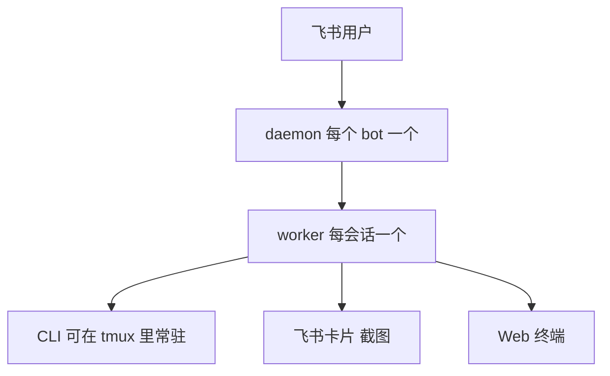
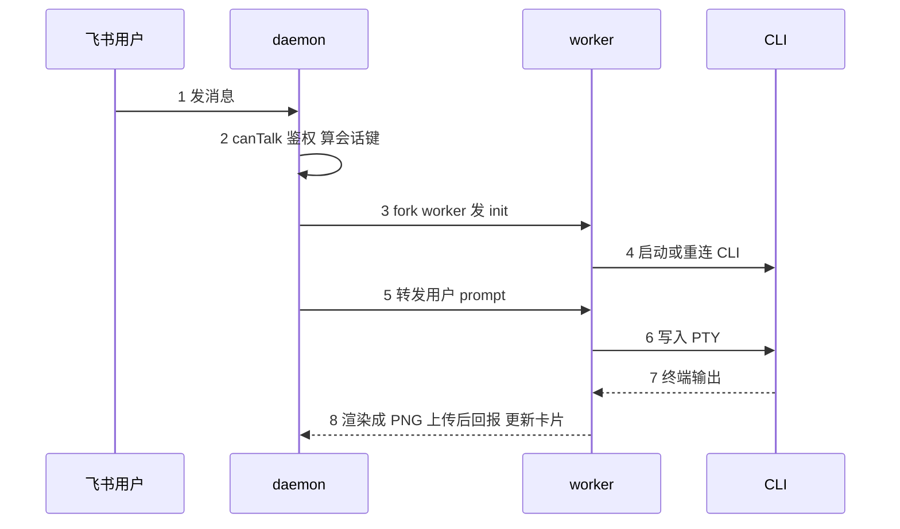
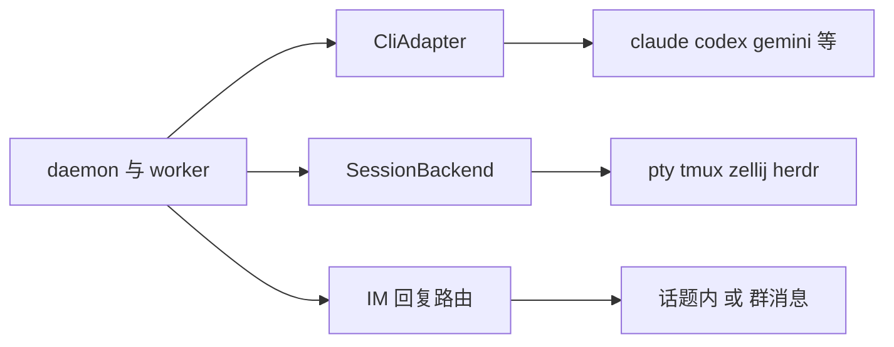
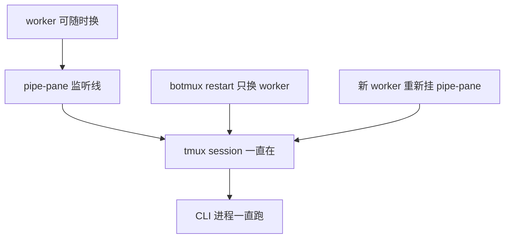
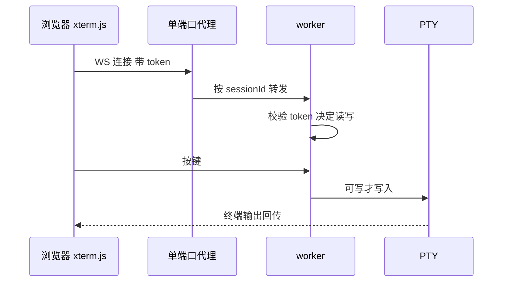
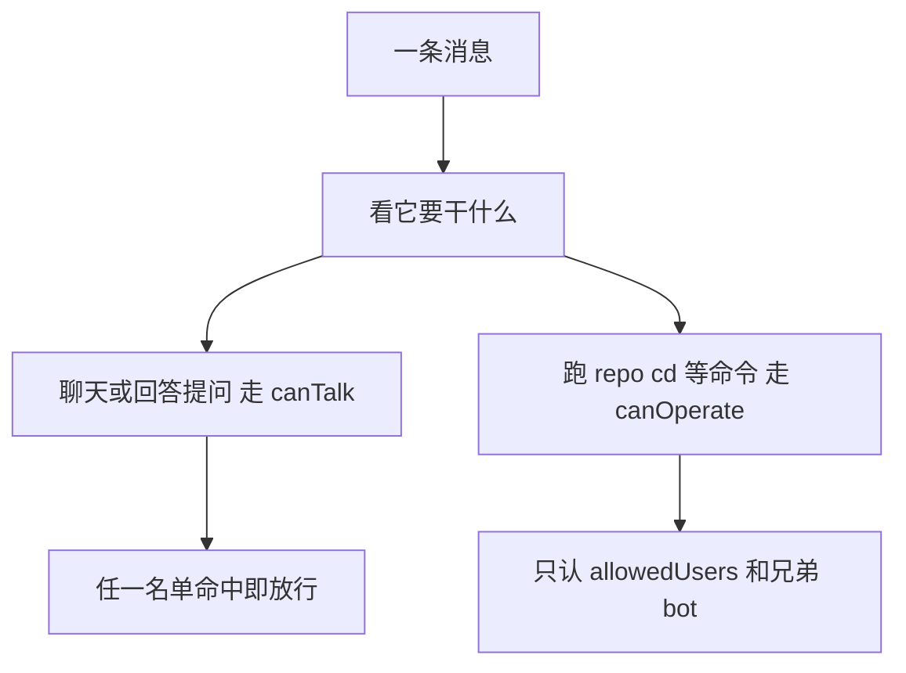
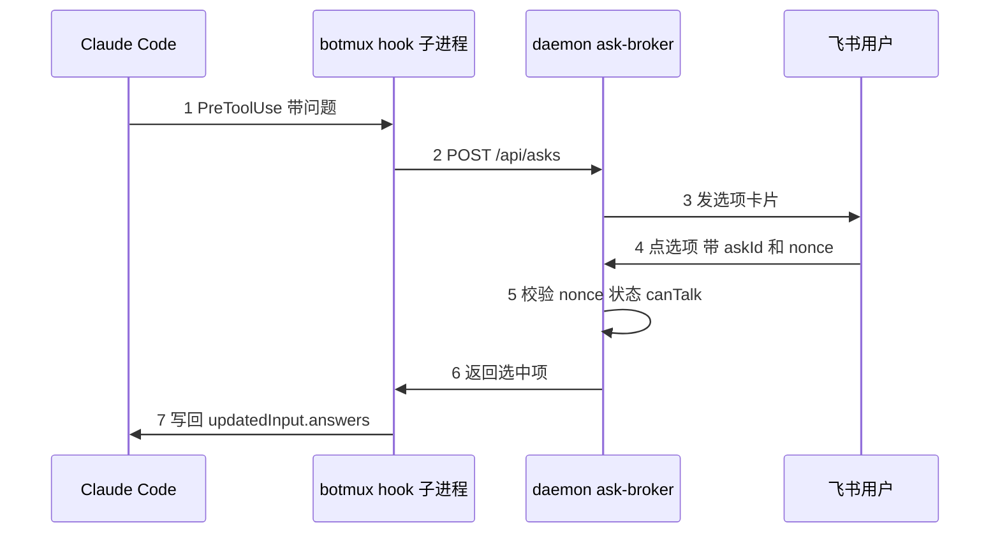

## 1. botmux

[botmux](https://github.com/deepcoldy/botmux) 是一个常驻 daemon。它监听飞书 / Lark 的消息，为每个会话拉起一个 AI 编程 CLI 进程（Claude Code、Codex、Cursor、Gemini、OpenCode、Antigravity、GitHub Copilot 等），把 CLI 的终端画面渲染成图片推到飞书卡片上，同时给每个会话开一个可交互的 Web 终端。

它的定位写在 README 第一句：**不做 SDK wrapper，直接桥接 CLI 进程**。记忆、上下文、工具调用、权限这些能力由 CLI 自己迭代，botmux 不重造，只在 CLI 之上做编排；CLI 升级，botmux 不用改。所以它几乎不碰 agent 能力，要解决的是进程编排、终端画面投影和多人权限这些纯工程问题。

设想周五晚上你已经离开工位，线上服务报警，手头只有手机。你在飞书里发一句“看下 order-service 最近的 5xx，先别改代码”，服务器上的 `claude` 就在仓库目录里跑起来，分析过程一帧一帧出现在卡片上。它拿不准先查哪个 pod 时，会弹一张选项卡片问你。等你决定动手，点开一个链接，手机浏览器里就是那个 `claude` 的完整终端。

把这件事做出来，要解决四个问题，对应本章的四个模块：

1. **三根变化轴各自隔离**。接 7 种以上 CLI、3 种终端后端，还可能换 IM。每一种差异做成一个接口加一张注册表，核心逻辑不受污染。
2. **编排进程重启，子进程不死**。CLI 托管在 tmux 里常驻，daemon 重启后逐个探测，存活的分批重新接管。
3. **把终端画面投到手机上**。CLI 是全屏重绘的 TUI 程序，项目用无头 xterm 把它渲染成图片推送，另开一个 Web 终端，读和写按 token 分开。
4. **对话和操作分成两道闸**。能跟机器人说话的人，不一定能让它改工作目录，也不一定能替它在终端里按键。

对照源码：

```bash
cd _references && git clone https://github.com/deepcoldy/botmux.git
cd botmux && git checkout v2.93.1
```

路径都从仓库根算起。项目以 TypeScript 为主，核心文件偏大：`worker.ts` 5580 行，`daemon.ts` 3998 行。本文基于 tag `v2.93.1`（commit `1d24e82a`）。

## 2. 部署形态与 5 分钟接入

botmux 要先在飞书开放平台建一个应用，再以 daemon 形态常驻。所以对它来说，5 分钟跑起来其实是 5 分钟接入飞书。

前置条件：

- Node.js ≥ 22。
- 本地装好并登录至少一种 AI 编程 CLI（`claude`、`codex`、`gemini` 等在 PATH 中），botmux 只桥接，不自带。
- 推荐装 tmux（终端复用器，能让终端里的程序在断开连接后继续跑）。装了它，botmux 自动启用会话常驻，见 4.2。
- CJK 字体。截图要渲染中文，精简的 Linux 镜像常常没装；botmux 启动时检测到缺字体，会在后台 `apt-get install fonts-noto-cjk`（需要免密 sudo）。macOS 自带，不用管。

```bash
npm install -g botmux
botmux setup
botmux start
```

`botmux setup` 是交互式向导，要扫两次码：

- 第一次走飞书官方 device flow（底层 `@larksuiteoapi/node-sdk`），自动建出一个应用，落盘 AppID / AppSecret，事件订阅和机器人能力默认配好。
- 第二次让 botmux 以你的身份完成开放平台的配置：导入权限、配重定向 URL、提交发布版本。这一步失败不阻塞，会打印手动步骤。

向导里还会让你选这个机器人接哪种 CLI、默认工作目录是哪。确认能正常收发后，跑一次 `botmux autostart enable` 设为开机自启。

然后在飞书建一个话题群，把机器人拉进去：

1. 发消息开新话题，机器人弹出仓库选择卡片，选一个项目。
2. CLI 在该目录下启动，话题里出现一张实时刷新的终端卡片。
3. 卡片上能直接点 Esc、Ctrl+C、方向键；点“获取操作链接”会私聊给你一个可写的 Web 终端地址。
4. 每轮对话一张新卡片，上一轮冻结存档。

同一台机器还能跑多个机器人，各接一种 CLI。同群里 `@<bot1> @<bot2> /t 任务` 会让两个机器人各起一个会话并行干活，靠的是 4.1 节讲的复合会话键。

只想读源码、不接飞书也可以，后面的结论都锁定到了文件和行号。

## 3. 全景架构

botmux 运行时有三类进程：daemon 每个机器人一个，负责接飞书事件和管理会话；worker 每个会话一个，负责驱动 CLI；CLI 是真正干活的外部程序。手机上看到的截图和网页终端，都是 worker 从 CLI 引出来的。



图 5-1：botmux 的三类进程

一条消息从进来到画面回到手机，经过这几步：



图 5-2：一条消息的往返

worker 独立成进程，而不是在 daemon 里开协程跑 CLI，有三个原因：

- **隔离崩溃**：CLI 卡死或内存溢出，拖垮的只是一个 worker，daemon 只收到一个 `exit` 事件。
- **独占资源**：每个 worker 要给自己的 CLI 开一根 PTY（伪终端，操作系统伪造的键盘加屏幕，程序以为对面是真人），还要起一个 Web 终端服务。
- **独立环境变量**：每个机器人可以有自己的 env（比如第三方模型端点），按进程注入，进程边界就是隔离边界。

代价是进程间只能传可序列化的消息。daemon 和 worker 之间走 Node `fork` 自带的 IPC，消息定义成两个判别联合类型（`src/types.ts:272` 起），两端各用一个 `switch (msg.type)` 分发：

```ts
type DaemonToWorker =
  | { type: 'init'; sessionId: string; cliId: string; /* …共 44 个字段 */ }
  | { type: 'message'; content: string }       // 用户后续消息
  | { type: 'term_action'; key: TermActionKey } // 卡片上的键盘按钮
  | { type: 'close' } /* … */;

type WorkerToDaemon =
  | { type: 'ready'; port: number; token: string }                          // Web 终端起好了
  | { type: 'screen_update'; content: string; status: ScreenStatus }        // 状态变化
  | { type: 'screenshot_uploaded'; imageKey: string; status: ScreenStatus } // 新截图
  | { type: 'tui_prompt'; options: Array<…> } /* … */;                       // CLI 弹了菜单
```

`init` 一条消息带了 44 个字段：worker 刚 fork 出来什么都不知道，启动需要的一切都靠它带过去。

表 5-1 是贯穿全项目的五个抽象。

| 抽象 | 位置 | 职责 |
|---|---|---|
| `DaemonSession` | `src/core/types.ts:30` | 一个会话的全部状态 |
| `CliAdapter` | `src/adapters/cli/types.ts` | 一种 CLI 的全部差异 |
| `SessionBackend` | `src/adapters/backend/types.ts:34` | CLI 跑在哪、输入输出怎么走 |
| `WorkerPool` | `src/core/worker-pool.ts` | worker 生命周期和卡片合并写 |
| `canTalk` / `canOperate` | `src/im/lark/event-dispatcher.ts:843`、`:881` | 两道权限闸 |

## 4. 核心模块

### 4.1 CLI、终端后端、IM 各一根变化轴

botmux 要应付三类互相独立的差异：接的是哪种 CLI，CLI 跑在哪种终端里，消息来自哪个 IM。它给每一类定义一个接口、配一张注册表，daemon 和 worker 只和接口打交道。

#### 七种 CLI 各有各的脾气

Claude Code 的就绪信号是一个 SessionStart hook；Codex 有自己的消息队列，支持提前输入；Gemini 可以把首轮 prompt 直接塞进 `-i` 参数；有的 CLI 提交输入要回车，有的不用。CLI 进程可以跑在裸 PTY、tmux、zellij 里，也可以是远程执行服务。IM 今天是飞书，明天可能是 Lark 国际版。

不做隔离，这些差异会以 `if (cliId === 'claude') … else if …` 的形式渗进 daemon 的每个角落。

隔离的常见做法有两种：

| 做法 | 代价 |
|---|---|
| 插件式，运行时发现和加载（像 ESLint plugin） | 要维护插件协议、版本兼容、加载顺序，对自用工具过重 |
| 编译期接口 + 静态注册表，一种实现一个文件 | 加新实现要改注册表那一个文件 |

botmux 选第二种。

三根轴在代码里是这样落地的（图 5-3）：



图 5-3：三根变化轴各一个接口

- **CLI 轴**（`src/adapters/cli/`）：`CliAdapter` 把每种 CLI 的启动参数、输入写法、就绪判断收成方法和属性。
- **后端轴**（`src/adapters/backend/`）：`SessionBackend` 把“进程跑在哪”抽象成 `spawn / write / resize / onData / onExit / kill`。
- **IM 轴**（`src/im/lark/`）：`DaemonSession.scope` 把回复路由收成 `thread`（话题内回复）和 `chat`（普通群消息）两种。

#### 注册表工厂和 claude-code 的 buildArgs

注册表是一个按 id 分发的工厂函数（`src/adapters/cli/registry.ts:111`）：

```ts
switch (id.toLowerCase() as CliId) {
  case 'claude-code': return createClaudeCodeAdapter(pathOverride);
  case 'codex':       return createCodexAdapter(pathOverride);
  case 'gemini':      return createGeminiAdapter(pathOverride);
  // … 共 18 个 case，每个对应一个 adapter 文件
  default: throw new Error(`Unknown CLI adapter: ${id}`);
}
```

`id` 先被断言成 `CliId` 联合类型。新增一种 CLI 要先往 `CliId` 里加成员，TypeScript 才允许在 switch 里加对应的 case，这个联合类型就成了一份待实现清单。项目的 CLAUDE.md 把新增 CLI 写成 8 步 checklist，每一步都是机械的局部改动。

具体 adapter 负责把接口字段翻译成真实命令行。claude-code 的实现（`src/adapters/cli/claude-code.ts:492`）：

```ts
buildArgs({ sessionId, resume, resumeSessionId, model, disableCliBypass, skillPluginDir }) {
  const args: string[] = [];
  if (resume) args.push('--resume', resumeSessionId ?? sessionId);   // 续接
  else        args.push('--session-id', sessionId);                  // 新建
  if (model?.trim())     args.push('--model', model.trim());
  if (!disableCliBypass) args.push('--dangerously-skip-permissions'); // 默认绕过审批
  // … 进程级 --settings 与 --plugin-dir …
  args.push('--append-system-prompt', buildBotmuxSystemPromptText({ locale, botName, botOpenId }));
  return args;
}
```

worker 只传一个 `resume` 布尔，这个 CLI 用什么 flag 表达续接由 adapter 决定。`disableCliBypass` 把“要不要绕过审批”收成接口的一个入参。

接口也会承认能力缺失。`buildResumeCommand` 返回 `string | null`：opencode、Gemini 只能 resume 最近一个会话，没法按 id 精确续接，就返回 `null`，卡片退回静态提示。

同样的思路还用在命令分发上（`command-handler.ts`）。一条消息先判断是不是 CLI 自己的斜杠命令（`/model`、`/clear`，原样透传），再判断是不是 botmux 的命令（`/repo`、`/relay`），都不是就当普通消息。透传集合是内置、adapter 默认、机器人自定义三份的并集（`command-handler.ts:115`），透传排在 botmux 命令之前，这样 CLI 自带的 `/status` 不会被同名命令吃掉。

#### 复合会话键：同一个话题里的多个机器人

daemon 在内存里用 `Map<string, DaemonSession>` 存会话，键由两部分拼成（`src/core/types.ts:171`）：

```ts
export function sessionKey(anchorId: string, larkAppId: string): string {
  return `${anchorId}::${larkAppId}`;
}
```

`anchorId` 在话题模式下是话题根消息 id（`om_` 开头），在群模式下是群 id（`oc_` 开头），两种前缀不会撞。再加上 `larkAppId`，同一个话题里的多个机器人就各自持有独立会话。多机器人同群协作靠的就是这个函数。

每个机器人是 `bots.json` 里的一条记录，以 `larkAppId` 为主键，各自配 `cliId`、`model`、`backendType`、`workingDir`、`allowedUsers` 和一套 `env`。给 bot B 填 `ANTHROPIC_BASE_URL` 和 key，它就能跑第三方模型，和跑官方 Claude 的 bot A 共存。tmux 后端把 env 注入到每个 pane 的启动命令里，不写进 tmux server 的全局环境，两个 bot 的配置不会串。

#### 表还是接口

这个模块的核心取舍是静态注册表还是插件系统。botmux 选静态，换来类型安全和简单，放弃了第三方热插拔。

决定用接口而不用配置表，看的是差异的性质。claude-code-router 这类路由层面对的是 N 个 provider 的协议差异，端点、鉴权头、字段映射都是数据，一张配置表就能描述。botmux 面对的是 N 个 CLI 的行为差异，怎么拼参数、怎么写输入、怎么判就绪，只能写成代码。

判断的尺子是：**差异是数据就用表，差异是行为就用接口**。把行为硬塞进配置表，会得到带回调字符串和条件字段的畸形表；把数据写成接口，会得到一堆只返回常量的样板实现。

按这把尺子写一个最小的 CLI 轴：

```ts
interface CliAdapter {
  id: string;
  buildArgs(o: { sessionId: string; resume: boolean }): string[];
  writeInput(write: (s: string) => void, content: string): void;
}

const claudeCode: CliAdapter = {
  id: 'claude-code',
  buildArgs: (o) => (o.resume ? ['--resume', o.sessionId] : ['--session-id', o.sessionId]),
  writeInput: (write, c) => write(c + '\r'),
};
const codex: CliAdapter = {
  id: 'codex',
  buildArgs: (o) => (o.resume ? ['resume', o.sessionId] : []),
  writeInput: (write, c) => write(c + '\n'),
};

type CliId = 'claude-code' | 'codex';        // 加一种 CLI 先在这里加成员
function createCliAdapter(id: CliId): CliAdapter {
  switch (id) {
    case 'claude-code': return claudeCode;
    case 'codex': return codex;
    default: {
      const unreachable: never = id;         // 漏写 case 时这里编译报错
      throw new Error(`unknown cli: ${unreachable}`);
    }
  }
}
```

这段在 Bun 下跑过，也过了 `tsc --strict`。后端轴照同样的结构写：`interface SessionBackend { spawn; write; onData; kill }` 加一个按 `backendType` 分发的工厂。

### 4.2 daemon 重启，CLI 不死

daemon 经常重启：改了代码要 `botmux restart`，升级也要重启。服务器上可能同时有几十个 CLI 会话，有的干到一半。重启要是把它们全杀掉，每次升级都等于让所有人的活白干。

所以要同时做到两件事：daemon 重启时 CLI 进程继续活着；daemon 起来后能找回有哪些会话、各自跑到哪、卡片在哪条消息上。

#### 保活交给谁

| 做法 | 问题 |
|---|---|
| 存下全部状态，重启后整盘恢复 | CLI 的对话上下文在它自己的内存里，存不出来，只能 `--resume` 从磁盘冷加载 |
| 每个会话跑成一个 systemd service | 进程活了，但 daemon 和 CLI 之间的 PTY 随 daemon 消失，重新接管还得自己做 |
| 把 CLI 跑进 tmux / zellij | 复用器是独立的 server 进程，保活和输入输出通道一起给了；代价是依赖系统装了 tmux |

botmux 以第三种为主路径，第一种兜底：有 tmux 时进程真常驻、热重连；没有时退到 `PtyBackend` 加 `--resume` 冷恢复。

tmux-resurrect、mosh 这类工具也在做终端保活，但它们面向人：手动 attach、断线重连。botmux 要的是程序化地观察和写入，用的是 `pipe-pane`、`send-keys`、`capture-pane` 这类适合程序驱动的命令。

#### 编排进程不持有终端

tmux 会话名由会话 id 推出来，不用另存映射表：

```ts
// src/adapters/backend/tmux-backend.ts:70
static sessionName(sessionId: string): string {
  return `bmx-${sessionId.slice(0, 8)}`;
}
```

worker 启动时，后端选择器先探测同名 session 在不在（`session-backend-selector.ts:58-73`）。两种情况用的都是 `TmuxPipeBackend`：

- **不在**：`tmux new-session -d` 建一个 detached session，把 CLI 跑进去（`tmux-pipe-backend.ts:564`）。
- **在**：说明 CLI 还活着，什么都不重建，直接挂上观察。

观察的方式写在文件头注释里（`tmux-pipe-backend.ts:9`）：

```
- mkfifo 建一个唯一的 fifo
- tmux pipe-pane -O -t <pane> 'cat > <fifo>'   把 pane 的每个字节复制进 fifo
- fs.createReadStream(<fifo>) 读这条 ANSI 流
- 写入走 tmux send-keys / paste-buffer，capture-pane 取当前屏
```

worker 自始至终不 attach 这个 session，手里也没有 CLI 的终端。可以把 tmux session 想成一间一直亮着灯、有人在干活的房间，worker 只是在墙上接了一根监听线。worker 走了，线断了，屋里照样干活；新 worker 来了，重新接一根就行。



图 5-4：重启只换掉监听线

所以 `botmux restart` 不打断任何会话：daemon 和 worker 全换一遍，CLI 一个没死。只有 `/close` 才真正结束 tmux session。仓库里还留着一个用 `attach-session` 的 `TmuxBackend`，现在只有它的命名、探测等静态方法还在被复用，选择器已经不再创建它。

不 attach 还有一个原因：`/adopt` 接管用户自己的 tmux 时，用户那边可能正开着 iTerm2 的 `-CC` 控制模式客户端，再 attach 一个会让画面错乱。`pipe-pane` 对 tmux 来说是零侵入的单向观察。

命名也用来区分状态。CLI 启动失败时，botmux 把现场改名成 `bmx-diag-<id>` 留着排查（`tmux-backend.ts:82`）。失败的 pane 如果还叫 `bmx-<id>`，下次探测会以为 CLI 还活着，挂上去才发现是个空 shell。

fifo 有一个通用的坑：读端不读，写端 `cat > fifo` 就会阻塞，反压回 tmux，把 pane 里 CLI 的输出也卡住。botmux 的处理有两点：

- 用 `O_RDWR` 打开 fifo，自己同时持有读写两端，谁先 open 都不会卡在等对方。
- 用一个一直在读的 `createReadStream`，加一个处理多字节字符跨 64KB 边界的解码器。

自己仿的时候守住一条：fifo 的读端必须一直读，读出来的数据别在主路径上做重活。

`/adopt` 能接管一个不是 botmux 起的 CLI，比如你在 iTerm2 里开到一半的 `claude`。难点在认出 pane 里跑的是哪种 CLI：Linux 上读 `/proc/<pid>/cmdline`，macOS 退到 `ps`，再按进程名映射到 `CliId`（`src/core/session-discovery.ts`）。zellij 不暴露 pane 的 pid，只能按 `(cliId, cwd)` 两边匹配，匹配到 0 个或多于 1 个进程都不接。

#### 重启后逐个探测，拿不准就不关

daemon 重启后，`restoreActiveSessions()`（`session-manager.ts:695`）从磁盘读出所有活跃会话。adopt 会话先确认外部 pane 还活着；排队中、从没起过 CLI 的会话只登记，绝不能走通用恢复分支，否则下一条消息会去 `--resume` 一个不存在的 CLI 会话。

其余会话按后端分两种。pty 后端没有东西可重连，只建好会话对象，等下一条消息来了再冷恢复。tmux、zellij、herdr 这类常驻后端则逐个探测，结果分成这几种（`session-manager.ts:876-944`）：

| 探测结果 | 处理 |
|---|---|
| 在，CLI 配置没变 | 排队，稍后重新接管 |
| 在，但 bot 已经换了 CLI | 杀掉旧 session；重连会让旧 CLI 复活 |
| 不在，会话被计数回收过 | 留着，下一条消息冷恢复 |
| 不在，整个 tmux server 都不在 | 多半是宿主机重启，留着，下一条消息冷恢复 |
| 不在，server 还在 | 只有它没了，当僵尸关掉 |
| 探测失败或超时 | 不下结论，留着 |

“不在”要分三种看，是踩过坑的结果。源码注释记着：早先把 server 整体不在也当僵尸处理，一次宿主机重启就把整个 dashboard 的会话全关了。探测失败同理，一次瞬时超时不能换来永久关闭。

排队的会话由 `staggeredRecoveryFork`（`session-manager.ts:680`）分批重新 fork worker，默认 5 个一批、间隔 250ms，几十个会话存活时不会一起拉起。已经被真实消息提前唤醒的会话会跳过，免得把正在跑的 worker 杀掉重来。

`examples/05-botmux/keeper.ts` 是这一套的最小实现：detached 启动、原子落盘、分类、分批接管，在真实 tmux 上跑过。

会话状态落在 `~/.botmux/sessions-<larkAppId>.json`，写入走临时文件加 `renameSync` 原子替换；内容和磁盘上一样就跳过（`session-store.ts:110`）。处理一条消息会触发好几次 `updateSession`，这一步挡掉了大部分重复写盘。

#### 从黑盒输出判断空闲

会话数量靠计数回收，不靠超时。`idle-worker-sweeper.ts:13` 给每个 bot 设 `maxLiveWorkers`（默认 30），超了就挑最久没活动、而且处于空闲的会话挂起。它不打断进行中的轮次；按空闲 N 分钟回收的做法，会误杀正在思考、暂时没输出的 agent。

挂起会连 tmux session 和里面的 CLI 一起销毁，因为占内存的是 CLI，只退 worker 等于没回收（`worker.ts:5458-5476`）。daemon 给这个会话打上 `suspendedColdResume` 标记（`worker-pool.ts:1105-1106`），下一条消息来了用 `--resume` 从磁盘记录冷恢复；上面那张表里“被计数回收过”的那一行，认的就是这个标记。sweeper 文件头的注释还写着 CLI 会在后台继续跑，那是旧行为，读源码时以 worker 里的实现为准。

问题是 CLI 不会报告自己忙不忙，botmux 只能从 PTY 输出反推（`idle-detector.ts`），三条判据叠加：

- adapter 提供的 `completionPattern`（输入框就绪的特征正则）命中后，再静默 500ms，判为空闲；
- PTY 静默 2 秒，且 3 秒内没出现过 spinner（转圈动画）；
- spinner 一出现就重置计时，避免把“还在思考”误判成空闲。

这个判断同时决定卡片头部的颜色、要不要发最终输出、回收时能不能动这个会话。桥接任何不报告状态的外部程序，都得做类似的事。

探活本身也要去抖。tmux / zellij 探活在高负载下偶尔超时，`liveness-gate.ts` 要求连续多次失败才判死，任何一次成功就清零。

后端有四种，能力差别如下（`adapters/backend/types.ts:1`）：

| 后端 | daemon 重启时 | 适用 |
|---|---|---|
| `pty` | CLI 随 worker 退出，只能冷 `--resume` | 没装 tmux 的环境 |
| `tmux` | 热重连，上下文不丢 | 默认，装了 tmux 自动启用 |
| `zellij` | 热重连 | 偏好 zellij 的用户 |
| `herdr` | 由远程执行服务保活 | 远程后端 |

四种都实现同一个 `SessionBackend` 接口，上层不感知自己跑在哪种后端上。

### 4.3 终端画面投到手机

CLI 的终端画面用一个不接显示器的 xterm 在内存里算好，画成 PNG 定时推到飞书卡片；想动手时，另开一个 xterm.js 网页终端连回去，读和写按 token 分开。

#### 三条投影路线

Claude Code 这类 CLI 是 TUI 程序（全屏终端界面，靠光标控制序列原地重绘，像 `top`、`vim`）。输出直接贴进 IM 是一屏乱码，去掉转义贴纯文本又丢了布局。

| 做法 | 问题 |
|---|---|
| 去掉 ANSI 转义，发文本 | 方框、表格、进度条全乱，重绘界面没法看 |
| 录成 asciinema 事后回放 | 不是实时，IM 里也放不了播放器 |
| 无头渲染成图片，定时推送 | 要自己处理字体，还要控制推送频率，别打爆 IM 接口 |

botmux 用第三种做卡片，再加一个 ttyd 式的 Web 终端（把终端通过 WebSocket 暴露成网页），两者共享同一个 PTY 数据源。依赖只有 `@xterm/headless`、`@napi-rs/canvas`、`node-pty`、`ws` 四个，没有 puppeteer、sharp、electron。不用 headless 浏览器截图，是因为要画的是一张规整的等宽网格，逐格画比拉起一个 Chromium 轻，也更可控；要渲染的是任意 HTML，结论就反过来。

#### 字体链的顺序

渲染在 `src/utils/screenshot-renderer.ts`。`captureToPng()`（`:215`）遍历 `@xterm/headless` 的屏幕缓冲区，用 `@napi-rs/canvas`（skia 的 Node 原生绑定）逐格画成 PNG，格宽 8.4px、格高 18px。

这里最容易出错的是字体链顺序。skia 在 Linux 上不会自动发现系统字体，要 `GlobalFonts.registerFromPath()` 显式注册，并且会按链的顺序逐字符找含该字形的字体。源码注释记下了踩过的坑（`screenshot-renderer.ts:42` 一带）：

```ts
// ── fontFamilyChain 顺序很关键 ──
// skia 按 chain 顺序逐字符找含该 glyph 的字体。Latin 必须放在 CJK 前面，
// 否则 CJK 字体自带的 ASCII glyph 会先抢走拉丁字符的渲染权，
// 宽度跟 cell grid 不匹配 → 截图里英文字符间距时疏时密。
// 顺序：BotmuxMono → Latin mono → CJK mono → Color emoji。
```

直觉上会把覆盖最全的 CJK 字体放前面，这恰好是错的。正确顺序是拉丁等宽字体在前、占住 ASCII，CJK 只补汉字，emoji 最后。顺序装反，英文间距会乱；没注册 CJK，中文是方块。

字体从哪来也要管。候选路径第一位是 `~/.botmux/fonts/`（`screenshot-renderer.ts:48`），`botmux setup` 会把 Noto CJK、JetBrains Mono 下载到这里；每一档都列了 Linux 和 macOS 的候选路径，逐个尝试注册。要在陌生服务器上出图的工具，得把渲染资源缺失当成常态处理。

#### 10 秒一帧，三步削减请求

worker 用一个 10 秒定时器截图（`src/worker.ts:2429`）。从 CLI 输出到手机刷新的管线如图 5-5：


图 5-5：截图推送管线

三步依次削掉多余请求：

- **节流**：10 秒一帧。用户点了卡片按钮，会在 1 秒后补一张，给即时反馈。
- **去重**：PNG 的 MD5 和上一张相同就不上传。
- **合并写**：飞书卡片 PATCH 还在途时，新内容排队，只保留最新一份，在途请求完成后再发（`worker-pool.ts` 的 `scheduleCardPatch`）。

回传消息也分轻重两种。`screen_update`（`src/types.ts:311`）只带文本和状态，状态一变就发，用来更新卡片头部颜色；`screenshot_uploaded`（`:315`）要先渲染上传，成本高。`displayMode` 默认是 `hidden`，用户点了“显示输出”，worker 才开始渲染图片。

`tui_prompt`（`:313`）是第三种回传。worker 的屏幕分析器检测到 CLI 弹出了选择菜单，就把选项结构化后发给 daemon，渲染成可点的卡片；用户选中后，结果作为方向键和回车送回 CLI。这等于替 CLI 按键，要过 `canOperate`，见 4.4 节。

#### 写回 PTY：卡片按键和 Web 终端

反向操作有两个入口。

**卡片键盘按钮**。截图模式下卡片底部有一排按键（`card-builder.ts:776`）：Esc、Ctrl+C、方向键、翻页。点击后 `card-handler.ts:1683` 把 `{ type: 'term_action', key }` 发给 worker，worker 转成 ANSI 字节写进 PTY。

**Web 终端**。worker 内嵌一个单页 HTML（`worker.ts` 4817 行起），前端是 xterm.js，通过 WebSocket 连回 worker。可写链接带 `?token=<writeToken>`，握手校验通过的连接才能写；只读连接只放行鼠标滚轮序列，让你能翻屏看历史。一个源广播给所有连接、写回按 token 放行，这一套的最小实现在 `examples/05-botmux/web-term.ts`。



图 5-6：Web 终端的写回链路

所有会话的 Web 终端都挂在一个端口后面（`core/terminal-proxy.ts`）：`/s/<sessionId>/...` 解析出会话，转发到对应 worker 的端口。SSH 端口转发只需要转一个端口，访问到睡着的会话时还能顺手唤醒 worker。代价是多一跳转发，代理自己成了单点。ttyd 是一个终端一个端口，只有一个终端、本地访问时，这种直连更简单。

手机上翻屏有两套实现。Claude 这类用了 alt-screen（全屏程序专用的备用屏幕，没有滚动缓冲）的 CLI，手指上下滑会被转成鼠标滚轮事件发给 CLI，让它自己重绘历史；普通 CLI 则用 xterm 自带的 `scrollLines`。

#### 自己渲染时的三个坑

写一个 PTY → headless xterm → PNG 的最小管线不难，难在内层循环。下面是示意代码，省略了取色函数 `toCss` 和光标：

```ts
for (let r = 0; r < rows; r++) {
  const line = term.buffer.active.getLine(r); if (!line) continue;
  for (let c = 0; c < cols; c++) {
    const cell = line.getCell(c); if (!cell) continue;
    const w = cell.getWidth();
    if (w === 0) continue;                 // 宽字符的尾格，前一格已画过
    const x = PAD + c * CELL_W, y = PAD + r * CELL_H;
    if (cell.getBgColor() >= 0) {          // 背景按字符宽度画
      ctx.fillStyle = toCss(cell, 'bg'); ctx.fillRect(x, y, CELL_W * w, CELL_H);
    }
    const ch = cell.getChars(); if (!ch) continue;
    ctx.font = `${cell.isBold() ? 'bold ' : ''}14px mono, emoji`;
    ctx.fillStyle = toCss(cell, 'fg');
    ctx.fillText(ch, x, y);
  }
}
```

要自己补三件事：

- **宽字符**：一个汉字或 emoji 占两格，xterm 存成一个宽度为 2 的格加一个宽度为 0 的尾格。尾格要跳过，背景按两格宽画，漏了中文就会重叠。
- **取色**：`getFgColor()` 可能是 256 色调色板索引，也可能是 24 位 RGB，要看 `isFgRGB()` 分别转换。
- **粗体、反色、光标**：粗体换字重，反色交换前景和背景，光标在 `cursorX / cursorY` 那格画一个反色块。

`screenshot-renderer.ts` 的一百多行主要就在处理这三件事。

### 4.4 对话闸和操作闸

两个纯函数就是两道闸：`canTalk` 管能不能跟机器人说话，`canOperate` 管能不能让它改工作目录、跑管理命令。`canOperate` 放行时只认 `allowedUsers` 和同部署的兄弟 bot，对话授权名单只用来判断当前是不是 open 模式。

#### 为什么只分两档

一个群里有人，也有别的机器人。要回答的问题是分层的：谁能让机器人响应自己，谁能跑 `/repo`、`/cd`、`/relay` 这类改工作目录、搬运会话的命令，agent 停下来问“选方案 A 还是 B”时谁能回答，CLI 弹出确认菜单时谁能替它按键。

| 模型 | 问题 |
|---|---|
| 单一白名单 | 表达不了“能对话但不能操作” |
| 完整 RBAC（权限位 + 角色，像 Slack OAuth scope） | 要维护角色到权限、用户到角色两张映射，外加授权 UI 和审计，对自部署工具太重 |

botmux 只分两档：能对话、能操作。它的判断是，自部署场景的用户就是机器主人和几个同事，“能跑 `/repo` 但不能跑 `/relay`”这种粒度几乎没人需要。两档的好处是两个纯函数读完就懂全部规则；以后真需要更细的档，再加也不迟。

#### canOperate 的实现

一条消息先过哪道闸，取决于它想干什么（图 5-7）：



图 5-7：按意图选闸

`canTalk` 背后的 `evaluateTalk`（`event-dispatcher.ts:847`）按顺序检查，任一命中就放行：

1. 在 `allowedUsers` 里（owner）。
2. 是 oncall 群成员。oncall 群是 owner 用 `/oncall bind` 绑定到一个工作目录的群，群里的人发消息就在那个目录起会话。
3. 是同部署的兄弟 bot。
4. 消息来自 `allowedChatGroups` 里的群。
5. 没配任何名单，也就是 open 模式。
6. 命中 `chatGrants` 或 `globalGrants` 这类只授对话权的名单。

`canOperate` 短得多：

```ts
// src/im/lark/event-dispatcher.ts:837-841、:881-897（有删节）
function hasConfiguredAllowlist(bot): boolean {
  return (bot.config.allowedUsers?.length ?? 0) > 0
    || (bot.config.allowedChatGroups?.length ?? 0) > 0
    || (bot.config.globalGrants?.length ?? 0) > 0;
}

export function canOperate(larkAppId, _chatId, senderOpenId): boolean {
  const bot = getBot(larkAppId);
  if (isKnownPeerBot(config.session.dataDir, larkAppId, senderOpenId)) return true;
  if (!hasConfiguredAllowlist(bot)) return true;      // open 模式
  return !!senderOpenId && bot.resolvedAllowedUsers.includes(senderOpenId);
}
```

对话授权名单在这里只出现在 `hasConfiguredAllowlist` 里，不参与放行。它必须出现，这就是源码注释里说的 PR #46 堵的洞：一个 bot 如果只配了 `globalGrants`，判断时不把它算进名单，就会被当成 open 模式，`canOperate` 对所有人放行，对话授权就漏成了操作权。

还有一个细节：判断有没有名单用的是原始配置，不是解析后的 `resolvedAllowedUsers`。owner 配了邮箱但启动时解析失败，解析结果是空的；拿它判断会误入 open 模式，变成谁都能操作。用原始配置判断，解析失败时就是谁都放不进来，由 owner 去修配置。

| 身份 | 怎么识别 | 对话 | 操作 |
|---|---|---|---|
| Owner 与共同 owner | 在 `allowedUsers` 里 | 能 | 能 |
| 同部署兄弟 bot | `isKnownPeerBot()` | 能 | 能 |
| Oncall 群成员、授权群成员、被 grant 的人或 bot | oncall 绑定、授权群、grant 名单 | 能 | 不能 |
| 没被 grant 的外部 bot | 未登记 | 不能 | 不能 |

`/grant @bot` 只写进 `chatGrants`，碰不到 `allowedUsers`；`/grant`、`/revoke` 本身只有 owner 能执行。

open 模式是危险的默认值：没配白名单时 `canOperate` 直接放行，谁进群谁就能改工作目录，`/grant` 也变成空操作。注释把它标成“没有信任根”的状态。生产部署一定要配 `allowedUsers`。

#### 身份、角色、权限是三件事

权限判定以飞书的 open_id 为主体，但 open_id 是一串不可读的字符，卡片和日志里要显示成人名。`identity-cache.ts` 按成本从低到高解析，能用便宜的就不调贵的：

1. **@ 消息自带的名字**：飞书的 mention 载荷里本来就有 `(name, open_id)`，直接收下（`:147`）。
2. **消息事件的发送者信息**：自带 open_id 和类型，顺手记进缓存。
3. **通讯录 API**：前两档都没命中才调（`:215`）。应用没开通讯录权限时，飞书返回 `99991672`，代码记下“这个应用没这项权限”，之后直接显示 open_id，不再每条消息撞一次（`:229`）。

角色是另一回事。`role-resolver.ts` 按 `roles/<appId>/<chatId>.md` 给 CLI 注入人设，比如 coder、reviewer。一个人可以被设成 reviewer 角色，却根本不在 `allowedUsers` 里。你是谁、扮演什么、能干什么，分成三套机制，互不借用。

#### agent 提问走对话闸，终端按键走操作闸

agent 干到一半常会停下来问人：两个方案选哪个，要不要连测试一起改。Claude Code 里这是 `AskUserQuestion` 工具。人不在终端前，问题得搬到飞书上，这是 ask-broker 的活。

它拦的不是工具权限审批：

- botmux 默认给 Claude Code 带 `--dangerously-skip-permissions`，并在进程级 `--settings` 里设 `defaultMode: 'bypassPermissions'`，默认配置下 CLI 根本不会弹“是否允许执行”（`src/adapters/cli/claude-code.ts:502-523`）。
- 它挂的 `PreToolUse` hook 只认 `tool_name === 'AskUserQuestion'`，其他工具在解析阶段就返回 `null`（`src/core/ask-hook/claude-code.ts:69-70`）。
- 选 `PreToolUse` 而不是 `PermissionRequest`，是因为 bypass 模式下 `AskUserQuestion` 不经过权限请求（`src/adapters/hook-installer.ts:142-144` 的注释）。



图 5-8：agent 的提问怎么变成飞书卡片

hook 子进程把问题 POST 给 daemon 后阻塞等结果（`src/cli.ts` 的 `runHook`）。第 5 步有三道校验：nonce 对不上说明是旧卡片；已经答过的拒绝重复作答；最后才是身份。身份判定在 `src/core/ask-broker.ts:54`：

```ts
function isAuthorizedToAnswer(ask, by): boolean {
  return canTalkChecker?.(ask.larkAppId, ask.chatId, by) ?? false;
}
```

注释写明了理由：回答 agent 的提问和跟它说一句话性质相同，所以走 `canTalk`。`canTalkChecker` 没注入时返回 `false`，默认拒绝。

结算后，hook 输出 `{ permissionDecision: 'allow', updatedInput: { questions, answers } }`。这里的 `allow` 放行的是 `AskUserQuestion` 调用本身，答案通过 `answers` 塞回去。daemon 不可达时 hook 输出空字符串，问题退回终端原生提问（同文件 `:124-130`）；注释特别警告不能输出带空 answers 的 `allow`，那会把问题答成空。

工具权限走另一条路。某个 bot 配了 `disableCliBypass: true`（`src/bot-registry.ts:86-90`）时，CLI 会在终端里弹原生确认菜单。botmux 通过屏幕分析识别出菜单，发一张 `tui_prompt` 卡片；按钮最终往 PTY 里按键，属于敏感动作，要过 `canOperate`（`src/im/lark/card-handler.ts:1047` 的 `isSensitive` 列表）。

| 交互 | 实现 | 闸 |
|---|---|---|
| 回答 agent 的澄清提问 | hook → ask-broker | `canTalk` |
| 替 CLI 在终端里按键 | 屏幕分析 → `tui_prompt` 卡片 | `canOperate` |
| 跑 `/repo`、`/cd` 等命令 | 命令分发 | `canOperate` |

围观的同事可以回答“用方案 A 还是 B”，但不能替 agent 批准一条命令，也不能改工作目录。

#### 浏览器入口用 token

Web 终端和 Dashboard 在浏览器里打开，没有飞书身份可认，改用 token：

- **Web 终端写 token**：worker 启动时随机生成，可写链接通过 `/term` 私聊发给你，`/term` 本身要过 `canOperate`。飞书身份先换 token，token 再进网页。
- **Dashboard token**：`botmux dashboard` 生成并落盘（`dashboard.ts:99`），重启后旧链接仍可用，再跑一次命令才轮换。
- **Dashboard 调 daemon 要签名**：请求头里带用 `~/.botmux/.dashboard-secret` 对“时间戳:nonce”算的 HMAC-SHA256（`dashboard.ts:202`）。本机进程知道 daemon 的端口，不代表它能读到这份 secret；在多用户机器上，能连上本地端口不等于有权操作。

两道闸的最小实现（完整版和测试在 `examples/05-botmux/gates.ts`）：

```ts
interface BotPerm {
  allowedUsers: string[];      // owner：能对话，也能操作
  allowedChatGroups: string[]; // 这些群里的人：只能对话
  talkGrants: string[];        // 被 grant 的人或 bot：只能对话
  peerBots: Set<string>;       // 同部署的兄弟 bot：两样都能
}

const restricted = (p: BotPerm) =>   // talk 名单只在这里出现
  p.allowedUsers.length + p.allowedChatGroups.length + p.talkGrants.length > 0;

function canTalk(p: BotPerm, who: string, chatId?: string): boolean {
  if (p.allowedUsers.includes(who) || p.peerBots.has(who)) return true;
  if (chatId && p.allowedChatGroups.includes(chatId)) return true;
  if (!restricted(p)) return true;                      // open 模式
  return p.talkGrants.includes(who);
}

function canOperate(p: BotPerm, who: string): boolean {
  if (p.peerBots.has(who)) return true;
  if (!restricted(p)) return true;                      // open 模式
  return p.allowedUsers.includes(who);                  // 放行只认 owner
}
```

这段在 Bun 下跑过，也过了 `tsc --strict`。只配了 `talkGrants` 时，被 grant 的人能聊天、不能 `/repo`，陌生人两样都不行，不会退化成全开放；oncall 群成员只能对话；兄弟 bot 两样都能。回答 agent 提问直接复用 `canTalk`。

#### 让群成员支使 agent：读放开，写收口

oncall 群里人人都能让 agent 干活，就得防着它改坏真实文件。`sandbox.ts` 的模型是读全部放开、写全部隔离：

- **读**：不拦。agent 看得到整个真实文件系统，CLI 的配置、认证、项目代码原样可用，CLI 照常工作。
- **写**：改动落到一层 overlayfs（联合挂载，把改动层叠在只读的底层之上）的会话专属 upper 目录，真实文件永远不动。只有被改过的文件会复制进 upper，不用先 clone 一份项目。
- **落地**：任务做完，再把 upper 里的改动集合回真实项目。

实现上，`buildSandboxArgs`（`sandbox.ts:151`）拼出的 bwrap 命令先用 `--ro-bind / /` 把整个根目录挂成只读，再把 overlay 合并后的目录绑进来盖住工作区。想藏起来的敏感文件，每个 bot 配 `sandboxHidePaths`，用空文件只读挂载盖掉。Linux 上是 bubblewrap 加 overlayfs，macOS 走 Anthropic 的 sandbox-exec 方案。

读写都关进沙箱，CLI 连自己的配置都读不到，得一样样挂进去；只管写，实现简单得多，又正好对准要防的事：让 agent 能干活，但别毁现场。

## 5. 其他值得搬走的做法

| 做法 | botmux 里的位置 | 适用场景 |
|---|---|---|
| 进程间消息定义成判别联合，收端穷尽 `switch` | `src/types.ts` | 进程或线程间通信，改个类型编译器就报出漏处理的分支 |
| 从稳定 id 推出句柄名，不存映射表 | `bmx-<前 8 位>` | 跨进程共享句柄 |
| 重启后先分类，存活的分批接管，拿不准的不关 | `session-manager.ts` | 重启时要接管大量外部资源 |
| 在途时新内容排队，只留最新一份 | 卡片 PATCH | 高频本地状态推给限流的远端 API |
| 重启时不给每个会话补发卡片，owner 收一条私聊汇总 | `restart-report.ts` | 运维动作对终端用户无感 |
| 外部接口确认无权限就停止重试，降级显示 | `identity-cache.ts:229` | 依赖可能没开权限的第三方 API |
| 剔除用户 env 里的保留前缀和保留键 | `per-bot-env.ts:41` | 让用户填环境变量的功能 |
| 周期任务执行前先把下次时间推走 | `scheduler.ts:378` | 崩溃后不重复执行的定时任务 |

最后两条多说几句。

- **per-bot env 净化**：`BOTMUX`、`LARK_APP_` 前缀和 `CLAUDE_CONFIG_DIR`、`__OWNER_OPEN_ID` 等保留键一律丢弃（`sanitizePerBotEnv`，`:65`），否则用户配置能劫持会话身份或冒充 owner。它只防篡改，不防泄露，值仍然明文存在 `bots.json` 和进程环境里。
- **定时任务**：先推 `nextRunAt` 再执行，是最多执行一次的语义，崩溃后不会重复触发；反过来，这次失败了也不会重试。必须成功的任务要自己加重试或告警。

反面的一点：`worker.ts`、`daemon.ts` 都是几千行的单文件，Web 终端的前端 HTML 也整段内嵌在 `worker.ts` 里。读它时按函数名 `grep` 比按文件结构找快。

## 6. 适用边界与不该照搬的部分

适合的场景：你已经在重度使用某个 AI 编程 CLI，想把操作面搬到手机和飞书上，让 agent 在服务器上常驻；或者想让几个 agent 在一个群里分工协作。它面向个人和小团队自部署。

不适合的场景：

- **面向公网的多租户服务**。`bots.json` 明文存 AppSecret 和第三方 key，open 模式默认全放行，每会话一个进程在大规模下很吃资源。
- **只要一个聊天机器人**。botmux 的重量都在终端投影和进程编排上。
- **agent 能力是自研的**。botmux 的前提是有一个值得桥接的现成 CLI；没有这个前提，要看 OpenClaw 那类用 Agent SDK 重建 agent 能力的方案。代价反过来：它不桥接 CLI，换一种 CLI 等于重写。

不要照搬的几处：

- **`DaemonSession` 50 多个字段的巨型类型**。会话核心状态（身份、worker 句柄、CLI 状态）和飞书渲染状态（卡片 id、截图、菜单）揉在一个对象上，靠注释维持边界。迁移时拆成与 IM 无关的核心状态，加一个挂在 IM 适配器里的渲染状态，换 IM 时只动后者。
- **明文凭证**。要上生产，至少用 sops / age 加密配置，或接系统 keychain、云厂商的密钥管理服务，运行时再注入。
- **open 模式默认放行**。自己做时默认拒绝，显式配置信任根。

## 7. 自己写一个 mini 版的路线图

用 Node.js + TypeScript，依赖用 botmux 验证过的 node-pty、`@xterm/headless`、`@napi-rs/canvas`、ws。IM 先接 Telegram Bot API，跑通再换飞书。

| 阶段 | 做什么 | 完成后 |
|---|---|---|
| 1（2-3 天） | IM 消息 → node-pty 启动 `claude` → 输出去掉转义后回发文本 | IM 和 CLI 的最小回路 |
| 2（3-4 天） | 换成 4.3 节的截图管线：10 秒定时 + 去重 + 上传，重点调字体链 | 手机上能看终端 |
| 3（3-4 天） | 每会话一个 worker，IPC 只要 init / message / close；后端换 detached tmux，重启分类恢复（参考 `examples/05-botmux/keeper.ts`） | 多会话常驻，随时重启 |
| 4（2-3 天） | xterm.js 的 Web 终端，token 分读写（`web-term.ts`）；接上两道闸（`gates.ts`） | 完整遥控和分权 |

定时任务、dashboard、多 bot 协作、`/adopt`、zellij 都可以先砍掉，对理解四个核心做法没有增量。

最容易漏的是清理，孤儿有两类：

- **tmux session**：`/close` 时要 `tmux kill-session`。自己实现时，启动后再扫一遍 `demo-*` 这类前缀，清掉对不上任何活跃会话的。
- **worker 进程**：daemon 被硬杀时来不及收尾，worker 会被 init 接管，之后再也找不到。botmux 启动时用 `reapOrphanWorkers`（`worker-pool.ts:2834`）清理，只杀同时满足两条的进程：父进程是 init，命令行指向本安装的 worker 脚本。注释里记着一次事故：攒下了 841 个孤儿 worker，约 65 GB 内存。

## 8. 延伸阅读

- [OpenClaw](https://github.com/openclaw/openclaw)：同样是 IM 和 agent 之间的桥，但用 Agent SDK 重建能力。和 botmux 对照着读，能看到“桥接 CLI”和“基于 SDK 重造”在能力与维护成本上的差别。
- [ttyd](https://github.com/tsl0922/ttyd)：把本地终端通过 WebSocket 暴露成网页 xterm.js。它是最简形态的 Web 终端，对照能看出 botmux 多做的截图投影和 token 分权。
- [tmux](https://github.com/tmux/tmux) 手册里的 `pipe-pane` 和 `capture-pane`：4.2 节的旁路观察全靠这两个命令。
- node-pty、`@xterm/headless`、`@napi-rs/canvas` 的 README。三者分工是：node-pty 给 CLI 一个真终端并收发原始字节，`@xterm/headless` 把字节流解析成屏幕缓冲区，`@napi-rs/canvas` 把缓冲区画成 PNG。
