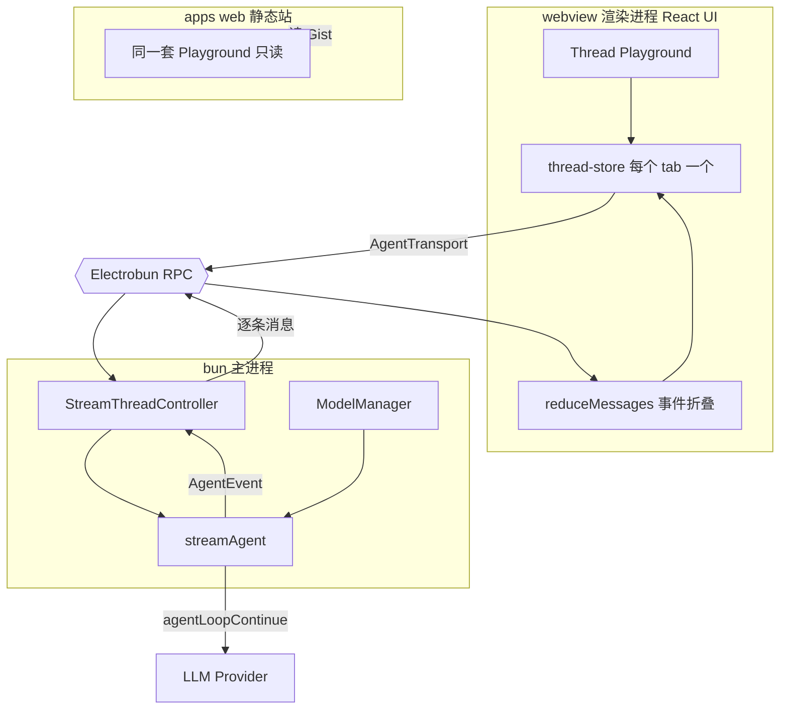
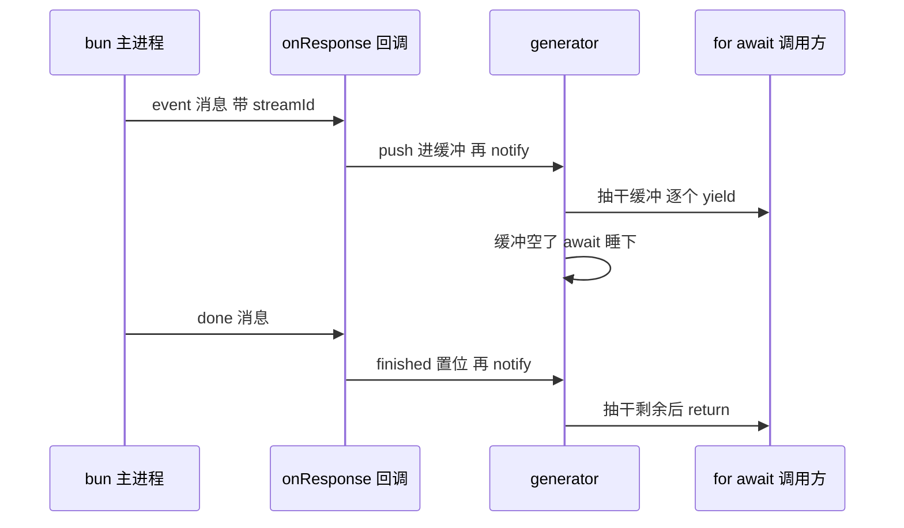
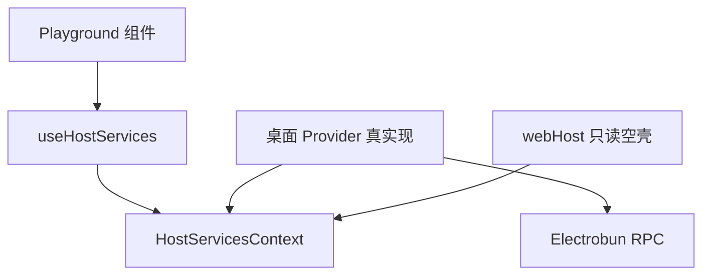
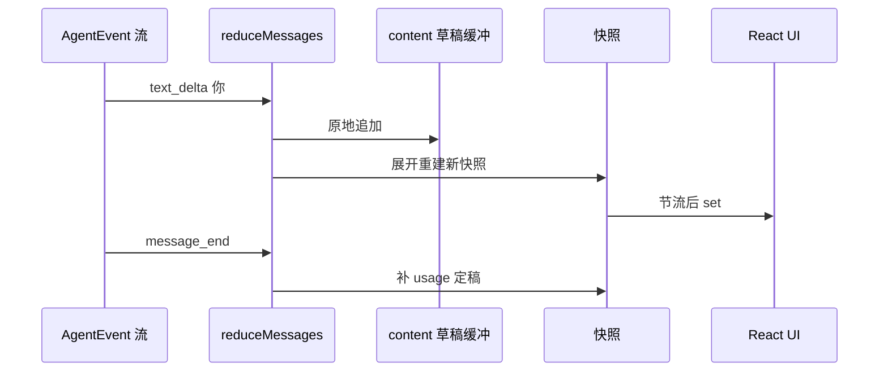
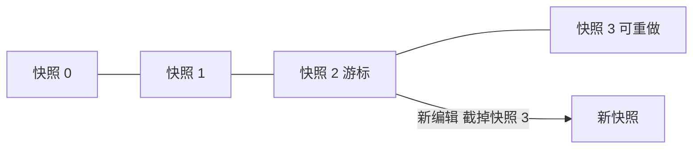
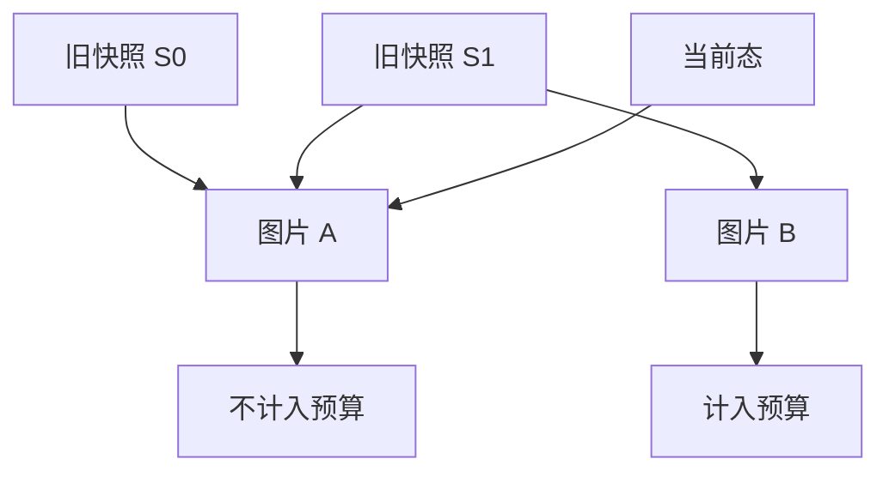

## 1. LLM Space

[LLM Space](https://github.com/deer-flow/llm-space) 是一个 macOS 桌面应用，用来搭、试、调、评一个 Agent：写 prompt 和工具，跑一轮看模型怎么反应，单步往下走，回放失败的 run，跨多次 run 打分对比。它是字节 [DeerFlow](https://github.com/bytedance/deer-flow) 的姊妹项目，DeerFlow 的版本就是用它调出来的。

它的数据单位叫 Thread：一个存盘的 `.json` 文件，记着这次实验用的模型、system prompt、工具、消息列表和 run 历史。

设想你在调一个会调工具的 Agent。发一句话，模型调错了工具，或者参数填错了。你想知道它当时收到了什么上下文，想把某条工具返回改一改看它下一步会不会就对了。用 `curl` 或 SDK 脚本做不到这些：中间态看不见，改一个变量要改代码重跑，失败的 run 没法回放。LLM Space 的做法是把 Agent 的运行时状态直接摊开给你编辑，然后一步一步往下跑。

做这样一个工作台，要解决四个和 Agent 本身无关的工程问题。实时、可交互、要存盘的前端工具都会碰到它们：

1. **把推送消息拼回一条流**。桌面 app 的两个进程之间只能发离散消息，项目把它们重新拼成一个能 `for await`、能中途取消的事件流。
2. **一套 UI 跑在两个宿主里**。同一套界面既跑在功能齐全的桌面 app 里，也跑在只读的网页里，靠的是一个注入接口，不是两份代码。
3. **把事件流折叠成消息快照**。模型一段一段往外吐，界面要的是一条条不断长大的完整消息，中间用一个纯函数折叠。
4. **copy-on-write 撤销**。每次编辑都深拷贝整个 Thread 会撑爆内存，项目让新旧快照共享没改动的部分，再按图片字节淘汰旧快照。

对照源码：

```bash
cd _references && git clone https://github.com/deer-flow/llm-space.git
cd llm-space && git checkout v4.4.5
```

路径都从仓库根算起。项目是 TypeScript 写的 Bun monorepo，核心库 `packages/core` 约 1.3 万行，桌面 app 在 `apps/desktop`，共享 UI 在 `packages/ui`。本文基于 tag `v4.4.5`（commit `8433eae`）。

## 2. 5 分钟跑起来

两种用法：装 DMG 直接用，或从源码跑。

**直接用**：从 [release 页](https://github.com/deer-flow/llm-space/releases/latest)下载 DMG，Apple Silicon 和 Intel 都有。普通版用系统 WebView，约 27 MB；Performance 版内嵌渲染引擎，约 130 MB，跨 macOS 版本渲染一致。两个版本共用 `~/.llm-space` 数据目录。

**从源码跑**（要读代码建议走这条）：

```bash
bun install          # 仓库根目录
mise run dev         # 启动桌面 app 开发模式
```

首次打开会进 onboarding。它会读 shell 环境变量里的 `OPENAI_API_KEY`、`ANTHROPIC_API_KEY` 等，自动推荐能用的 Provider：看到 `Providers detected` 点一下就加上了，看到 `Ready to run` 说明至少有一个模型可用。没检测到就点 `Configure models` 手填。

进主界面后点 `Start from Example`，第一个建议选 `General Agent`，它自带一组常用工具和 system prompt。点右上角 `Run`。

跑起来你会发现它**默认不自动执行工具**。模型返回工具调用后就停住，等你点工具卡片上的播放键执行这一个，或者点底部 `Call tools` 并行跑完所有待执行的工具，再点 `Continue` 进入下一轮。这不是 UI 层拦的：服务端给每个工具的 `execute()` 直接返回 `terminate: true`，Agent loop 看到它就停（`packages/core/src/server/agent/stream.ts:176-181`）。想自动连跑，在 `Run` 旁边的下拉里打开 `Enable ReAct loop`。

数据在 `~/.llm-space`（可用 `LLM_SPACE_HOME` 覆盖）：`workspace/` 放 Thread 文件，`settings/` 放模型、窗口、MCP 配置。Thread 文件名就是 UI 上显示的标题。

## 3. 全景架构

桌面壳用的是 Electrobun：一个跨平台桌面框架，UI 跑在系统 WebView 里，主进程跑在 Bun 上，定位类似 Electron 和 Tauri。加上一个独立的静态网站，整个项目有三个运行时：

- **bun 主进程**（`apps/desktop/src/bun/`）：原生窗口、菜单、文件系统、模型配置，以及真正打模型的 Agent 执行。
- **webview 渲染进程**（`apps/desktop/src/app` 和共享的 `packages/ui`）：React UI。它和主进程之间只有一条类型化的 RPC 通道。
- **Web 静态站**（`apps/web`）：复用同一套 `packages/ui`，只读展示别人通过 Gist 分享的 Thread，没有后端。

图 6-1 是整个系统的骨架。



图 6-1：LLM Space 的三个运行时与一次 run 的数据流

图里有两条线要记住。

第一条是**一次 run 的数据流**，从 UI 出发，跨过 RPC 到主进程打模型，再流回 UI：

1. UI 点 Run，store 调 core 的 `streamThread()`，传进去一个 `AgentTransport`。
2. 桌面端的 transport 是 `createRpcTransport()`，把请求通过 RPC 送到 bun 侧。
3. bun 侧的 `StreamThreadController.run()` 迭代 `streamAgent()`，后者驱动 pi（LLM Space 底层的轻量 Agent 框架）的 `agentLoopContinue()` 打模型。
4. 吐回来的 `AgentEvent` 经 RPC 回到渲染进程，`reduceMessages()` 折叠成消息，UI 重渲染。

第 3 步到第 4 步之间，bun 侧的 `for await` 循环把事件逐条发成 RPC 消息，渲染进程再把这些消息拼回一个可以 `for await` 的迭代器。4.1 节讲怎么拼回去，4.3 节讲拼回来的事件怎么折叠成消息。

第二条是**同一套 UI 跑在两个宿主里**。`packages/ui` 里的组件不知道自己跑在桌面还是网页，只调一个 `useHostServices()` 拿宿主能力。4.2 节讲这个接口。

表 6-1 是五个核心抽象。

| 抽象 | 是什么 | 在哪 |
|---|---|---|
| Thread | 一次实验的全部输入和 run 历史，一个 `.json` | `packages/core/src/types` |
| AgentTransport | 流式传输的接口，一个返回异步迭代器的函数 | `packages/core/src/client/transport.ts` |
| HostServices | 宿主能力的注入接口，按运行时换实现 | `packages/ui/src/host/types.ts` |
| reduceMessages | 把事件流折叠成消息快照的 reducer | `packages/core/src/client/reducer.ts` |
| thread-store | 每个打开的 Thread 一个 Zustand store，含撤销历史 | `packages/ui/src/components/thread-playground/stores/` |

Thread 是地基。剥掉细节，一个 Thread 文件长这样：

```json
{
  "title": "core-concepts",
  "model": { "provider": "openai", "id": "gpt-4.1",
             "params": { "temperature": 0.7, "maxTokens": 4096 } },
  "context": {
    "systemPrompt": "You are a helpful assistant.",
    "tools": [ { "type": "function", "name": "lookup_order", "parameters": { } } ],
    "messages": [
      { "id": "msg_1", "role": "user", "content": [ { "type": "text", "text": "查订单 A123" } ] },
      { "id": "msg_2", "role": "assistant", "content": [ ],
        "toolCalls": [ { "id": "call_1", "input": { "name": "lookup_order",
          "arguments": { "orderId": "A123" } }, "output": { "content": [ ] } } ] }
    ]
  }
}
```

一次实验的全部输入都在这一个对象里。后面两个设计都直接依赖它：4.3 节 reducer 的输出就是这里的 `messages[i]`，4.4 节的撤销快照就是整个对象的 copy-on-write 副本。真实文件还带 `runHistory`、`evaluations` 等 run 元数据，由 app 维护。

`packages/core` 按运行环境分了导出入口：`./client`、`./thread`、`./types` 可以在浏览器跑，`./server`（含 `streamAgent`、文件系统）只能在 Node 或 Bun 跑。渲染进程只 import 前者，想用后者必须走 RPC。同一个包能同时服务两端，靠的就是这层划分。

## 4. 核心模块

### 4.1 把 RPC 消息拼回一条流

Agent 的输出在 bun 主进程里逐个产生，渲染进程想用 `for await` 逐个消费。两个进程之间的 RPC 不支持流，项目在 RPC 的单向消息上自己拼出了一条。

#### RPC 只给了两种原语

Electrobun 的 RPC（底层是 `rpc-anywhere`）只提供两样东西：

- **request**：一次调用换一个响应，只能返回一次。rpc-anywhere 默认 1 秒超时，项目在 `apps/desktop/src/lib/electrobun.ts:10-13` 把它放宽到了 5 分 10 秒。
- **message**：单向发送，发出去就不管，没有响应，也没有完成信号。

一次 Agent run 要在几秒到几分钟里产出几十上百个 `AgentEvent`，中途还可能被取消。request 只能返回一次，做不了逐个推送；message 能发很多条，但每条都是孤立的，不知道属于哪次 run、流有没有结束。渲染进程那边的代码却只想写成这样：

```ts
for await (const event of transport(request, { signal })) { ... }
```

把推送源接成这种写法，常见有三种办法：

| 做法 | 代价 |
|---|---|
| 暴露 `onEvent` / `onDone` / `onError` 回调 | 调用方自己管状态、取消和清理，控制流散在回调里 |
| 用一次 request 等全部跑完再返回 | 没有流式输出，用户盯着空屏，而且会撞超时 |
| 每个事件发一条 message，接收端缓冲后交给一个 async generator | 缓冲、唤醒、终止、清理都要自己写，但写完就藏在 transport 里 |

LLM Space 用第三种。它先把接口压到只剩一个函数签名（`packages/core/src/client/transport.ts:13-16`）：

```ts
export type AgentTransport = (
  request: AgentStreamRequest,
  options: { signal?: AbortSignal }
) => AsyncIterable<AgentEvent>;
```

源码注释写明了意图：不同部署形态之间唯一的差别就是 transport，Web 版用 HTTP，桌面版用 Electrobun RPC，校验、转换、折叠都共享。Web 版的 `createHttpTransport`（`transport.ts:22-48`）直接 `fetch` 一个 SSE 端点，浏览器的流本来就是真流，不用模拟。要费功夫的是桌面版的 `createRpcTransport`。

#### createRpcTransport 的三个部件

`createRpcTransport`（`apps/desktop/src/client/rpc-transport.ts`）本身是一个 async generator，靠三个部件把离散消息拼成流。图 6-2 是一个回合：消息到达，回调把它放进缓冲并叫醒 generator，generator 把缓冲抽干，再睡下等下一条。



图 6-2：一条 RPC 消息从到达到被消费

**第一个部件是 streamId。** 渲染进程可能同时开着几个 Thread tab 在跑，回来的消息都走同一个共享监听器。每次调用先生成一个 `streamId`，发请求时带上，收消息时只认自己的（`rpc-transport.ts:34-47`）：

```ts
const onResponse = (message: StreamThreadResponsePayload) => {
  if (message.streamId !== streamId) {
    return;                        // 别的流的消息，忽略
  }
  if (message.type === "event") {
    events.push(message.event);    // 进缓冲
  } else if (message.type === "done") {
    finished = true;
  } else {
    errorMessage = message.message;
    finished = true;
  }
  notify();                        // 叫醒消费方
};
```

bun 侧也用同一个 `streamId` 索引每次 run 的 `AbortController`，取消时能精确找到那一次。

**第二个部件是 notify。** 消息从同步回调里进来，回调不能 `await`；generator 没数据时又得有个地方等。做法是让 generator 停在一个新建的 Promise 上，把它的 `resolve` 存进变量 `wake`；回调每收到一条消息就调一次 `wake()`，然后把 `wake` 清空（`rpc-transport.ts:29-32`）：

```ts
const notify = () => {
  wake?.();
  wake = null;
};
```

如果对这种写法不熟，可以这样理解：`await` 一个 Promise 会让 async generator 暂停在这一行，Promise 什么时候 resolve，它就什么时候接着往下跑。把 `resolve` 存进 `wake`，等于把“继续跑”的开关交给了回调。写过多线程的人会认出这是条件变量（没满足条件就挂起、条件满足时被唤醒的同步原语），只是这里永远只有一个等待者。

**第三个部件是缓冲和终止顺序。** 主循环如下（`rpc-transport.ts:65-95`，省略了缓冲压缩）：

```ts
while (true) {
  while (eventHead < events.length) {   // 先把缓冲抽干
    const event = events[eventHead];
    events[eventHead] = undefined;      // 置空，让 GC 回收
    eventHead += 1;
    yield event!;
  }
  if (aborted) throw ABORT_ERROR();     // 抽干之后才看终止标志
  if (errorMessage !== null) throw new Error(errorMessage);
  if (finished) return;
  await new Promise<void>((resolve) => {
    wake = resolve;                     // 睡下，等 notify
  });
}
```

注意终止标志的检查位置：aborted、error、finished 都放在缓冲抽干**之后**。`done` 消息完全可能在还有事件没消费时就到达，要是先看标志就 return，最后几个事件会被丢掉。

bun 侧是对称的：`StreamThreadController.run()` 迭代 `streamAgent`，每个事件发一条消息，跑完发 `done`，出错发 `error`（`apps/desktop/src/bun/streaming/stream-thread.ts:32-52`）。取消时 bun 侧直接 `return`，不回发终止消息，渲染端在自己的 `onAbort` 里就地结束。两端各自收尾，取消不需要多一轮握手。

#### 容易漏掉的三处

**早退时通知对端。** 调用方 `break` 出 `for await`，或者下游抛错，generator 的 `finally` 会被执行。项目在这里补发一条 `abortStreamThread`（`rpc-transport.ts:96-104`）：

```ts
} finally {
  rpc.removeMessageListener("receiveStreamThreadResponse", onResponse);
  signal?.removeEventListener("abort", onAbort);
  if (!finished) {
    rpc.send.abortStreamThread({ streamId });   // 读的人走了，让 bun 侧也停
  }
}
```

`finally` 是唯一能感知“消费方不读了”的地方。少了这一段，bun 侧会继续打模型、烧 token，去喂一个没人读的流；每次 run 还会在共享的 rpc 对象上漏一个监听器。

**不用 `shift()` 出队。** 每消费一个事件就 `shift()` 是 O(n)，长流会退化成 O(n²)。项目用 `eventHead` 游标往前走：缓冲抽空时直接把数组长度清零；游标超过 1024 且消费过的部分超过一半时，才 `slice` 压缩一次（`rpc-transport.ts:72-81`）。

**没有背压。** 背压指消费方处理不过来时，能反过来让生产方放慢。这里 bun 侧发消息不等对端确认，按 `streamAgent` 的产出速度往外推。渲染端如果消费慢，事件就在它的缓冲里堆着，没有信号让 bun 侧慢下来。Agent 事件速率低、React reducer 消费快，所以实际用起来没事；但 Node.js stream、gRPC 流都内建了背压，这里为了实现简单放弃了。

#### 通用骨架：回调源转 `for await`

去掉 streamId 和取消，这个模式可以抽成一个通用函数。任何 EventEmitter、WebSocket 的 `onmessage`、`.on('data')` 回调，套上它就能 `for await`：

```ts
function toAsyncIterable<T>(
  subscribe: (h: {
    onData: (v: T) => void;
    onEnd: () => void;
    onError: (e: Error) => void;
  }) => () => void            // 返回退订函数
): AsyncIterable<T> {
  return {
    async *[Symbol.asyncIterator]() {
      const buffer: T[] = [];
      let wake: (() => void) | null = null;
      let done = false;
      let error: Error | null = null;
      const notify = () => { wake?.(); wake = null; };

      const unsubscribe = subscribe({
        onData: (v) => { buffer.push(v); notify(); },
        onEnd: () => { done = true; notify(); },
        onError: (e) => { error = e; done = true; notify(); },
      });
      try {
        while (true) {
          while (buffer.length) yield buffer.shift()!;   // 先抽干
          if (error) throw error;                        // 再看终止
          if (done) return;
          await new Promise<void>((r) => { wake = r; });
        }
      } finally {
        unsubscribe();                                   // break 或抛错都会走到
      }
    },
  };
}
```

这段在 Bun 1.x 下跑过：同步连发三条再 `onEnd`，三条都能取到；消费方中途 `break`，退订函数会被调用。

它有两个边界要清楚：

- `subscribe` 在第一次取值时才执行。对 WebSocket 这类不等人的热源，创建 iterable 到开始 `for await` 之间到达的消息会丢，要么先订阅再交出去，要么保证立刻开始消费。
- 外部调用 `it.return()` 时，如果 generator 正停在 `await` 上，退出要等下一条数据到来才会发生；源一直不发数据，就一直不退订。这正是生产版本要接 `AbortSignal` 的原因：abort 时主动 notify，让 generator 醒来退出。

另外生产版本应把 `shift()` 换成游标。

### 4.2 同一套 UI 跑在桌面和网页

Thread Playground 是一大块 React UI，要同时跑在桌面 app 和一个 GitHub Pages 上的静态网页里。桌面端有文件系统、模型、工具执行、原生文件选择器，网页端什么都没有。项目的做法是让 UI 声明它需要哪些能力，由宿主注入实现。

#### 两个宿主注入的东西

先看结果最直观。桌面端注入的全是真实现（`apps/desktop/src/host/host-services.tsx:85` 起）：

```tsx
const value = useMemo<HostServices>(() => ({
  presentational: false,
  transport,                       // 4.1 节的 createRpcTransport()
  executeTool,                     // 通过 RPC 真执行工具
  skills: { getSettings: getSkillsSettings, listSkills },
  files: { readText: readTextFile, exists: textFileExists,
           pickFile, pickDirectory, /* … */ },
  generator: { checkUv, runUv, writeFile, /* … */ },
  actions: { /* 路由到命令总线 */ },
}), [/* … */]);
```

网页端注入的是一组只读空壳（`apps/web/src/host/web-host.ts:13` 起）：

```ts
export const webHost: HostServices = {
  presentational: true,
  transport: null,
  executeTool: null,
  skills: {
    getSettings: () => Promise.resolve({ discoveryPaths: [] }),
    listSkills: () => Promise.resolve([]),
  },
  files: {
    readText: () => Promise.resolve(""),
    exists: () => Promise.resolve(false),
    pickFile: () => Promise.resolve(null),
    /* … */
  },
  generator: null,
  actions: {
    openLink: (url) => window.open(url, "_blank", "noopener,noreferrer"),
    openSettings: () => {}, shareThread: () => {}, /* … */
  },
};
```

两份的差别：

- `presentational` 从 false 变成 true；
- `transport`、`executeTool`、`generator` 从真实现变成 `null`；
- 读操作从“走 RPC”变成返回空值；
- 导航动作变成空操作。

两个 app 各自在根组件挂 `<HostServicesProvider value={...}>`，共享 UI 只调 `useHostServices()`。

#### HostServices 接口和注入方式

接口本身（`packages/ui/src/host/types.ts:168-181`）：

```ts
export interface HostServices {
  presentational: boolean;              // 只读展示态
  transport: AgentTransport | null;
  executeTool: ExecuteTool | null;
  skills: SkillsHost;
  mcp: McpHost;
  builtinTools: BuiltinToolsHost;
  paths: PathsHost;
  files: FilesHost;
  generator: GeneratorHost | null;      // 导出成 LangGraph 项目
  actions: HostActions;
}
```

有三个字段是 `| null`，在只读宿主里它们就是 null。字段可空，组件不判空就编译不过。

注入走 React context（`packages/ui/src/host/host-services.tsx:7-36`），默认值是 `null`，在 Provider 外调用直接抛错：

```ts
const HostServicesContext = createContext<HostServices | null>(null);

export function useHostServices(): HostServices {
  const ctx = useContext(HostServicesContext);
  if (!ctx) {
    throw new Error("useHostServices must be used within a HostServicesProvider");
  }
  return ctx;
}
```

组件在错误的位置使用宿主能力时会立刻崩，不会悄悄变成空操作。图 6-3 是这条依赖关系。



图 6-3：UI 只依赖接口，两个宿主各自提供实现

`packages/ui` 的 `package.json` 不声明 Electrobun 依赖，宿主 SDK 的 import 只出现在各自 app 的适配器里。要注意这是约定，不是编译器保证：Bun workspace 会把依赖提升到根目录，UI 里真写了 `import ... from "electrobun"` 照样能解析。想让它变成硬约束，需要加 lint 规则（如 `import/no-extraneous-dependencies`）或用严格隔离的安装模式。

另外两种常见做法做不到这种隔离：

- 在组件里写 `if (isDesktop)`：UI 包要同时依赖所有宿主的 SDK，Web 打包会把桌面运行时一起拖进来。
- 用打包器的条件编译剔除代码：UI 仍然知道有几种宿主，宿主差异散落在几十个组件里。

#### 只读降级靠两层

网页端能力全缺，UI 要退化成只读。第一层是把 `presentational` 并进全局的 `readonly`（`thread-playground.tsx:214-217`）：

```ts
const { presentational } = useHostServices();
const readonly = useMemo(() =>
  readonlyFromProps || presentational || status === "running",
[readonlyFromProps, presentational, status]);
```

原本 `readonly` 拦住的编辑，只读宿主下自动一起拦住。组件也按它隐藏运行、添加、删除按钮，把模型选择器换成静态文本。

第二层是调用点判空，但只覆盖部分功能。辅助文本生成在调用前检查 `transport`，是 null 就提示“这里不可用”（`use-stream-text.ts:158-164`），导出 LangGraph 的按钮也有类似检查。主 Run 按钮则不同：它用的 transport 由宿主 app 通过 `ThreadPlayground` 的 props 传入（`thread-playground.tsx:97`），不从 `useHostServices()` 取；不传的话，core 会默认退回 HTTP transport（`packages/core/src/client/api.ts:37`）。所以网页端的主运行路径实际只靠 `presentational` 这一层挡住。

VS Code 的扩展 API 同时跑在桌面和 vscode.dev 的浏览器里，缺失的能力同样要么空操作、要么报不支持，是同一思路的大规模版本。

自己做的时候按这个顺序：

1. 把共享 UI 需要的外部能力列成一个接口，宿主专属的能力设为可空。
2. 建 context、Provider，以及一个在 Provider 外调用就抛错的 hook。
3. 每个宿主写一个适配器对象。
4. 共享包不声明任何宿主 SDK 依赖。

### 4.3 把事件流折叠成消息快照

4.1 节把事件运到了渲染进程，但事件是碎的。模型不会一次吐出一条完整回复，而是吐一串增量。一次回复的事件大致按这个顺序到达：

```
message_start
  text_start(index=0) → text_delta("你") → text_delta("好") → …
  toolcall_start(index=1, name="search") → toolcall_delta('{"q') → toolcall_delta('":"…"}') → toolcall_end
message_end(usage={in:1200,out:80})
```

UI 要的是一个 `AssistantMessage` 对象：有文本、有工具调用数组、有 usage。它要随着增量原地长大，每一帧都能拿去渲染，跑完还能原样存进 `.json`。负责把碎事件折叠成这个对象的，是一个纯函数 `reduceMessages`。

在组件里边收边拼（`setText(prev + delta)`）也能跑，但拼装逻辑会和渲染绑死：换一种传输方式就得重写，也没法单测。把折叠抽成 `(当前状态, 事件) => 新状态` 的纯函数，换传输方式、写单测都不用动它。

#### 为什么要两份表示

`reduceMessages` 同时维护两份数据（`packages/core/src/client/reducer.ts`）：

- `content`：一个**可变的草稿缓冲**，按模型给的 `contentIndex` 寻址。文本增量直接 `+=` 到这里，工具参数的原始 JSON 字符串也在这里拼。
- `streamingMessage`：一份**不可变的快照**，每来一个事件重建一次，交给 React 渲染，最后存盘。

追加在草稿上做，便宜；渲染和存盘用快照，安全。reducer 每处理一个事件，就把草稿的最新内容复制进一份新快照。图 6-4 是一个增量从到达到上屏的过程。



图 6-4：一个文本增量的折叠与渲染

文本增量是最简单的情况（`reducer.ts:213-224`）：

```ts
case "text_delta": {
  const textContent = content[event.contentIndex] as TextContent;
  textContent.text += event.delta;                    // 草稿：原地追加
  return _createUpdateMessageEvent(
    { ...message,                                      // 快照：展开重建
      content: message.content.map((c) =>
        c.type === "text" ? { ...textContent } : c) },
    content);
}
```

#### 工具参数的半截 JSON

工具参数以原始 JSON 字符串的形式分段流进来，中途收到的几乎都是残缺的 JSON，比如刚到 `{"q`。reducer 每收到一段就解析一次（`reducer.ts:252-271`）：

```ts
case "toolcall_delta": {
  const toolCallContent = content[event.contentIndex] as ToolCallContent;
  toolCallContent.arguments += event.delta;
  let args: Record<string, unknown> = {};
  try {
    args = parseJSON(toolCallContent.arguments);
  } catch {
    return _createUpdateMessageEvent(message, content); // 兜底：沿用上一份
  }
  return _createUpdateMessageEvent(/* 用 args 重建 toolCall */, content);
}
```

关键在 `parseJSON`：它不是 `JSON.parse`，而是 `best-effort-json-parser`（`packages/core/src/utils/json.ts:1`）。这个库会把残缺的 JSON 补全成尽量多的内容，`{"q` 解析成 `{}`，`{"q":"ab` 解析成 `{"q":"ab"}`，都不抛错。所以 UI 上的工具参数会一个字一个字长出来。`catch` 只是兜底，真解析不了时沿用上一份快照。

`message_end` 时 reducer 产出带 usage 的最终快照；如果整条消息是空的，还会补一个空文本块，保证不存在内容为空的助手消息（`reducer.ts:66-69`）。store 再给它加上客户端测到的首 token 延迟和总耗时，追加进 `messages[]`（`thread-store.ts:1123-1187`）。

#### 渲染节流，错误走事件流

**每个事件都折叠，渲染每 100ms 最多一次。** reducer 不能漏任何事件，漏了消息就断；推给 React 的频率由 `createFrameThrottle` 控制，间隔 `PREVIEW_THROTTLE_MS = 100`，并对齐到动画帧（`thread-store.ts:999-1010`）。对齐到帧不只是为了省渲染：快速的流会在一个微任务链里同步吐出一串事件，每个事件都 `set()` 一次会一直不跨出 React 重置嵌套更新计数的任务边界，最终报 “Maximum update depth exceeded”（`packages/ui/src/lib/frame-throttle.ts` 头注释）。在 `onDelta` 里直接 `setState` 的聊天 UI，碰到的就是这个问题。

**快照就是存盘格式。** reducer 输出的就是最终存进 `.json` 的 `AssistantMessage`，形状由 typebox（TS 的 schema 定义与校验库，作用类似 zod）严格定义。一轮跑完，提交只是把最后一份快照挪进数组（`thread-store.ts:976-982`），省掉了一次“渲染模型转存储模型”。

**模型出错不让流 reject。** 模型 API 失败时，Agent loop 照常跑完，把错误写进助手消息的 `errorMessage`。reducer 在 `agent_end` 看到带 `errorMessage` 的消息才主动抛错（`reducer.ts:84-89`），store 接住后把这次 run 标成失败，不计入 run 历史。错误不需要单独的通道。

#### 最小 reducer

```ts
type Snapshot = { text: string; toolCalls: Record<string, unknown>; done: boolean };
type Ev =
  | { type: "message_start" }
  | { type: "text_delta"; i: number; delta: string }
  | { type: "toolcall_delta"; i: number; id: string; delta: string }
  | { type: "message_end" }
  | { type: "text_start" | "toolcall_start" | "toolcall_end"; i: number };

function reduce(prev: Snapshot, ev: Ev, scratch: string[]): Snapshot {
  switch (ev.type) {
    case "message_start":
      scratch.length = 0;                                  // 新消息，清空草稿
      return { text: "", toolCalls: {}, done: false };
    case "text_delta":
      scratch[ev.i] = (scratch[ev.i] ?? "") + ev.delta;    // 草稿缓冲
      return { ...prev, text: scratch[ev.i] };             // 新快照
    case "toolcall_delta":
      scratch[ev.i] = (scratch[ev.i] ?? "") + ev.delta;
      try {
        const args = JSON.parse(scratch[ev.i]);            // 试着解析
        return { ...prev, toolCalls: { ...prev.toolCalls, [ev.id]: args } };
      } catch {
        return prev;                                       // 半截 JSON，沿用上一份
      }
    case "message_end":
      return { ...prev, done: true };
    default:
      return prev;
  }
}
```

这段在 Bun 下跑过，连续喂两条消息也不会串文本（`message_start` 会清空草稿）。和源码相比有三处简化：

- 用的是 `JSON.parse`，工具参数会从空一下跳到完整值；要逐字显示，换成 best-effort 解析器。
- 只保留了一个文本块。
- 没处理 `text_start`、`toolcall_end` 这类不带内容的事件，它们走 `default` 原样返回。

### 4.4 copy-on-write 撤销

Thread Playground 里什么都能改：system prompt、变量、工具、模型参数、每条消息的文本和图片附件，每次改动都要能撤销。难点在于图片附件以 base64 内联存在 Thread 里，一个 Thread 可能带着几十 MB 图片。每次改动都深拷贝整个 Thread 压栈的话，保留 N 步就是 N 倍图片，而这些图片用户根本没动过。

另一种做法是只记录编辑操作和它的逆操作。它不复制数据，但每种编辑都要成对写正向和逆向逻辑，复杂编辑的逆操作很难写对。LLM Space 选的是第三条路：状态不可变，快照之间共享没改动的部分。

#### 一个数组，一个游标

每次改动都通过浅展开产出一个新 Thread（`thread-store.ts:252-260`）：

```ts
const patchThread = (partial: Partial<Thread>) => {
  const next = { ...get().thread, ...partial };
  set({ thread: next });
  if (get().status !== "running") {
    set({ changeHistory: recordSnapshot(get().changeHistory, next) });
  }
};
```

只有从根到改动点这一路上的对象是新的。其余对象，包括那些大图片，都按引用在所有快照之间共享，所以一个撤销快照的成本只是几个浅对象。

历史本身是一个数组加一个游标（`thread-history.ts:9-12`）：

```ts
export interface ChangeHistory {
  snapshots: Thread[];   // 从旧到新
  index: number;         // snapshots[index] 是当前态
}
```

游标左边是可以撤销的过去，右边是可以重做的未来。撤销就是游标减一，再把那一格存着的 Thread 引用还回去，不复制也不重建（`thread-history.ts:90-99`）。发生新编辑时，游标右边的部分被截掉。



图 6-5：撤销栈就是一个数组和一个游标

#### 只数只为撤销留着的图片

淘汰有两道闸：条数上限 100，以及 64 MiB 的图片预算（`thread-history.ts:69-88`）：

```ts
export function recordSnapshot(history: ChangeHistory, next: Thread): ChangeHistory {
  if (next === history.snapshots[history.index]) return history;   // 同一引用，不记
  const snapshots = history.snapshots.slice(0, history.index + 1); // 截掉可重做部分
  snapshots.push(next);
  if (snapshots.length > MAX_HISTORY)                               // 闸一：条数
    snapshots.splice(0, snapshots.length - MAX_HISTORY);
  while (snapshots.length > 2 &&
         _retainedImageBytes(snapshots) > MAX_HISTORY_IMAGE_BYTES)  // 闸二：图片
    snapshots.shift();
  return { snapshots, index: snapshots.length - 1 };
}
```

图片预算只统计当前态已经不再引用的图片。因为结构共享，很多快照指向同一个图片对象。如果当前态还在用这张图，那么删掉再多旧快照也省不下它的内存。只有当前态已经不用、只剩旧快照还指着的图片，才是真正为撤销付出的内存。

图 6-6 画出了这层引用关系。



图 6-6：当前态还在用的图片不计入撤销预算

`_retainedImageBytes` 就按这个规则算：用 `Set` 存当前态引用的图片对象，旧快照里的图片只有不在这个集合里时才计数，而且同一个对象只数一次（`thread-history.ts:46-67`）：

```ts
const live = new Set<unknown>(_imageContents(current));   // 当前态在用的图片
const counted = new Set<unknown>();
for (/* 除当前态外的每个旧快照 */) {
  for (const content of _imageContents(snapshot)) {
    if (!live.has(content) && !counted.has(content)) {
      counted.add(content);
      bytes += content.data.length;
    }
  }
}
```

用对象身份判断“是不是同一张图”，前提是更新走 copy-on-write：图没被改过，就一定还是同一个对象。换成深拷贝，每个快照里的图都是新对象，这套核算就不成立了。

读源码时还要注意三个口径：

- `_imageContents` 只遍历 `role === "user"` 的消息，助手消息里的图片不计入预算。
- `content.data.length` 数的是 base64 字符数，比图片文件本身大约三分之一。V8 存纯 ASCII 字符串时一个字符占一个字节，所以这个数接近这些字符串实际占的内存。
- 源码注释称它为 soft ceiling。`while` 条件里的 `snapshots.length > 2` 保证至少留一步可撤销，所以单张超大图片仍可能让历史超过 64 MiB。

#### run 期间不记快照，撤销不回退 run 历史

一次 run 会往消息里灌几十上百个增量。`patchThread` 在 `status === "running"` 时跳过 `recordSnapshot`（见上面的代码），整个 run 结束时由 `finalizeActiveRun` 合并成一步撤销。

撤销恢复的是旧 Thread，但 `runHistory`、`evaluations` 这类 run 元数据不该跟着一次 prompt 编辑倒回去。`undo()` 会把当前的 run 元数据嫁接到恢复出的旧 Thread 上，再把组装好的对象写回 `snapshots[index]`，让历史里存的引用和实时状态一致（`thread-store.ts:1250-1272`）。

撤销粒度是另一个要自己决定的地方。system prompt 编辑器每次 `onChange` 都直接调 `updateSystemPrompt`（`system-prompt-editor.tsx:39-43`），中间没有防抖，所以连续打字时每个字符都会记成一步。100 步上限对打字来说大约只有 100 次按键。编辑器类产品通常按时间窗口或连续输入合并撤销步，照搬这套历史结构时要一并考虑。

#### 通用骨架

把 Thread 换成任意不可变状态，这套历史结构可以直接拿走。和业务相关的只有 `bytesRetained`：告诉它状态里哪些是大对象。

```ts
interface History<T> { snapshots: T[]; index: number }

function record<T>(h: History<T>, next: T, opts: {
  maxCount: number;
  maxBytes: number;
  bytesRetained: (snaps: T[]) => number;  // 只数当前态不再引用的大对象
}): History<T> {
  if (next === h.snapshots[h.index]) return h;       // 同一引用，不记
  const snaps = h.snapshots.slice(0, h.index + 1);   // 截掉可重做部分
  snaps.push(next);
  if (snaps.length > opts.maxCount) snaps.splice(0, snaps.length - opts.maxCount);
  while (snaps.length > 2 && opts.bytesRetained(snaps) > opts.maxBytes) snaps.shift();
  return { snapshots: snaps, index: snaps.length - 1 };
}

function undo<T>(h: History<T>): [History<T>, T] | null {
  if (h.index === 0) return null;
  return [{ ...h, index: h.index - 1 }, h.snapshots[h.index - 1]];
}

function redo<T>(h: History<T>): [History<T>, T] | null {
  if (h.index >= h.snapshots.length - 1) return null;
  return [{ ...h, index: h.index + 1 }, h.snapshots[h.index + 1]];
}
```

这段在 Bun 下跑过：记 5 步、撤销 2 步后再编辑，可重做的部分被截掉；条数和字节两道闸都按预期淘汰最旧的快照。

## 5. 其他值得搬走的做法

| 做法 | 项目里的位置 | 适用场景 |
|---|---|---|
| 服务端工具 `execute()` 返回 `terminate: true`，每一步都停下交给人 | `packages/core/src/server/agent/stream.ts:176-181` | 单步调试器、需要人工确认的 workflow |
| 临时改共享单例的字段，在 `finally` 里还原 | `stream.ts:72-89`、`:149-152` | 按请求覆盖全局配置 |
| 用 `Map<streamId, AbortController>` 管理在飞的 run，`shutdown()` 一次全取消 | `stream-thread.ts:14`、`:66-77` | 要单独取消、整体关停的并发任务 |
| 用 package.json 的 exports 入口隔离只能在服务端跑的代码 | `packages/core/package.json` | 同时服务浏览器和服务端的共享库 |
| 用根 `package.json` 的 catalog 统一钉依赖版本 | 根 `package.json:28` 起的 `catalog` 字段 | 多包 monorepo |

关于第二条：pi 的模型注册表是进程级共享对象，按 run 覆盖 `baseUrl` 后必须在 `finally` 里还原，否则会泄漏到下一次 run；headers 则每次调用单独传入，从不改共享对象。

项目还能把 Thread 一键导出成能跑的 LangGraph Python 项目（`packages/core/src/generator/langgraph/`），`uv sync` 之后就能跑。这里有一个所有“配置生成代码”工具都会碰到的问题：prompt 模板的语义（``、`@include` 宏、内置变量）有 TypeScript 和 Python 两套实现，加一个内置变量要改两处，不然导出的 Agent 和 UI 里预览的行为不一致。项目的应对是把生成器的回归测试和“生成后真跑一次 Python”写进发布检查。

## 6. 什么时候用，哪些不要照搬

LLM Space 适合单人在 macOS 上做 Agent 原型和调试：逐步检查每一步、直接改运行时状态、回放失败的 run、跨 run 打分。它和 LangSmith、Langfuse 这类云端可观测平台不是一类东西，后者面向团队和生产 trace 的聚合与留存。它目前没有多人协作，也不采集生产环境的 trace。

照搬时要注意三处：

- **RPC 流没有背压。** 传 Agent 事件没问题；要传文件、音视频帧这类高吞吐数据，无流控的缓冲会让内存无界增长，换用有背压的 stream。
- **服务端不执行工具是调试器的产品选择。** 自动连跑的生产 Agent 需要在服务端执行工具，别把单步语义搬过去。
- **字节核算是线性全扫描。** 每次淘汰都重算一遍 O(快照数 × 图片数)，100 条上限下无所谓；历史要留几万条时，得改成增量维护的账本。

## 7. 拼成一个最小 Playground 的顺序

四个模块的骨架上面都给了，建议按这个顺序拼：

1. **先写数据模型和 reducer。** 定义 `Thread` 和 `AgentEvent`，用假事件流在纯 Node 里把 `reduce` 喂熟。
2. **再接传输和宿主接口。** 先用浏览器 `fetch` 加 SSE 实现 `AgentTransport`，打通事件到渲染的全链路；然后抽出 HostServices，以后换桌面壳只多写一个适配器。
3. **最后做撤销。** 先只做条数上限，真有图片再加字节预算，同时想好撤销步的合并规则。

反过来先折腾桌面壳和 RPC，核心还没跑起来就会陷进胶水代码里。

## 8. 延伸阅读

- [pi](https://github.com/earendil-works/pi)：LLM Space 底层的 Agent 框架，`agentLoopContinue` 来自这里。想看 Agent loop 本身怎么实现，读它。
- [DeerFlow](https://github.com/bytedance/deer-flow)：字节开源的多智能体研究框架，LLM Space 就是为调它而做的，可以看到这个工作台在真实项目里怎么用。
- [LangGraph](https://github.com/langchain-ai/langgraph)：Thread 的导出目标，想看“配置变成可运行 Agent”的下游长什么样，读它的图和节点模型。
- [Langfuse](https://github.com/langfuse/langfuse)：开源的 LLM 可观测平台，和 LLM Space 解决同一个“看清 Agent 每一步”的需求，面向团队和生产环境。
- 两个底层模式的原始资料：[MDN 迭代协议](https://developer.mozilla.org/en-US/docs/Web/JavaScript/Reference/Iteration_protocols)和 Node.js Streams 的 backpressure 文档；Alistair Cockburn 的 Hexagonal Architecture 原文。
