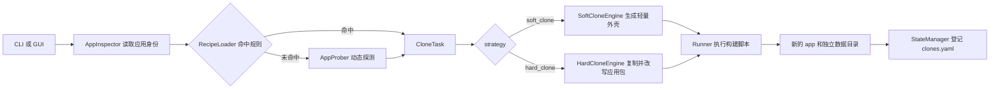
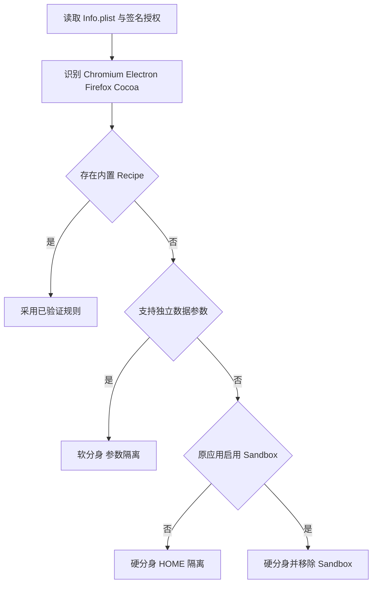
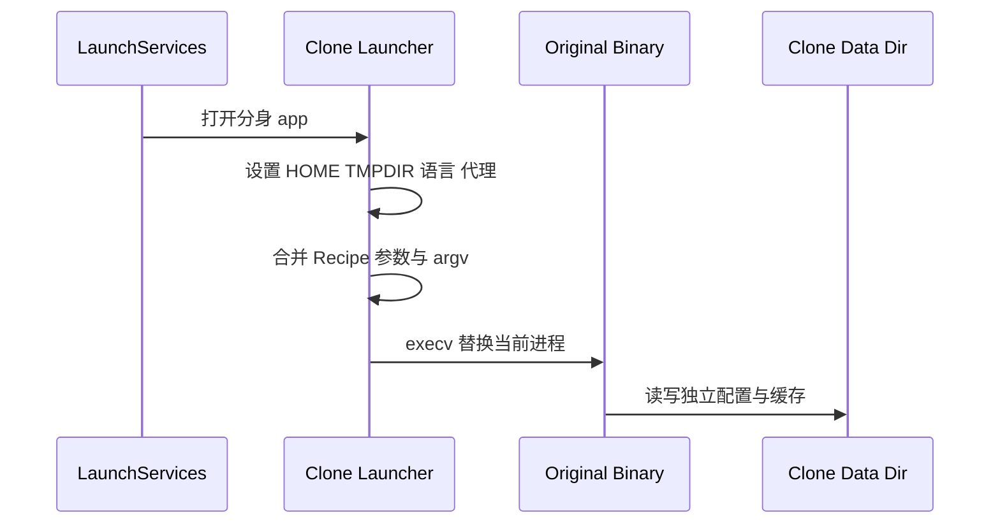
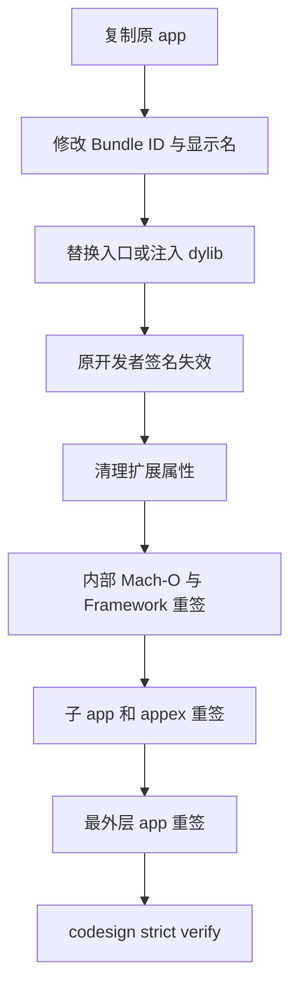
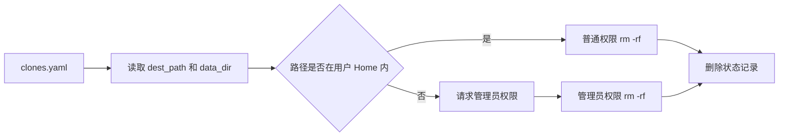

## 1. ATBClone

[ATBClone](https://github.com/aitobox/ATBClone) 是一个 macOS 应用多开工具。给它一个 `/Applications/WeChat.app`，它会生成带独立名称、Bundle ID 和数据目录的第二个 `.app`。Chrome、Firefox 这类原生支持多配置目录的程序可以只做一层启动包装；微信、Telegram 等程序则需要复制应用包、改身份、替换入口，再重新签名。

应用多开难在身份和状态，复制文件只是第一步。把微信复制一份再打开，两个进程虽然来自两份二进制，但如果还用同一个用户目录、同一个 Bundle ID 或同一把单实例锁，第二个进程会把打开请求转给第一个，或者跟它抢同一个数据库。反过来，改动应用包又会立刻破坏开发者签名，还可能让钥匙串、推送和系统权限失效。

ATBClone 把这组冲突压进了一条流水线：先探测目标应用，再用 Recipe 选择克隆策略，最后生成新的应用包并登记生命周期。它的实现并不等于安全沙盒，其中不少兼容性手段会主动拆掉原应用的安全边界。正因如此，这个仓库适合同时学习两面：怎么让一个闭源桌面程序多开，以及系统工具在哪些地方必须比普通应用更谨慎。

本章聚焦四个可迁移模式：基于能力探测的策略选择、原生启动器注入、签名失效后的身份重建，以及带提权和删除能力的生命周期设计。

路径都从仓库根目录算起。本文锁定 tag `v1.2.0`、commit `c13656d`。核心 Python 代码约 1.3 万行。

## 2. 五分钟跑起来

ATBClone 只能在 macOS 上完成真实克隆。源码安装需要 Python 3.10 以上，硬分身还依赖 `clang`、`codesign`、`PlistBuddy` 和 LaunchServices（macOS 登记和打开 `.app` 的系统服务）。

```bash
git clone --branch v1.2.0 https://github.com/aitobox/ATBClone.git
cd ATBClone
python3 -m venv .venv
source .venv/bin/activate
pip install -e '.[dev]'
```

先检查系统工具，再探测目标应用：

```bash
atbclone doctor
atbclone probe /Applications/Google\ Chrome.app
```

`probe` 不会修改应用。它读取 `Info.plist`、签名授权和 Framework 目录，还会扫描可执行文件中的字符串，寻找 `--user-data-dir`、`-profile` 等参数。确认策略后再创建分身：

```bash
atbclone clone /Applications/Google\ Chrome.app \
  --name Chrome-Work \
  --data-dir "$HOME/ATBClone/Data/Chrome-Work"
```

默认产物在 `~/ATBClone/Apps`，数据在 `~/ATBClone/Data`，不需要管理员权限。把 `--output-dir` 指到 `/Applications` 才会触发 macOS 管理员授权。学习源码时应先使用用户目录，并选择不含敏感数据的测试程序。

常用生命周期命令只有三条：

```bash
atbclone list
atbclone update Chrome-Work
atbclone remove Chrome-Work --keep-data
```

仓库的非 GUI 测试可以在非 macOS 环境运行。本章检查的提交上，排除依赖 Toga 的 GUI 测试后共有 348 项通过。这个数字只能说明纯 Python 逻辑通过，不能替代 macOS 上的签名、Gatekeeper（打开应用时检查签名和来源的闸门）、TCC（管理摄像头、通讯录等隐私授权的系统组件）和实际启动测试。

## 3. 全景架构

一句话看懂：ATBClone 先把应用变成一份结构化描述，再把描述和 Recipe 合并成 `CloneTask`，最后由两种 Engine 生成新的 `.app`。

如图 3-1 所示，CLI 和 GUI 共用同一套核心流水线。界面只负责收参数；探测、决策、构建和状态登记都在 core 层完成。



图 3-1：从目标应用到分身应用的数据流

核心抽象只有五个：

| 抽象 | 源码位置 | 职责 |
|---|---|---|
| `AppInfo` | `src/atbclone/core/models.py:5-15` | 描述路径、Bundle ID、入口和沙盒状态 |
| `Recipe` | `src/atbclone/recipes/models.py:25-38` | 声明策略、参数、环境、代理和补丁开关 |
| `CloneTask` | `src/atbclone/core/clone_task.py:10-23` | 冻结一次克隆需要的输入 |
| `CloneEngine` | `src/atbclone/core/engines.py:14-448` | 把任务翻译成应用包改造步骤 |
| `CloneRecord` | `src/atbclone/core/state.py:11-25` | 保存后续更新和删除所需的状态 |

Recipe 是架构的中轴。它不是一份应用名单，而是目标程序的适配协议：该用软分身还是硬分身，数据目录从参数还是环境变量注入，要不要移除 Sandbox，要不要处理单实例锁。新增应用主要改 YAML，构建引擎保持不动。

## 4. 核心模块

### 4.1 能力探测驱动的策略选择

一句话总结：先问目标程序愿意开放哪条隔离通道，再决定改造深度。

#### 4.1.1 复制应用不等于复制状态

桌面程序保存状态的方式没有统一答案。Chromium 接受 `--user-data-dir`，Firefox 接受 `-profile`，Electron 程序可能把路径落在 `app.getPath('userData')`，原生 Cocoa 程序还可能直接访问容器、Keychain 或硬编码目录。

因此多开有三条常见路线：

| 路线 | 怎么隔离 | 优点 | 代价 |
|---|---|---|---|
| 启动参数 | 给原二进制传独立 profile 路径 | 不改原应用，签名不变 | 目标程序必须明确支持参数 |
| 环境变量 | 改 `HOME`、`TMPDIR` 等进程环境 | 对闭源程序也能尝试 | Cocoa API 和硬编码路径未必遵守环境变量 |
| 应用包改写 | 复制 `.app`、改 Bundle ID 和入口 | Dock、LaunchServices、部分系统权限可分开识别 | 必须重签，兼容与安全代价最高 |

ATBClone 的优先级就是从浅到深。内置 Recipe 先覆盖已知应用；没有规则时，`AppProber.analyze()` 按 Framework、entitlements（签名里声明的权限清单）和二进制字符串生成临时 Recipe（`src/atbclone/core/app_prober.py:101-186`）。

```python
if app_type in ("chromium", "electron"):
    strategy = "soft_clone"
    launch_args = ["--user-data-dir={{ATB_DATA_DIR}}"]
elif app_type == "firefox":
    strategy = "soft_clone"
    launch_args = ["-profile", "{{ATB_DATA_DIR}}"]
else:
    strategy = "hard_clone"
    strip_sandbox = has_sandbox
    env_injection = {
        "HOME": "{{ATB_DATA_DIR}}/Home",
        "TMPDIR": "{{ATB_DATA_DIR}}/Tmp",
    }
```

代码节选自 `src/atbclone/core/app_prober.py:136-176`，tag `v1.2.0`。

这段决策树的价值不在具体应用名，而在降级顺序：有正式能力就用正式能力；没有才进入兼容性更差、侵入性更强的路径。



图 4-1：从能力探测到克隆策略

#### 4.1.2 静态字符串只是线索，不是能力证明

`BinaryArgumentProber` 最多读取可执行文件前 15 MB，从可打印字符串里寻找候选参数（`src/atbclone/core/argument_prober.py:67-130`）。随后 `LaunchArgumentValidator` 先查 Framework 白名单，陌生参数再回到二进制字符串确认（`src/atbclone/core/argument_prober.py:205-292`）。

这比盲目塞参数稳一些，但仍可能误判。二进制里出现某个字符串，可能来自帮助文本、依赖库或已经废弃的分支，不代表当前入口会消费它。更可靠的能力系统应把证据分级：官方声明、已验证 Recipe、静态猜测。只有前两类可以自动执行，静态猜测最好停在建议层，并要求用户试运行确认。

可迁移到别的工具时，可以把策略选择写成显式评分。下面是示意伪码，ATBClone 里没有 `planner` 这个对象：

```python
evidence = [
    builtin_recipe(bundle_id),
    framework_capability(app_type),
    signed_entitlements(app_path),
    binary_string_hint(executable),
]

plan = planner.choose(
    evidence=evidence,
    prefer=["documented-flag", "verified-wrapper", "binary-rewrite"],
)
```

关键不是评分公式，而是让每个决策能回答：证据来自哪里，可信度是多少，失败后降级到哪一步。

### 4.2 启动器是进程环境的适配层

一句话总结：启动器不实现业务，只在 `exec` 前改好进程看到的世界。

#### 4.2.1 为什么不能一直用 Shell 脚本

最小启动器确实只有几行：导出环境变量，然后 `exec` 原二进制。问题是 macOS 把 `.app` 的入口当成真正的可执行文件参与签名和启动。某些应用还会检查入口类型、派生子进程，或者依赖通知中心和菜单栏识别当前二进制。Shell wrapper 的兼容性很快到顶。

ATBClone 最终选择运行时编译一个 C 启动器，产物是 Mach-O（macOS 的可执行文件格式）二进制。软分身的启动器直接 `execv()` 原应用入口；Chromium/Electron 的硬分身先把原入口改名为 `.bin`，再让同名启动器执行它（`src/atbclone/core/engines.py:450-540`、`893-912`）。

软分身有个前提要先说清。它的启动器 `execv` 的是原应用包里的二进制，而 macOS 按可执行文件所在的位置确定 main bundle。进程起来以后，`NSBundle.mainBundle` 仍是原来那个 `.app`，程序读到的 Bundle ID 也是原应用的。分身包 `Info.plist` 里改过的名称和 Bundle ID（`engines.py:531-533`），只影响 Dock 和 LaunchServices 怎么显示、登记这个入口；按 Bundle ID 做的单实例检测和偏好读写都挡不住。所以软分身只适合 Chromium、Firefox 这类能靠参数把数据目录分开的程序，其余程序得走复制二进制的硬分身。

| 启动器形态 | 生成成本 | 系统兼容性 | 修改原应用 |
|---|---:|---:|---:|
| Shell wrapper | 最低 | 较低 | 软分身可不改 |
| 原生 C launcher | 需要 `clang` | 较高 | 硬分身要替换入口 |
| 动态库构造器 | 需要改 Mach-O load command | 取决于目标二进制 | 会改原二进制副本 |

启动器构造器把 Recipe 中的环境变量写成 `setenv()`，把启动参数与用户传入的 `argv` 合并，最后调用 `execv()`。核心位于 `src/atbclone/core/engines.py:251-343`。

```c
int main(int argc, char *argv[]) {
    setenv("HOME", "/Users/me/ATBClone/Data/WeChat2/Home", 1);
    setenv("TMPDIR", "/Users/me/ATBClone/Data/WeChat2/Tmp", 1);

    char *new_argv[] = {argv[0], "--user-data-dir=...", NULL};
    execv(real_bin, new_argv);
    return 1;
}
```

上面是 `CloneEngine._build_c_launcher_compile_cmd()` 的教学化缩写。真正代码还保存原始 `HOME` 到 `REAL_USER_HOME`，供白名单软链接使用。



图 4-2：启动器只改启动边界，随后把进程交给原程序

#### 4.2.2 环境隔离不是文件系统沙盒

把 `HOME` 指向另一个目录，只会影响愿意读取这个环境变量的代码。目标程序仍然以当前用户身份运行，理论上可以访问该用户原本有权访问的其他文件。它也可能通过 Foundation API、容器路径或绝对路径绕过 `HOME`。

ATBClone 还会为伪 Home 链接真实的 `Library/Keychains`，部分 Recipe 甚至链接 `.ssh`。微信规则就是如此（`src/atbclone/recipes/builtin/com.tencent.xinWeChat.yaml:1-11`）。这样做能减少登录或 Git 功能失效，却把最敏感的宿主凭据重新暴露给分身。

所以启动器模式应该叫状态分流，而不是安全隔离。真正需要安全边界时，应使用 App Sandbox、独立 macOS 用户、容器或虚拟机。启动器适合解决多账号和文件锁冲突，不适合运行不可信代码。

### 4.3 改一个字节，整条签名链都要重建

一句话总结：签名不是构建末尾的盖章，它把应用身份、权限和完整性绑成一个整体。

#### 4.3.1 Bundle ID 与代码签名解决不同问题

修改 `CFBundleIdentifier` 能让 LaunchServices 把分身视作另一个应用，也会影响偏好设置、TCC 和容器寻址。但 Bundle ID 只是声明。代码签名还绑定可执行文件、资源、Team ID 和 entitlements。替换入口、改 plist 或修改 Framework 后，原开发者签名都会失效。

常见处理方式有三种：

| 方式 | 身份连续性 | 能否修改应用包 | 适合场景 |
|---|---|---|---|
| 保留原签名 | 完整 | 不能改受保护内容 | 只用启动参数的软分身 |
| ad-hoc 重签 | 丢失开发者身份 | 可以 | 本机实验和开发工具 |
| 自有证书重签 | 变成新开发者身份 | 可以 | 有完整发布、授权和公证流程的产品 |

ATBClone 对生成的包执行 ad-hoc 重签，也就是 `codesign --sign -`。硬分身会先给 dylib、可执行文件、Framework、appex（App Extension，打包在应用里的扩展）和子应用逐层签名，再签最外层 bundle，最后执行严格校验（`src/atbclone/core/engines.py:984-1024`）。



图 4-3：应用包改写后的签名重建顺序

#### 4.3.2 移除 Sandbox 是兼容性交换，不是隔离增强

如果 Recipe 设置 `strip_sandbox: true`，引擎先从原应用提取 entitlements，再删掉 App Sandbox 开关和一组绑定原开发者团队的能力（应用组、钥匙串组、推送、关联域名、iCloud 等），最后用剩余内容重签（`src/atbclone/core/engines.py:958-999`）。

这一步解决的是新身份拿不到原团队专属 entitlement 的签名问题。代价也很直接：分身不再受原 App Sandbox 约束，访问范围可能扩大；与此同时，钥匙串组、推送、iCloud 和应用组功能可能失效。

仓库还提供两类更深的二进制补丁：一类修改 Electron/Chromium 的 `ProcessSingleton` 调用，让每份副本都认为自己是主实例；另一类修改 CEF 的 Seatbelt 和 GPU 相关分支（`src/atbclone/core/engines.py:556-677`）。这些补丁依赖指令和字节模式，目标应用升级后可能匹配失败，也可能命中错误位置。

安全判断应该分成两问：

1. 工具源码有没有明显的数据外传或后门？本章检查的 v1.2.0 没看到运行时遥测和主动上传逻辑。
2. 工具生成的分身是否保持原应用的安全属性？硬分身通常不能。原签名、Sandbox 和部分 entitlement 已被替换或删除。

不要把第一问的答案自动套到第二问。

### 4.4 生命周期工具的真正边界是可信路径

一句话总结：能替用户递归删除目录的工具，状态文件就是权限边界的一部分。

ATBClone 把 `clone_name`、源路径、目标路径、数据路径、Bundle ID 和代理摘要写进 `~/ATBClone/clones.yaml`（`src/atbclone/core/state.py:11-76`）。`update` 先删除旧应用包，再用原数据目录重新构建；`remove --with-data` 同时删除应用和数据。

这套数据与程序分离的思路是对的。应用升级时只替换 bundle，账号和聊天数据留在外部目录。问题出在信任关系：删除命令直接采用状态文件里的 `dest_path` 和 `data_dir`，只做 shell quote，没有验证路径必须位于 ATBClone 管理根目录（`src/atbclone/cli/cmd_remove.py:59-77`）。



图 4-4：当前删除流程把状态文件内容直接带进执行层

更稳的实现要在执行前重新建立边界：

```python
def assert_managed_path(path: Path, roots: list[Path]) -> Path:
    resolved = path.expanduser().resolve(strict=False)
    if resolved in {Path("/"), Path.home()}:
        raise UnsafePath(resolved)
    if not any(resolved.is_relative_to(root.resolve()) for root in roots):
        raise UnsafePath(resolved)
    return resolved
```

还应补四层保护：状态文件权限固定为 `0600`；代理密码不写入摘要；更新使用临时目录构建，校验成功后原子替换；提权时传结构化参数或固定脚本，不把用户输入拼进整段 root shell。

引擎里的路径大多用 `shlex.quote` 转义过，显示名称和 Bundle ID 却是拼进双引号 Shell 片段的。问题分三步：

1. `_build_display_name_cmd()` 只转义反斜线和双引号，双引号里的 `$()` 照样会执行（`src/atbclone/core/engines.py:80-94`）。
2. 目标应用的 Bundle ID 来自它自己的 `Info.plist`，也会被插进构建脚本（`engines.py:934-954`）。
3. 产物写进 `/Applications` 时，整段脚本以管理员权限运行。

三步连起来，克隆一个不可信的应用，就等于让它的 `Info.plist` 以管理员身份执行命令。

可迁移的原则很简单：Shell quoting 只能保护被正确放入一个 Shell 参数的位置。只要代码先拼模板、再让 `shell=True` 解释整段文本，就要逐个追踪数据来自哪里、落在哪种语法上下文。路径、PlistBuddy 命令、C 字符串和 AppleScript 是四种不同上下文，不能靠一个 escape 函数通吃。

## 5. 能搬走的工程习惯

| 习惯 | ATBClone 的做法 | 搬到其他项目时怎么用 |
|---|---|---|
| 先探测再决策 | `AppInspector` 与 `AppProber` 先生成结构化事实 | 安装器、迁移工具、驱动管理器先产出 capability report |
| 策略与执行分离 | YAML Recipe 描述差异，Engine 只解释规则 | 多平台构建、IDE 适配、数据导入器可用同一模式 |
| 侵入性逐级升级 | 参数隔离优先，最后才改二进制 | 自动修复工具应优先可逆、可验证的动作 |
| 数据与程序分开 | clone bundle 可重建，data dir 独立保留 | 桌面应用更新和插件更新都可减少迁移风险 |
| 构建后校验 | 最后执行 `codesign -vv --deep --strict` | 任何会改制品的工具都要验证最终产物而非中间步骤 |

其中最重要的是第一条和第三条。系统工具面对的不是一种输入，而是一批历史包袱不同的程序。好的自动化不是把失败隐藏起来，而是知道当前证据支持多深的改造，并让更危险的步骤显式可见。

## 6. 适用边界与不该照搬的部分

ATBClone 适合个人在受控 Mac 上做多账号、测试配置和应用兼容性实验。软分身尤其适合本来就支持 profile 参数的浏览器和编辑器，因为它不需要复制、反汇编或拆掉原应用沙盒。

硬分身不适合以下场景：运行来源不明的应用；承载主力企业账号、支付或密码管理数据；把独立代理当作匿名或防关联保证；要求保留原厂签名、推送、Keychain Group 和 App Store 更新链路。

四个实现细节不应直接照搬：

- 不要把清除 quarantine（下载文件带的来源标记，Gatekeeper 据此拦截）当成普通构建步骤。`xattr -cr` 会同时移除安全来源信息。
- 不要默认把真实 Keychains 或 `.ssh` 链回伪 Home。兼容性提高了，隔离边界也被打穿。
- 不要把 `HTTP_PROXY` 和 `HTTPS_PROXY` 当成全流量代理。应用可以忽略环境变量，DNS、QUIC、UDP 或自建网络栈也可能绕开。
- 不要在自动探测到 Sandbox 后直接移除它。应展示风险、要求明确确认，并优先建议软分身或独立系统用户。

源码审计也不能证明 Release 里的 DMG 必然由同一份源码构建。高敏感环境应从锁定提交自行构建，并核对签名、公证和最终制品哈希。

## 7. 自己实现一个最小版本

一个教学版不需要二进制补丁、动态库注入和管理员权限。把范围限制为支持 profile 参数的应用，约一两百行 Python 就能完成。

第一步只支持两种适配器：Chromium 的 `--user-data-dir` 和 Firefox 的 `-profile`。第二步读取 `Info.plist`，生成新的 Bundle ID 与轻量 `.app`。第三步写一个启动脚本或预编译的小型 launcher。最后把记录写入只允许当前用户读取的 JSON 文件。

```python
def build_soft_clone(source_app: Path, dest_app: Path, data_dir: Path):
    info = inspect_plist(source_app / "Contents/Info.plist")
    adapter = choose_adapter(info.bundle_id, source_app)

    dest_app.mkdir(parents=True)
    copy_info_plist(source_app, dest_app)
    rewrite_bundle_id(dest_app, info.bundle_id + ".profile.work")

    launcher = Launcher(
        executable=source_app / "Contents/MacOS" / info.executable,
        args=adapter.profile_args(data_dir),
        env={},
    )
    launcher.write_to(dest_app / "Contents/MacOS" / info.executable)
    sign_and_verify(dest_app)
```

这个 mini 版故意不处理通用 Cocoa 应用。遇到不支持数据目录参数的目标就明确报错，不自动改 `HOME`，更不移除 Sandbox。限制功能范围，反而能保住一条清楚的安全承诺：它只生成启动入口，不改目标程序的安全模型。

如果继续扩展，顺序应该是：先加入 dry-run，输出即将修改的文件和命令；再加入临时目录构建与原子替换；然后做路径约束和恶意输入测试；最后才考虑 hard clone。二进制 patch 应作为单独实验模块，按目标版本和哈希精确启用，不能依赖模糊字节搜索自动运行。

## 8. 延伸阅读

- [Apple Code Signing Guide](https://developer.apple.com/library/archive/documentation/Security/Conceptual/CodeSigningGuide/Introduction/Introduction.html)：理解为什么改动 `Info.plist`、资源或 Mach-O 后必须重新签名，以及签名身份和完整性如何绑定。
- [App Sandbox Design Guide](https://developer.apple.com/library/archive/documentation/Security/Conceptual/AppSandboxDesignGuide/AboutAppSandbox/AboutAppSandbox.html)：补齐 Sandbox、entitlements 与最小权限模型。读完再回看 `strip_sandbox`，其代价会更清楚。
- [Electron app.getPath](https://www.electronjs.org/docs/latest/api/app#appgetpathname)：理解 Electron 应用的数据目录从哪里来，也能看出命令行参数并不是唯一可靠的适配入口。
- [Chromium user data directory](https://chromium.googlesource.com/chromium/src/%2B/HEAD/docs/user_data_dir.md)：查看 Chromium 对 user data dir、profile 和平台默认路径的官方说明。

ATBClone 最适合作为一份边界鲜明的系统工程标本：Recipe、探测器和双引擎展示了兼容性工具如何组织差异；Shell 拼接、递归删除、ad-hoc 重签和 Sandbox stripping 则展示了功能做通以后，安全承诺为什么必须重新审视。
