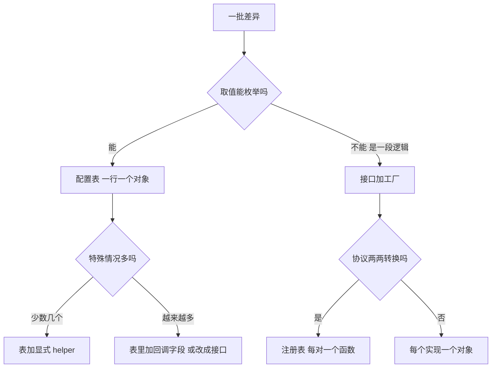

## 怎么用这份索引

九章各拆一个项目，但同一类工程问题会在不同项目里反复出现：多个后端的差异怎么收拢，流式响应怎么边转发边处理，有状态的上游怎么调度，约束写在提示词里还是工具里。这份索引按问题把它们串起来，每一类列出各章的做法、分歧在哪、怎么选。

碰到具体问题时，先查下表，再跳到对应章节看源码和代码。

| 你要解决的问题 | 看哪几章 | 本附录小节 |
|---|---|---|
| 接一堆异构的后端、客户端或宿主 | 1、4、5、6、7、9 | 差异放数据还是放接口 |
| 代理流式响应，同时要记录或计费 | 3、4、6 | 流式：转发、缓冲、折叠 |
| 上游有会话状态或按时间窗限额 | 1、3 | 有状态上游的调度 |
| 多个进程或副本共用一批 OAuth 凭证 | 1、3 | 凭证续期与并发 |
| 规则写了，模型或用户不照做 | 2、5、8 | 约束放在哪一层 |
| 规则、技能太多，塞不进上下文 | 2、7、8 | 按需加载上下文 |
| 升级、重启后用户数据不能丢 | 5、7、8、9 | 状态和程序分开存 |
| 判断文件或远端内容到底变没变 | 1、7 | 变更检测 |
| 本地工具要签证书、开端口、删目录 | 4、5、7、9 | 本地工具的安全边界 |

## 差异放数据还是放接口

几乎每个项目都要接一堆彼此不同的东西：CLIProxyAPI 接 5 种入站协议和 6 种后端，claude-tap 接 12 个 client，botmux 接 7 种 CLI，vercel-labs/skills 要适配 70 多个 agent 工具。把差异收拢到一处，有三种形态：

| 形态 | 章节与位置 | 差异长什么样 |
|---|---|---|
| 注册表 + 每个方向一个函数 | [第 1 章](01-cliproxyapi.md)，4.1 协议翻译 | 每一对协议的转换逻辑，`init()` 自注册 |
| 一行配置一个对象，排成表 | [第 4 章](04-claude-tap.md)，4.3 节；[第 7 章](07-vercel-skills.md)，4.6 节；[第 9 章](09-atbclone.md)，Recipe | 环境变量名、目录、默认模式这类可枚举的取值 |
| 接口 + 工厂 | [第 5 章](05-botmux.md)，4.1 节；[第 6 章](06-llm-space.md)，4.2 节 | 怎么拼参数、怎么写输入、宿主有没有某种能力 |

第 5 章给了一把尺子：**差异是数据就用表，差异是行为就用接口**。拿它回看其他几章：

- claude-tap 的 12 个 client 差异都能枚举，所以 `ClientConfig` 一张表装下，`run_client` 只剩一条流水线。表装不下的三个 client（Hermes 改子命令、Codex 改配置文件、CodeBuddy 探测上游）另写了 helper。第 4 章给的信号是：helper 加到第五个，就说明表的抽象不够用了。
- botmux 的 CLI 差异是行为，写成 `CliAdapter` 接口，工厂里用 `never` 做穷尽检查，漏一个 case 编译就报错。
- LLM Space 的差异是宿主能力，同样是接口（`HostServices`），但注入方式是 React context；缺失的能力在类型上写成 `| null`。
- CLIProxyAPI 介于两者之间：每一对协议是一个函数（行为），注册进一张 map（数据）。第 1 章讨论过它没选统一中间格式的原因：协议都是别人定义的，隔几周就变，中间格式会被追新字段拖垮。
- vercel-labs/skills 的 agent 表还被 CI 回写成文档，表既驱动代码，也是唯一的事实来源（第 7 章 4.6 节）。
- ATBClone 的 Recipe 是 YAML，新增应用主要改规则文件，引擎不动（第 9 章第 3 节）。

图 A-1 把这把尺子画成判断顺序。

图 A-1：差异该放进表还是接口

## 流式：转发、缓冲、折叠

三章都在处理同一件事：上游一段一段吐数据，中间层既要尽快交给下游，又要自己留一份完整结果。区别在于第一个字节什么时候发、发出去之后还能不能反悔。

| 章节 | 中间层 | 第一个字节什么时候给下游 | 留完整结果的方式 |
|---|---|---|---|
| [第 3 章](03-sub2api.md)，4.2 节 | HTTP→WS 网关 | 首个 token 到达时 | 计费用的 usage |
| [第 4 章](04-claude-tap.md)，4.2 节 | 录流量的代理 | chunk 一到就转发 | 喂给累积器，结束时取快照 |
| [第 6 章](06-llm-space.md)，4.1、4.3 节 | 进程间 RPC 与 UI | 每个事件都推 | reducer 折叠成消息快照 |

几个分歧点：

- **能不能重试。** sub2api 在首个 token 之前只缓冲、不写响应头，这样上游早期出错时还能重连或返回一个完整的错误响应。代价是首字延迟略增。claude-tap 是调试工具，不重试，所以 chunk 一到就转发。判据是：中间层要不要在出错时换条路。要，就在第一个不可撤销的动作之前留窗口。
- **下游断开后读不读完上游。** claude-tap 在 child 断开后退出循环，trace 会被截断；sub2api 继续读完上游，为的是拿到完整 usage 计费。要结果完整就学后者。
- **累积逻辑放在哪。** claude-tap 的 `SSEReassembler` 和 LLM Space 的 `reduceMessages` 都是不发请求、不写文件的纯数据处理，都能用录下来的 fixture 直接写单测。LLM Space 还多了一步：折叠每个事件都做，推给 React 限到每 100ms 一次（第 6 章“渲染节流，错误走事件流”）。
- **推送源怎么变成拉取。** 第 6 章的 `toAsyncIterable` 把回调源包成 `for await`：一个缓冲、一个唤醒变量、抽干缓冲后才检查终止标志、`finally` 里退订。任何 WebSocket `onmessage` 或 EventEmitter 都能套。要注意它没有背压，高吞吐的数据流要换有背压的 stream。

## 有状态上游的调度

传统负载均衡假设后端无状态，谁都能接任何请求。订阅型上游打破了两条：会话状态绑在某个账号上，限额按时间窗算。

| 章节 | 上游的状态 | 调度做法 |
|---|---|---|
| [第 1 章](01-cliproxyapi.md)，4.2 节 | 滚动窗口限额 | 默认 round-robin，可切 fill-first；可选 session-affinity |
| [第 3 章](03-sub2api.md)，4.1 节 | `previous_response_id` 绑账号 | 三层：会话 id 粘性 → session_hash 粘性 → 负载均衡 |

怎么选，看上游的状态是哪一种：

- **按请求计费、无状态**：round-robin 把流量摊匀。
- **限额按时间窗算**：fill-first 先把一个账号用到触顶进入冷却，再切下一个，各账号的冷却窗口错开。round-robin 会让所有账号同时逼近上限、一起触顶。
- **会话状态绑账号**：先保证续聊回到原账号，负载均匀放到最后一层。第 3 章的经验是先让客户端传显式会话标识（`session_id`、`conversation_id`、`prompt_cache_key`），内容哈希只做兜底，因为两个用户发同样的开场白会撞到同一个哈希。

两章都把冷却挂在“凭证加模型”这一级：第 1 章同一个 Auth 在 sonnet 上冷却时，haiku 照常可用。第 3 章还处理了粘性 key 的算法迁移：新旧两种哈希同时算，读缓存先新后旧，上线那一刻老会话不断粘性。

## 凭证续期与并发

| 章节 | 场景 | 做法 |
|---|---|---|
| [第 1 章](01-cliproxyapi.md)，4.2 节 | 单进程管一批凭证 | 最小堆排到期时间，固定 16 个 worker 续期；401 时续一次再重试 |
| [第 3 章](03-sub2api.md)，4.3 节 | 多副本共用账号，`refresh_token` 一次性 | 进程内锁、Redis 锁、加锁后重读 DB、`invalid_grant` 竞争恢复 |

单进程时，问题是别让一批凭证同时续期打爆上游，第 1 章用固定并发数解决。多副本时，问题变成同一个 `refresh_token` 被两个副本同时用掉，第 3 章用四道防御解决。

第 3 章的要点是锁只能减少撞车，消灭不了：Redis 挂了会降级，锁 TTL 会过期。所以加锁之后还要从 DB 重读、二次检查，撞了车还要能认出“别人已经刷成功了”。它还记录了一个具体的坑：锁的值固定为 1、释放时无条件删除，TTL 过期后会删掉别人的锁。正确做法是值用持有者自己的 token，比较和删除用 Lua 原子执行，那一节贴了真实 Redis 上的复现输出。

另外一个前提，第 3 章也提到了：如果授权服务器做了 refresh token 复用检测，撞车一次可能导致整族 token 被吊销，竞争恢复就救不回来。

## 约束放在哪一层

同一条规则可以写在三个地方：提示词里、工具配置里、检查脚本里。三章给出了各层能做到什么。

| 层 | 章节与位置 | 能挡住什么 |
|---|---|---|
| 提示词 | [第 2 章](02-superpowers.md)，4.2 节 | 模型自己找借口破例：用铁律加借口表 |
| 工具配置 | [第 8 章](08-claude-for-legal.md)，4.4 节 | 被输入注入之后的越权：出网白名单、每种危险能力只给一个节点 |
| 代码中的判定函数 | [第 5 章](05-botmux.md)，4.4 节 | 用户越权：`canTalk` 和 `canOperate` 两个纯函数 |
| 检查脚本 | [第 8 章](08-claude-for-legal.md)，4.4 节 | 配置写错：lint 检查每个节点的工具列表 |

第 2 章和第 8 章看起来方向相反，其实处理的是两种不同的失败：

- 第 2 章要防的是模型在正常对话里为破例找理由。办法是先不加规则跑一遍，把模型的原话记下来，再写规则专门点名这些话。那一节有一轮用 `claude -p` 跑的实测。
- 第 8 章要防的是模型读到恶意输入后被说服。这时提示词里写多少遍都没用，原文的说法是：工具层的 `allowed_hosts` 才是真正的控制，提示词里那一份只是说明。

判据是：**这条约束会不会被模型读到的内容说服**。会，就必须在模型之外再实现一遍。

第 8 章还给出了两处边界。一是占位符门禁和配置迁移都只写在提示词里，仓库没有脚本去检查，模型可能漏执行。二是闭合的 JSON Schema 能限制输出的结构和体量，但 `title`、`summary` 这类自由文本字段仍然能携带注入，真正的控制在下游节点没有危险权限。

第 5 章的两道闸说明了另一件事：权限规则写成纯函数，所有边界情况都能用单测钉住。它踩过的坑是只配了对话授权时被误判成开放模式，对话权限漏成了操作权限。

## 按需加载上下文

| 章节 | 加载单位 | 靠什么决定加载 |
|---|---|---|
| [第 2 章](02-superpowers.md)，4.1 节 | 技能 | description 写触发条件，加一条“1% 可能就加载”的元规则 |
| [第 7 章](07-vercel-skills.md)，4.1 节 | skill | 规范规定的三段加载：名字和描述常驻，正文和资源按需读 |
| [第 8 章](08-claude-for-legal.md)，4.1 节 | 插件内的技能 | 路由技能先读合同标题和附件名，再决定走哪条线 |

三章的共识是，description 或路由信号写的是**什么时候用**，不是“这是关于什么的”。第 7 章引了规范里的正反例；第 2 章说明了 description 相比向量检索的好处：触发错了，改一句人能读懂的话就行。第 8 章的路由用标题而不用正文关键词，因为一份主服务协议里 confidential 出现几十次，按词频会被误判成保密协议。

两个容易漏的成本：

- 常驻部分每轮对话都在烧 token。第 7 章估算过，装 50 个 skill 每轮固定占约 5K tokens，所以 skill 库不是越大越好。
- 引导层自己不能按需加载。第 2 章的 `using-superpowers` 讲的就是“怎么加载技能”，所以它必须一开始就全文注入，其余技能才能按需加载。

第 8 章的私有知识选了全量进上下文、不走 RAG（第 8 章 4.2 节）。知识量小、漏召回的代价是输出错误时，全量加载比检索更可靠。

## 状态和程序分开存

四章都要回答同一个问题：程序本体要升级、重启、重建，用户的状态怎么保住。

| 章节 | 程序本体 | 状态放哪 |
|---|---|---|
| [第 5 章](05-botmux.md)，4.2 节 | daemon 和 worker | CLI 跑在 tmux 里，daemon 只接一根 `pipe-pane` 监听线 |
| [第 7 章](07-vercel-skills.md)，4.3、4.4 节 | 各工具目录里的 skill | `.agents/skills` 下一份主副本，其余是相对符号链接；锁文件记来源 |
| [第 8 章](08-claude-for-legal.md)，4.2 节 | 带版本号路径下的插件 | 不带版本号的用户级配置目录 |
| [第 9 章](09-atbclone.md)，4.4 节 | 分身 `.app` | 独立数据目录，加 `clones.yaml` 登记 |

共同做法是让程序本体可以随时整个丢掉重建，状态放在它管不到的位置。几处值得对照的差别：

- **活的进程也是状态。** botmux 保的不只是文件，还有正在跑的 CLI 进程。它把进程交给 tmux 托管，重启时逐个探测：在的就分批重新挂上，拿不准的一律不关。第 5 章记录了一次宿主机重启把所有会话当僵尸关掉的教训。
- **模板和实例分开。** claude-for-legal 在插件里只发带 `[PLACEHOLDER]` 的模板，用户填的内容写到另一个路径，升级只替换模板。配置缺失时拒绝干活而不是用默认值，因为错误输出和正确输出看起来一样。
- **锁文件要能合并。** vercel-labs/skills 的项目锁不写时间戳、按名字排序，两个分支各装一个 skill，git 能自动合并。
- **状态文件本身是权限边界。** ATBClone 删除时直接采用状态文件里的路径，状态文件被篡改就会删错目录，见下面最后一节。

## 变更检测

| 章节 | 检测对象 | 做法 |
|---|---|---|
| [第 1 章](01-cliproxyapi.md)，4.3 节 | 本地配置和凭证文件 | 防抖合并事件，再比 SHA256；文件消失后等 50ms 判断是不是原子替换 |
| [第 7 章](07-vercel-skills.md)，4.3 节 | 远端和本地的 skill 目录 | GitHub 来源比 tree SHA，免下载；其余在本地算目录 sha256 |

两章合起来说明了三件事：

- **事件不等于变化。** 编辑器保存会先删后建，很多工具内容不变也会 touch。第 1 章先用防抖合并密集事件，再用内容哈希过滤没变的，重载时新配置解析失败就保留旧配置，替换配置指针在锁内一次完成。
- **哈希只能测漂移，不能测完整性。** 第 7 章发现锁文件里的哈希在还原流程里从没被读过，`experimental_install` 不校验任何东西。它回答的是“上游变了吗”，不回答“我装到的是对的吗”。
- **自己算目录哈希时的三个坑**：路径和内容之间要加分隔符（第 7 章复现了两个不同目录算出同一个哈希），文件权限位要进哈希，排序不要用依赖 ICU 的 `localeCompare`。Go 的 `dirhash` 可以当参照。

## 本地工具的安全边界

开发者工具常常要签证书、开端口、代理流量、删目录。这些能力放在本地，边界比服务端更容易被忽视。

| 章节 | 能力 | 边界怎么守 |
|---|---|---|
| [第 4 章](04-claude-tap.md)，4.1 节 | 自签 CA，解密 child 的 HTTPS | CA 只通过环境变量交给 child，不进系统证书库 |
| [第 4 章](04-claude-tap.md)，第 2 节 | 本地代理端口 | `--tap-no-launch` 默认监听 0.0.0.0，要手动加 `--tap-host 127.0.0.1` |
| [第 5 章](05-botmux.md)，4.4 节 | Web 终端和 Dashboard | 读写分 token；调 daemon 要带 HMAC 签名；写操作进沙箱 |
| [第 7 章](07-vercel-skills.md)，4.4 节 | 按 skill 名字写目录 | 先净化名字，再做路径前缀检查 |
| [第 9 章](09-atbclone.md)，4.4 节 | 提权删除目录、拼 shell 命令 | 执行前重新校验路径在管理根目录下 |

几条共性：

- **能连上本地端口，不等于有权操作。** botmux 的 Dashboard 请求要用落盘的 secret 签名，多用户机器上其他进程知道端口也读不到 secret。claude-tap 的路径白名单在监听 0.0.0.0 时是局域网里唯一的护栏。
- **信任只给需要的进程。** claude-tap 把 CA 交给被包装的 child，系统里其他程序不受影响；CA 私钥是明文落盘的，装进系统证书库的风险要大得多。另外 `NODE_EXTRA_CA_CERTS` 是追加信任，`SSL_CERT_FILE`、`REQUESTS_CA_BUNDLE` 是替换整个信任库：Python 写的 child 只要有一条请求绕开代理直连，证书校验就会失败，要先把系统根证书和自签 CA 拼成一个 bundle（第 4 章 4.3 节）。
- **净化和校验都做。** vercel-labs/skills 先把名字里的 `/` 和开头的点处理掉，再检查路径前缀，但前缀检查不解析符号链接，要防链接逃逸还得先 `realpath`。ATBClone 的删除命令完全信任状态文件里的路径，第 9 章给了一个在执行前重新建立边界的函数。
- **拼 shell 时追踪每个值的来源。** ATBClone 对路径做了 `shlex.quote`，但显示名只转义了反斜线和双引号，双引号里的 `$()` 照样执行；显示名默认又来自目标应用自己的 `Info.plist`。写进 `/Applications` 时整段脚本以管理员权限运行。第 9 章的结论是，路径、PlistBuddy 命令、C 字符串、AppleScript 是四种不同的语法上下文，不能靠一个转义函数通吃。
